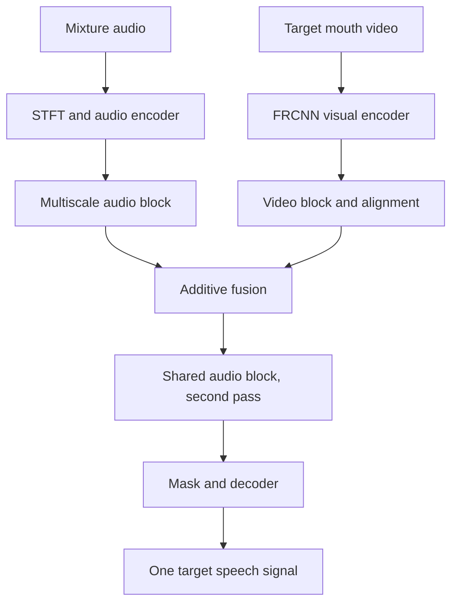

<div align="center">
  
  <h1>Falcon: audio-visual target speaker extraction</h1>
  <p>Extract one person's speech from a mixture, using that person's mouth video as a visual cue.</p>
  <p><a href="README_zh.md">详细中文说明</a> · <a href="https://arxiv.org/abs/2610.32749">Paper</a> · <a href="https://cslikai.cn/Falcon/">Project page</a> · <a href="https://huggingface.co/JusperLee/Falcon">Weights</a> · <a href="https://huggingface.co/spaces/JusperLee/Falcon-Studio">Space</a></p>
  <p><a href="https://huggingface.co/papers/2610.32749"></a><br><small>Hugging Face Daily Papers, 2026-10-29</small></p>
</div>

This fork contains Falcon training and evaluation code, a local Studio application, a recording-based Space, data conversion tools, and reproducibility records. The default model receives a mixture and a target speaker's mouth video and returns **one** speech signal. `2Mix` describes a two-speaker mixture; the model extracts the target speaker. All current root configurations use `n_src: 1`.

The [Chinese README](README_zh.md) is the detailed starting point. The following project guides explain the current implementation and the evidence behind it:

- [Model, visual fusion, and time dependence](docs/understanding/20261110-model-and-streaming.md)
- [160 ms chunk-wise causal streaming: training and inference](docs/FALCON_STREAMING_160MS.md) (Chinese)
- [Datasets: what each open corpus contains and what is on this machine](docs/understanding/20261110-datasets.md) (Chinese)
- [Data and training](docs/understanding/20261110-data-and-training.md)
- [Dataset inventory and cold storage guide](docs/data_catalog/README.md) (Chinese)
- [Evaluation, Studio, and Space](docs/understanding/20261110-evaluation-and-apps.md)
- [Reproduction status](docs/STATUS.md) and [documentation index](docs/README.md)
- [November 10 audit and experiment records](docs/verification/deepdive-20261110/README.md)

These guides are in Chinese. The [complete document index](docs/DOCUMENTS_INDEX.md) also lists historical reports with their original dates and conditions.

## How the model uses audio and video



For a two-second, 16 kHz example, the audio has 32,000 samples. With a 256-sample STFT window and 128-sample hop, the encoder has 251 time frames and 129 frequency bins. The mouth track has 50 frames at 25 fps; after preprocessing and FRCNN it provides 512-dimensional visual features. The model projects and aligns those features, adds them to the audio representation, and runs the shared audio block a second time.

The block processes four time-frequency scales. Its deepest level is processed on the down path; the other levels use their frequency LSTM, time LSTM, and masked attention during the up path. The diagrams below are supplied by the upstream project; the [model guide](docs/understanding/20261110-model-and-streaming.md) describes the actual code path and implementation differences.

<p align="center"><br><em>Upstream Falcon architecture illustration.</em></p>
<p align="center"><br><em>Upstream multiscale separator illustration.</em></p>

## Repository layout

| Location | Purpose |
| --- | --- |
| `audio_train.py`, `configs/` | Training entry point and experiment configurations |
| `audio_visual_test.py` | Per-utterance evaluation and result merging |
| `look2hear/` | Models, video frontends, datasets, losses, metrics, and training modules |
| `tools/repro/` | Data conversion, experiments, tests, and launch scripts |
| `studio/` | Local interactive application and offline file inference |
| `space/` | Browser recording followed by windowed inference |
| `docs/` | Current guides, historical reports, and experiment evidence |

## Environment on the development server

The checked environment on `dev_a800_2gpus` is `/root/miniforge3/envs/falcon`. Its exact state may change; inspect it before running an experiment:

```bash
cd /root/code/github_repos/Falcon-fork
PY=/root/miniforge3/envs/falcon/bin/python
"$PY" -V
"$PY" -c 'import torch; print(torch.__version__, torch.cuda.is_available(), torch.cuda.device_count())'
"$PY" -c 'import look2hear.models, audio_train, audio_visual_test; print("imports OK")'
```

The November 10 check used Python 3.11.17, PyTorch 2.8.0+cu128, and two A800 GPUs. The [environment notes](AGENTS.md) explain the `typeguard<3` requirement and the local PESQ compatibility shim.

Weights are typically cached under `/root/.cache/falcon_weights/`. Data and weights are not included in full in this Git repository. The [dataset guide](docs/understanding/20261110-datasets.md) lists each corpus, the local directories, and which split training or evaluation actually used; the [data access guide](docs/DATA_ACCESS_GUIDE.md) keeps the download history and licence notes.

### A small CPU evaluation

The command below creates a separate temporary output directory and evaluates only the first five items. It checks the evaluation pipeline on a five-item subset. It assumes that the server already has the LRS2 test data and `falcon.pt` at the specified paths.

```bash
REPO=/root/code/github_repos/Falcon-fork
PY=/root/miniforge3/envs/falcon/bin/python
RUN_DIR="$(mktemp -d /root/tmp/falcon-eval-readme-XXXXXX)"
cd "$RUN_DIR"
PYTHONPATH="$REPO" OMP_NUM_THREADS=4 "$PY" "$REPO/audio_visual_test.py" \
  --conf_dir "$REPO/configs/LRS2_2Mix.yml" \
  --ckpt_path /root/.cache/falcon_weights/falcon.pt \
  --data_dir /root/data/falcon_lrs2_2mix --gpus cpu --limit 5
printf 'Results: %s\n' "$RUN_DIR"
```

`--limit` marks a subset. Separate working directories prevent runs with the same experiment name from overwriting one another. See the [evaluation guide](docs/understanding/20261110-evaluation-and-apps.md) for checkpoint formats, metrics, result files, and coverage checks.

## Reproduction results and limits

The values below come from saved evaluation records. SI-SNRi and SDRi are per-item improvements over the mixture, in dB.

| Test and weights | Items | SI-SNRi / SDRi | Interpretation |
| --- | ---: | ---: | --- |
| LRS2, released `falcon.pt`, full utterance | 3,000 | 7.029 / 7.713 | Result for this data and checkpoint; the checkpoint's exact training provenance needs independent confirmation |
| LRS2, locally trained ep124, older recipe | 3,000 | 8.858 / 9.270 | Not the paper's full eight-GPU training recipe |
| RealSSA-Sim, released `falcon.pt`, four-channel mean | 9,169 | 7.774 / 8.479 | Numerically close to the paper; four-channel mean, with checkpoint identity still to confirm |
| RealSSA-Sim, same weights, channel 0 | 9,169 | 7.977 / 8.452 | The channel axis is aligned to the stated channel-1 numbering; checkpoint provenance remains unresolved |

For the two RealSSA-Sim rows, SI-SNRi has 9,169 valid values, while SDRi and PESQ each have 9,166. See [status and source CSVs](docs/STATUS.md#已有评测结果). The paper's LRS2 14.1 / 14.7 row and the full training/ablation protocol are not yet reproduced under matching conditions.

The audio model has 537,697 parameter elements. A 2 s ptflops 0.7.5 run reports about 10.611 GMAC for the audio model, excluding the frozen visual frontend. A saved same-tool visual count at 50×88×88 is 15.897 GMAC. These are tool-dependent counts rather than a complete inventory of all hardware operations; the [operator probe](docs/verification/deepdive-20261110/falcon_ptflops_ops_probe_20261110.txt) found that direct STFT/iSTFT and some operator forms were not counted.

## Windowing, causality, and batch behavior

Studio takes a 2 s window and emits 0.5 s at a time, with an 80 ms right-side guard and 20 ms output crossfade. Space accepts a complete recording, then splits it into windows and normally batches up to 32 windows. RealSSA-Real uses another windowed evaluation path with different initial visual padding and output joining.

The 80 ms guard sets the output slice position within the window; measured end-to-end delay also includes capture, processing, and playback. The default `cLNhw` includes statistics over the whole window. An earlier output can therefore depend on later input within that window.

The default `VideoBlock` also feeds `[B,T,C]` into an LSTM configured with `batch_first=False`. In a real-weight, real-mouth isolation test, changing only the preceding batch item's mouth video changed the fixed target item's output. The isolation test used one example; its average quality effect remains to be measured. The [experiment record](docs/verification/deepdive-20261110/falcon_cross_sample_real_20261110.json) includes the input and checkpoint hashes.

The `paper_causal` and `video_lstm_batch_first` switches change model outputs. The current `paper_causal` path also shortens intermediate time dimensions at stride 2, so the comparison includes changes in both padding and intermediate frame count. The quality and latency of a corrected, retrained model remain unverified. See the [model guide](docs/understanding/20261110-model-and-streaming.md).

## Studio and input formats

Start with the [Studio instructions](studio/README.md). Installation and startup scripts can create environments, download weights, or install an audio driver. Browser permissions, camera tracking, and meeting-software routing must be verified on the actual device.

For `studio/infer_file.py`, the tested file path is mono 16 kHz, 16-bit PCM WAV. In the checked Python environment, standard IEEE float32 WAV is rejected by the reader, while 32-bit integer PCM can be misinterpreted as float. The offline mouth input expects a three-dimensional grayscale array; the existing `(T,96,96,3)` training-data `.pt` file needs conversion first. Tracking a region is not speaker identity verification: an existing ROI can be held after face detection is lost.

### Offline file and Python examples

The offline entry expects mono 16 kHz 16-bit PCM WAV and a synchronized grayscale mouth array. The example shows the interface and uses a separately prepared, synchronized mouth array.

```bash
cd /root/code/github_repos/Falcon-fork/studio
ffmpeg -i input.mp4 -ac 1 -ar 16000 -c:a pcm_s16le mix.wav
python infer_file.py --audio mix.wav --mouth mouth.npy --out target.wav --model JusperLee/Falcon
```

```python
import numpy as np
from falcon_runtime import FalconRuntime  # run from studio/

runtime = FalconRuntime.from_pretrained("JusperLee/Falcon")
audio = np.zeros(32000, dtype=np.float32)
mouth = np.zeros((50, 96, 96), dtype=np.uint8)
target = runtime.infer(audio, mouth)
```

The zero arrays only illustrate the interface. For mouth formats, batch behavior and long recordings, see the [evaluation and applications guide](docs/understanding/20261110-evaluation-and-apps.md).


## Tests and evidence

On November 10, the CPU reproduction suite reported **166 passed and 2 skipped**; the skipped tests depended on historical temporary files that were no longer present. A separate archived training CSV passed the relevant reused assertion, without changing the official suite result. Studio/Space non-slow tests reported **73 passed and 2 deselected**, Space static tests **3 passed**, and Studio Node checks **8 passed**. Conditions and logs are in the [audit evidence directory](docs/verification/deepdive-20261110/README.md).

Real browser devices, full eight-GPU training, and other identified edge cases require separate checks.

## Paper, data, and licence

The upstream [paper](https://arxiv.org/abs/2610.32749), [project page](https://cslikai.cn/Falcon/), [Falcon weights](https://huggingface.co/JusperLee/Falcon), [Falcon-Big weights](https://huggingface.co/JusperLee/Falcon-Big), and [Space](https://huggingface.co/spaces/JusperLee/Falcon-Studio) provide the authors' materials. The [RealSSA-Sim](https://huggingface.co/datasets/JusperLee/RealSSA-Sim) and [RealSSA-Real](https://huggingface.co/datasets/JusperLee/RealSSA-Real) data cards describe their own access and use conditions. Code, model, and data licences are separate; see [LICENSE](LICENSE) and the applicable provider terms.

See [CONTRIBUTING.md](CONTRIBUTING.md) for contribution notes and the [documentation index](docs/README.md) for historical evidence and current guides.

### Citation and acknowledgements

```bibtex
@inproceedings{sang2026falcon,
  title     = {Efficient Streaming Audio-Visual Target Speaker Extraction for Real-World Acoustic Scenes},
  author    = {Sang, Wendi and Li, Kai and Li, Yifan and Huang, Jianqiang and Hu, Xiaolin},
  booktitle = {Advances in Neural Information Processing Systems (NeurIPS)},
  year      = {2026}
}
```

The comparison and efficiency tables transcribed in the former README are retained in [paper-reported results](docs/PAPER_REPORTED_RESULTS.md); the tables reproduce the numbers reported in the paper. The visual encoder follows [CTCNet](https://github.com/JusperLee/CTCNet), and baseline context includes [Swift-Net](https://github.com/JusperLee/Swift-Net). Studio mouth tracking uses [MediaPipe Face Landmarker](https://ai.google.dev/edge/mediapipe/solutions/vision/face_landmarker).
