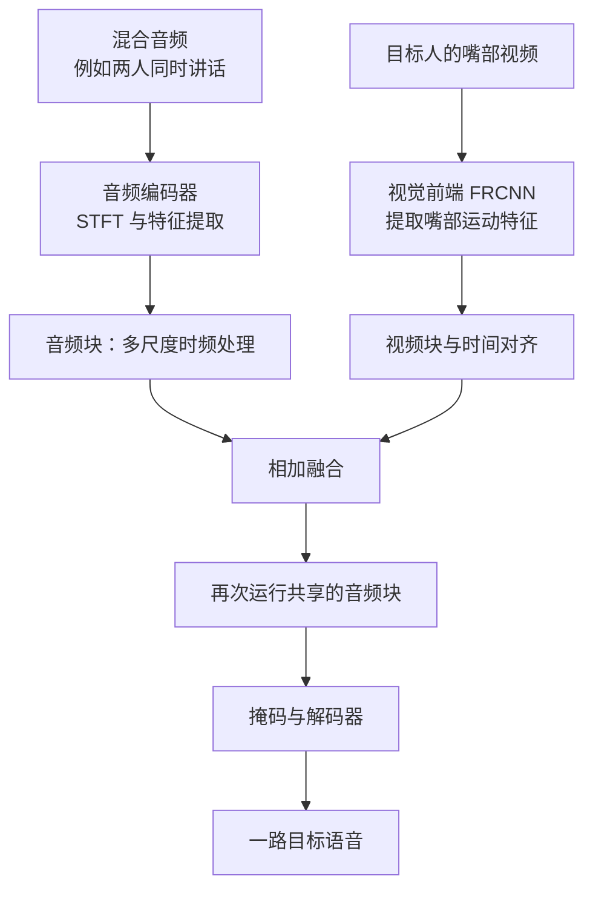
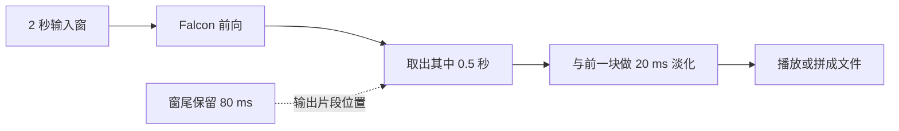

<div align="center">
  
  <h1>Falcon：音视频目标说话人提取</h1>
  <p>从多人混合语音中，借助目标说话人的嘴部视频提取一路语音。</p>
  <p><a href="README.md">English</a> · <a href="https://arxiv.org/abs/2610.32749">论文</a> · <a href="https://cslikai.cn/Falcon/">原项目主页</a> · <a href="https://huggingface.co/JusperLee/Falcon">模型权重</a> · <a href="https://huggingface.co/spaces/JusperLee/Falcon-Studio">在线体验</a></p>
  <p><a href="https://huggingface.co/papers/2610.32749"></a><br><small>Hugging Face 每日论文，2026-10-29</small></p>
</div>

Falcon 接收两种信息：包含多人声音的**混合音频**，以及希望听清的那个人的**嘴部视频**。模型输出目标说话人的一条语音。数据集名称中的 `2Mix` 表示两个人的声音混在一起，不表示模型同时输出两路。当前配置均为 `n_src: 1`；已有检查中，把它改为 2 会遇到通道形状错误。

这个仓库在上游 Falcon 的基础上增加了数据转换、训练与评测工具、Studio 演示和复现记录。它汇集了论文与源码说明、实验结果和实现问题；各项结果都列出对应的输入、权重与评测方式。

## 从哪里开始

| 想做什么 | 先看哪里 | 能得到什么 |
| --- | --- | --- |
| 看项目全貌 | 本页和[文档导航](docs/README.md) | 任务、目录、常用入口和已知限制 |
| 理解模型内部 | [模型、融合与时间依赖](docs/understanding/20261110-model-and-streaming.md) | 张量形状、多尺度处理、视觉融合和因果性 |
| 使用 160 ms 增量流式模型 | [流式模型与训练推理](docs/FALCON_STREAMING_160MS.md) | 状态缓存、实时接口、随机检查点和训练步骤 |
| 看五套数据本机有什么 | [数据集说明](docs/understanding/20261110-datasets.md) | 每套样本的内容、目录、索引条数和评测用的是哪一套 |
| 盘点项目与多模态数据 | [数据集全景](docs/data_catalog/README.md) | 项目训练/测试、37个登记库、冷端位置和按需恢复 |
| 理解数据和训练 | [数据准备与训练](docs/understanding/20261110-data-and-training.md) | 索引、采样、损失、检查点和配置差异 |
| 跑评测或体验演示 | [评测、Studio 与 Space](docs/understanding/20261110-evaluation-and-apps.md) | 评测口径、窗口切分、输入格式和运行边界 |
| 查看哪些结果有依据 | [复现状态](docs/STATUS.md)和[本轮审查证据](docs/verification/deepdive-20261110/README.md) | 已有结果、适用条件、实验脚本与尚未完成的验证 |
| 查看每份旧文档 | [文档清单](docs/DOCUMENTS_INDEX.md) | 当前说明、历史报告、数据卡和证据的区别 |

[English overview](README.md) 面向英文读者；本页与中文专题文档提供更详细的使用和理解说明。

## 先用一张图理解整个项目



图中的两次音频块使用同一组权重。视觉信息通过投影、时间对齐和逐帧相加进入音频特征；当前默认模型的视听融合没有使用跨模态注意力。训练时还会使用说话人对比损失；普通推理不需要目标人的干净语音或近场负样本。

下图是上游论文提供的整体结构示意，便于了解论文中的模块名称。实际调用顺序和本仓库已发现的实现差异，以上面的源码流程图和[模型说明](docs/understanding/20261110-model-and-streaming.md)为准。

<p align="center"><br><em>上游提供的结构示意图。</em></p>

## 输入、输出和模型内部发生了什么

以下以一条 2 秒样本为例。离线模型可处理其他长度；Studio 在线接口采用固定 2 秒窗口。

| 对象 | 默认示例 | 说明 |
| --- | --- | --- |
| 混合音频 | 16 kHz、32,000 个采样点 | 2 秒单声道；包含目标人和其他声音 |
| 嘴部视频 | 25 帧/秒、50 帧 | 训练数据通常存为 96×96 图像，输入视觉前端前裁剪为 88×88 灰度图 |
| 视觉特征 | `512 × 50` | FRCNN 为每个视频时间位置生成特征 |
| 音频时频特征 | `251 × 129` | 窗长 256、步长 128 的短时傅里叶变换；一个音频帧步长是 8 ms |
| 输出 | 32,000 个采样点 | 与输入等长的一路目标语音 |

音频块将时间和频率同时压缩到四个尺度。最深尺度先经过频率方向的双向 LSTM、时间方向的单向 LSTM 和带掩码的自注意力；恢复分辨率时，较浅的三个尺度也各自经过相应处理。输出的掩码作用于编码特征，再经解码器还原波形。详细形状和每一级的执行顺序见[模型说明](docs/understanding/20261110-model-and-streaming.md)。

<p align="center"><br><em>上游提供的多尺度分离器示意；源码逐层执行路径见模型说明。</em></p>

## 目录和入口

```text
Falcon-fork/
├── audio_train.py                 训练入口
├── audio_visual_test.py           按音频逐条评测
├── configs/                       小模型和不同训练配方
├── look2hear/
│   ├── models/                    Falcon、分离器与说话人池化
│   ├── videomodels/               FRCNN 与可选视觉前端
│   ├── datas/                     训练/评测数据集和预处理
│   ├── losses/、metrics/          损失、指标及其不同口径
│   └── layers/、system/、utils/   通用层、训练模块和辅助工具
├── tools/repro/                   数据转换、实验、测试和启动脚本
├── studio/                        本地音视频演示和离线文件处理
├── space/                         录制完整片段后的网页演示
└── docs/                          当前说明、历史报告和实验依据
```

训练、离线评测、Studio、Space 是四条入口。它们采用不同的分窗、批处理和拼接方式，评测时需分别记录这些条件。

## 在开发服务器上准备环境

已核查的项目环境位于 `dev_a800_2gpus` 的 `/root/miniforge3/envs/falcon`。非交互命令可直接使用其中的 Python；不要把旧日志中已经删除的 `/root/.venvs/falcon` 当成当前环境。

```bash
cd /root/code/github_repos/Falcon-fork
PY=/root/miniforge3/envs/falcon/bin/python
"$PY" -V
"$PY" -c 'import torch; print(torch.__version__, torch.cuda.is_available(), torch.cuda.device_count())'
"$PY" -c 'import look2hear.models, audio_train, audio_visual_test; print("项目模块可导入")'
```

2026-11-10 的现场检查使用 Python 3.11.17、PyTorch 2.8.0+cu128 和两张 A800。环境可能随后变化，上述命令显示的是运行时实际状态。环境重建需要根目录依赖、`typeguard<3` 和仓库外的 PESQ 兼容层；具体步骤见 [AGENTS.md](AGENTS.md)。

项目权重的缓存位置通常为 `/root/.cache/falcon_weights/`。权重与数据集不随 Git 仓库完整分发。五套开源数据的样本、本机目录和实际用于训练或测试的索引见[数据集说明](docs/understanding/20261110-datasets.md)；下载和许可见[数据访问说明](docs/DATA_ACCESS_GUIDE.md)。目录大小、可见性和数据提供方许可都可能变化。

## 快速做一次小范围评测

评测会写结果文件。下面先创建独立临时目录，再取当前测试索引的前 5 条检查链路。例子使用 CPU，假设服务器已存在对应数据和 `falcon.pt`：

```bash
REPO=/root/code/github_repos/Falcon-fork
PY=/root/miniforge3/envs/falcon/bin/python
RUN_DIR="$(mktemp -d /root/tmp/falcon-eval-readme-XXXXXX)"
cd "$RUN_DIR"
PYTHONPATH="$REPO" OMP_NUM_THREADS=4 "$PY" "$REPO/audio_visual_test.py" \
  --conf_dir "$REPO/configs/LRS2_2Mix.yml" \
  --ckpt_path /root/.cache/falcon_weights/falcon.pt \
  --data_dir /root/data/falcon_lrs2_2mix --gpus cpu --limit 5
printf '结果目录：%s\n' "$RUN_DIR"
```

结果位于该临时目录下的 `Experiments/checkpoint/.../results/`。`--limit 5` 截取五条，结果记录标为子集。不同实验分开使用输出目录，可以避免同名结果互相覆盖。评测器的覆盖检查按行数统计；合成反例中，相同总行数仍可能对应重复 ID 和缺失 ID。四份关键历史全量 CSV 与**当前**索引的 ID 集合核对未发现缺漏。见[评测说明](docs/understanding/20261110-evaluation-and-apps.md)。

### 这些分数是什么意思

- **SI-SDR / SI-SNR**：衡量预测语音与干净目标的接近程度，通常数值越高越好；本仓库相关指标的具体计算见 `look2hear/metrics/core.py`。
- **SI-SNRi**：输出分数减去混合音频本身的分数，表示相对输入改善多少。
- **SDRi**：另一种失真指标的改善量。本仓库的 SDR 使用 `fast_bss_eval`、512 tap；SI-SNRi 使用另一种计算口径。
- **PESQ / STOI / DNSMOS**：从不同角度衡量语音质量或可懂度。缺少有效参考、单条指标失败或算法版本不同时，分数的解释也不同。

例如，一条混合语音的 SI-SNR 是 2 dB，输出是 8 dB，那么这条的 SI-SNRi 是 6 dB。听感和目标身份需要结合音频另行检查。

## 当前复现到了哪里

下表汇总已保存的评测记录。SI-SNRi / SDRi 单位均为 dB，评测脚本按句子整段前向；表中列出数据、通道和权重条件。

| 测试与权重 | 条数和方式 | 已有 SI-SNRi / SDRi | 如何理解 |
| --- | --- | --- | --- |
| LRS2，发布 `falcon.pt` | 3,000 条、单目标方向 | 7.029 / 7.713 | 已保存的跨数据条件结果；权重训练来源主要依据配置线索，未获作者独立确认 |
| LRS2，旧配方自训 ep124 | 3,000 条、单目标方向 | 8.858 / 9.270 | 旧训练配方的结果，不是论文 8 卡配方 |
| RealSSA-Sim，发布 `falcon.pt` | 四通道均值，9,169 条 | 7.774 / 8.479 | 数值接近论文表；这里使用四通道均值，论文使用 channel 1，权重身份尚待确认 |
| RealSSA-Sim，发布 `falcon.pt` | ch0，9,169 条 | 7.977 / 8.452 | 通道与论文所述 channel 1 对应，权重身份仍需确认 |

RealSSA-Sim 的 SI-SNRi 有效条数为 9,169，SDRi 和 PESQ 各为 9,166；部分指标因单句计算异常记为 NaN。原始结果与分母复算见[复现状态](docs/STATUS.md#已有评测结果)和[证据目录](docs/verification/deepdive-20261110/README.md)。论文 LRS2 表中的 14.1 / 14.7 对应的训练协议尚待复现；不同 epoch 的差异同时受到训练时长等因素影响。

## 实时处理和因果性

Studio 使用 2 秒输入窗，每 0.5 秒输出一块；窗尾留有 80 ms 的余量，相邻输出用 20 ms 淡化。Space 先录完整段，再将它拆成同样量级的窗口，默认最多 32 个窗口组成一批。RealSSA-Real 的长音频评测也分窗，但首窗视频填充和输出淡化与 Studio 不完全相同。



**80 ms 是输出片段距窗尾的余量，不是端到端延迟，也不是模型只看 80 ms 未来的证明。**当前 `cLNhw` 包含全窗口统计，窗口内较早输出可以受后面的输入影响。已有特定探针中，去除相关归一化后，单次音频块和整链几何依赖分别约为 57 帧和 113 帧；这些是特定实验条件下的结构观察，不是直接测得的会议端到端延迟。

另有一个会影响批量使用的问题：默认 `VideoBlock` 将批次轴送进 LSTM 的序列维。单样本时没有预期的帧间递推；批次大于 1 时，后一个样本可能受前一个样本影响。本轮用发布 small 权重和真实嘴部视频做过隔离实验：固定目标样本，仅更换同批前一个视频，目标输出发生变化。该实验使用一组样本；实验代码、输入哈希和结果见[批次实测记录](docs/verification/deepdive-20261110/falcon_cross_sample_real_20261110.json)。

`paper_causal=True` 和 `video_lstm_batch_first=True` 是实验开关，会改变结果。当前 `paper_causal` 在步长为 2 的卷积处还会额外裁掉时间帧，因此开关对照同时包含 padding 和中间帧数的变化。修正这些行为后的质量、模型训练和完整延迟尚未验证。

## 数据与训练应怎样理解

五套开源数据的文件内容、本机路径和“哪一套已经拿来训练或测试”见[数据集说明](docs/understanding/20261110-datasets.md)。paper 版 LRS2 索引把每个混合音频分别以两个人作为目标：训练、验证、测试分别有 **40,000、10,000、6,000 条目标方向记录**，对应 **20,000、5,000、3,000 个混合**。默认训练集每次有放回地随机抽样，`train_samples=10000` 表示每轮抽取次数，不等于完整遍历 40,000 条。

在独立均匀抽 10,000 次的假设下，期望覆盖约 **22.12% 的方向记录**、约 **39.35% 的不同混合**。实际覆盖还受随机结果、分布式切分和丢弃不满批次的影响。文件名记录名义增益差，实际能量比还受到源信号电平影响：本轮系统抽查 1,000 个混合，其中 48 条的全段 RMS 比超出 0–10 dB。抽样方法和逐条文件哈希见[数据与训练说明](docs/understanding/20261110-data-and-training.md)。

当前论文版配置的单条记录通常只有一个 `near` 负样本。代码在 `K=1` 的分支中不使用 β，所以写入配置的 β 退火在该分支不会改变损失；`K=0` 时负项消失，正项仍可能存在。读取异常也可能使运行时的有效 `K` 与索引不同。

完整论文配方与可用的单卡、双卡配方在卡数、批大小、损失函数和训练时长上有所区别。训练会占用计算资源并生成检查点；[训练说明](docs/understanding/20261110-data-and-training.md)列出了具体配置及尚未验证的多卡风险，历史启动脚本也有固定输出目录、后台运行或覆盖日志等副作用。

## Studio：怎样使用和检查

Studio 的后端入口是 `studio/server.py`，默认绑定本机回环地址。音频、摄像头权限、浏览器设备和实际会议软件的连接都需要在运行设备上单独检查。请从 [Studio 中文说明](studio/README_zh.md)了解安装和启动；安装脚本可能创建环境、下载权重或安装音频驱动，不是只读检查。

离线文件入口 `studio/infer_file.py` 的实际输入有几个边界：

- 16 位 PCM、单声道、16 kHz WAV 是已有测试覆盖的路径。
- 当前 Python 环境中，标准 IEEE float32 WAV 会被读取库拒绝；32 位整数 PCM 可能被误当成浮点数。使用前可转成 16 位 PCM。
- 它要求灰度嘴部数组形状 `(T,H,W)`；现有数据中的 `(T,96,96,3)` 三通道 `.pt` 不能直接传入，需先按正确方式转换。
- 自动跟踪器在已有取景框时可能在短时未检测到人脸后继续沿用旧框。位置跟踪不等于身份识别；重锁后是否仍是原目标需要实际场景确认。

### 离线文件与 Python 调用示例

在已配置的 Studio 环境中，可以将音频转换为单声道 16 kHz、16 位 PCM，再提供目标说话人的灰度嘴部帧。嘴部帧应按采集时间与音频对应。

```bash
cd /root/code/github_repos/Falcon-fork/studio
ffmpeg -i input.mp4 -ac 1 -ar 16000 -c:a pcm_s16le mix.wav
python infer_file.py --audio mix.wav --mouth mouth.npy --out target.wav --model JusperLee/Falcon
```

`mouth.npy` 可使用 `(T,96,96)` 灰度数组，25 fps；`.npz` 和满足同样形状的 `.pt` 也可读取。离线入口对整段一次前向，长录音的注意力显存会增长。与 Studio 在线分窗有关的条件见[评测与应用说明](docs/understanding/20261110-evaluation-and-apps.md)。

```python
import numpy as np
from falcon_runtime import FalconRuntime  # 在 studio/ 目录下运行

runtime = FalconRuntime.from_pretrained("JusperLee/Falcon")
audio = np.zeros(32000, dtype=np.float32)       # 示例形状：2 秒、16 kHz
mouth = np.zeros((50, 96, 96), dtype=np.uint8)  # 示例形状：25 fps 灰度嘴部帧
target = runtime.infer(audio, mouth)            # 一路与音频等长的波形
```

示例中的零数组用于展示接口和形状。small 与 Big 对应的权重分别见 [Falcon](https://huggingface.co/JusperLee/Falcon) 和 [Falcon-Big](https://huggingface.co/JusperLee/Falcon-Big)；Big 的音频类和宽度不同，训练侧没有与 Studio 完全对应的同名实现。


## 测试和证据

2026-11-10 在服务器 CPU 上的检查：

| 检查 | 结果 | 范围 |
| --- | --- | --- |
| `tools/repro/tests` | **166 passed、2 skipped** | 两项跳过因为历史临时评测日志或训练目录不存在；归档训练 CSV 的替代断言另行通过 |
| Studio / Space 非慢速测试 | **73 passed、2 deselected** | 不包含真实浏览器、会议设备或在线 Space 集成 |
| Space 静态测试 | **3 passed** | 构建资源及静态检查 |
| Studio Node 检查 | **8 项通过** | 前端工具和约定；实机音视频另行检查 |

具体测试条件和日志见[证据说明](docs/verification/deepdive-20261110/README.md)。

## 论文、数据与许可

Falcon 的论文、原始项目和上游资料可从本页顶部访问。上游图和论文中的速度、结果表用于说明作者的报告；本仓库的复现结论应看各自的数据、权重和协议。RealSSA-Sim 与 RealSSA-Real 的访问条件以其数据提供方当前数据卡为准；代码许可、模型许可和数据使用许可分别适用。

- [RealSSA-Sim 数据卡](https://huggingface.co/datasets/JusperLee/RealSSA-Sim)
- [RealSSA-Real 数据卡](https://huggingface.co/datasets/JusperLee/RealSSA-Real)
- [上游论文](https://arxiv.org/abs/2610.32749) · [代码许可](LICENSE)
- [贡献说明](CONTRIBUTING.md) · [历史文档与证据目录](docs/DOCUMENTS_INDEX.md)

### 论文引用与致谢

```bibtex
@inproceedings{sang2026falcon,
  title     = {Efficient Streaming Audio-Visual Target Speaker Extraction for Real-World Acoustic Scenes},
  author    = {Sang, Wendi and Li, Kai and Li, Yifan and Huang, Jianqiang and Hu, Xiaolin},
  booktitle = {Advances in Neural Information Processing Systems (NeurIPS)},
  year      = {2026}
}
```

原 README 中的论文方法比较表和效率表保存在[论文结果表](docs/PAPER_REPORTED_RESULTS.md)，其中数值来自论文报告。视觉编码器和对比资料参见 [CTCNet](https://github.com/JusperLee/CTCNet)、[Swift-Net](https://github.com/JusperLee/Swift-Net)；Studio 的嘴部跟踪使用 [MediaPipe Face Landmarker](https://ai.google.dev/edge/mediapipe/solutions/vision/face_landmarker)。
