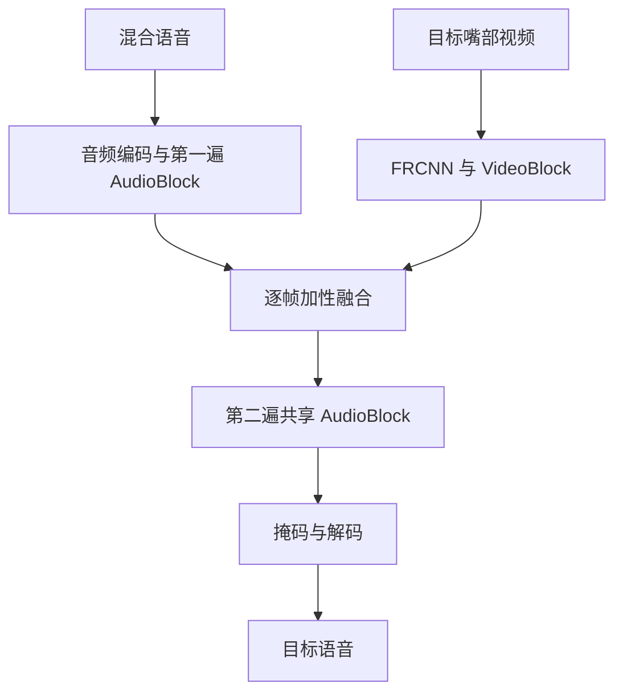

# Falcon 复现报告

此前版本保留在 [2026-11-09 复现报告](REPRODUCTION_REPORT_20261109.md)，其中结论应结合本页和当前状态重新判断。

截至 2026-11-10，Falcon small 的模型结构、权重加载和多条评测路径已有检查与结果记录；论文的完整 8 卡训练、全部消融与主要结果表尚未按同一协议完成复现。RealSSA-Sim 的部分分数接近论文；本地采用四通道均值，发布权重的训练谱系仍待确认。

本报告把模型是否能执行、保存的评测数字、论文协议是否对齐分开说明。它基于仓库 `6e5c1b5` 与 2026-11-10 多轮审查；历史记录与本次小规模复测分别标明。更新后的运行状态以 [STATUS](STATUS.md) 为入口，实验文件、脚本、哈希与测试日志见[审查证据](verification/deepdive-20261110/README.md)。

## 任务和复现范围

Falcon 的任务是音视频目标说话人提取：从混合语音和目标说话人的嘴部视频中恢复一路目标语音。当前模型配置为 `n_src=1`；数据集名 `2Mix` 表示混音有两个说话人，不表示模型返回两路。small 的音频主干参数元素为 537,697，视觉前端为 11,186,688；state_dict 中 525 个音频 key 对应的 tensor 元素数为 537,762。

音频块对四个时间—频率尺度分别进行处理；最深尺度在下行处理，其余尺度在恢复分辨率时处理。默认视频特征只在两遍音频块之间融合一次。完整结构、输入形状及实现差异见[模型说明](understanding/20261110-model-and-streaming.md)。

## 已保存的评测结果

数值来自仓库内保存的结果表。SI-SNRi 和 SDRi 均为相对于输入混音的改善量，单位 dB。

| 数据与输入 | 权重 | 样本 | SI-SNRi / SDRi | 范围与来源 |
| --- | --- | ---: | ---: | --- |
| LRS2 单目标方向、整句 | 发布 `falcon.pt` | 3,000 | 7.029 / 7.713 | [逐句 CSV](verification/phase2/P2D-eval-falcon-full.csv) |
| 同上 | 旧配方自训 ep99 | 3,000 | 8.726 / 9.122 | [逐句 CSV](verification/phase2/P2D-eval-epoch99.csv) |
| 同上 | 旧配方自训 ep124 | 3,000 | 8.858 / 9.270 | [逐句 CSV](verification/phase2/P2D-eval-epoch124-contrastive.csv)；比 ep99 还多训练了 25 个 epoch |
| RealSSA-Sim 四通道均值、整句 | 发布 `falcon.pt` | 9,169 | 7.774 / 8.479 | [逐句 CSV](verification/phase2/P2E-realssa-sim-metrics_combined.csv)；SDRi 有效 9,166 |
| RealSSA-Sim ch0、整句 | 发布 `falcon.pt` | 9,169 | 7.977 / 8.452 | [逐句 CSV](verification/phase2/P2E-realssa-sim-ch0-metrics_combined-20261030.csv)；SDRi 有效 9,166 |

本轮对 LRS2 官方权重、LRS2 ep124、RealSSA-Sim mean 和 ch0 四份 CSV 重新计算均值、有效数，并与当前数据索引按文件名核对 ID 集合，未见重复、缺少或多出；ep99 不在这次 ID 集合核查范围内。这项检查使用已保存的表格和当前索引；历史运行时的索引尚待核对。脚本和输出见[评测 ID 集合核查](verification/deepdive-20261110/评测ID集合核查.log)。

论文 LRS2 一行报告 14.1 / 14.7；现有 ep124 使用旧配方和单卡训练。RealSSA-Sim 的 7.774 / 8.479 在数值上接近论文 7.7 / 8.2，但四通道均值与论文所述 channel 1 不同，发布 checkpoint 的准确训练语料也未从原训练记录或作者处独立确认。ch0 与论文通道编号对应，checkpoint 身份仍待确认。[P2E 原报告](verification/phase2/P2E-report.md)记录了当时的转换与评测过程；使用时注意后续更正和指标分母。

## RealSSA-Real 与无参考分数

RealSSA-Real 没有逐句时间对齐的干净目标，本项目对其长录音使用窗口化推理，再计算 DNSMOS。保存的 [full4 结果](verification/phase2/DNSMOS-realssa-real-mean-full4-20261031/)覆盖 54 段：OVRL 均值 **2.7941**、P808 均值 **3.3365**。当前 checkpoint 是否与论文表格所用权重一致尚未确认，指标定义和处理方式也影响可比性；比较时应同时列出模型与处理条件。

更早的 full3 因窗口起点错误而作废。full4 的初始嘴部帧补零、输出不做 20 ms 淡化；Studio 的首窗边界和输出拼接采用不同处理。

## 训练记录能说明什么

paper 版数据将每个混音分别与两个目标方向配对，LRS2 训练索引 40,000 条对应 20,000 个混音。当前默认训练集有放回抽样，`train_samples=10000` 是抽样次数。在独立均匀抽 10,000 次的假设下，期望覆盖约 **22.12% 的方向记录**、**39.35% 的不同混音**。实际多卡分片、丢弃不满批次和随机结果会改变数值。

已有旧训练使用 −SNR 等配置；当前论文版 v2 配置使用 −SI-SDR、每卡 batch 4、β 从 0 到 1 的配置、1000 个最大 epoch、8 卡目标配方。现有服务器只有两张 A800，短流程测试与正式 8 卡训练是不同任务。[数据和训练说明](understanding/20261110-data-and-training.md)列出每份配置及其真实作用。

NASS 对比损失在运行时只有一个有效 near 负样本时，`K=1` 的代码分支不使用 β。本轮在相同输入上测试 β=0、1、100，损失和梯度一致；`K=0` 仍保留正项。该分支的加权结果与配置中的 β 退火速度无关。

发布的 LRS2 s1/s2 波形已经包含混合比例；本轮 40 条抽样中 `mix−target−near` 处于 PCM16 量化误差量级。文件名的名义 gain 差不等于实际波形 RMS 比，1,000 个混音的系统抽样中 48 条超出 0–10 dB。抽样清单及文件哈希见[能量比记录](verification/deepdive-20261110/能量比审查/summary.json)；这是一组系统抽样结果。

历史 ep86、ep99、ep124 的原 `/root/tmp` 路径在本轮定向检查时已不存在；当前项目中的几个 smoke checkpoint 尺寸与其历史记录不符。已有 CSV 和历史哈希仍可读取，其他归档位置仍有待检查。

## 流式处理与时间依赖

Studio 以 2 秒窗口计算，每 0.5 秒输出一块，窗尾预留 80 ms，块间淡化 20 ms。Space 一次提交完整录音，但内部仍分窗，默认最多 32 窗一批。离线基准逐句一次前向；三条路径分别采用各自的窗口和批处理方式。

当前模型 `cLNhw` 包含全窗统计；较早输出可以受同一窗口后面的输入影响。历史结构探针中，去除相应全窗统计后的单遍 AudioBlock 几何依赖约 57 帧，整链约 113 帧；两者是该探针测得的几何依赖。80 ms 是输出位置与窗口末尾的间隔；会议延迟还包括采集、计算和播放。

本轮发现三个影响实验解释的实现细节：

1. 默认 VideoBlock 把批次维当作 LSTM 序列维。真实权重和嘴部视频的隔离实验中，仅改变同批前一条视频就改变后一条的输出。Space 中成批窗口受到的整体质量影响仍需更大样本验证。
2. `paper_causal` 的 stride-2 卷积多裁时间帧；已有开关对照不只是 padding 方向变化，且通用 causal kernel=1 还可能切出空时间轴。修正后是否维持质量尚未训练验证。
3. 旧流式脚本之一的取帧规则会重复或跳过视频帧，归一化脚本用最小响应推断全体早期帧。归档里 `ln_c` 的 early_min 为 −240 dB、early_max 为 −75.29 dB；“前 121 帧全为数值零”不受该归档支持。

相关实验的代码、输入哈希和逐项局限见[模型与时间依赖](understanding/20261110-model-and-streaming.md)和[本轮审查记录](verification/deepdive-20261110/审查记录.md)。不同录音的质量和延迟需要分别测量。

## 计算量、测试与可信范围

已有 2 秒音频主干的 ptflops 0.7.5 结果约 **10.611 GMAC**；已有相同工具的视觉 50×88×88 输入记录约 **15.897 GMAC**，两项相加约 **26.51 GMAC**。本轮探针确认显式 `torch.matmul` 在该后端会计数，但直接 STFT/iSTFT 及部分运算符形式的逐元素计算未计入。这些是指定工具和算子覆盖条件下的计数；硬件操作和功耗需另行测量。

2026-11-10 的 CPU 检查结果：完整复现套件 **166 passed、2 skipped**；Studio/Space 非慢速测试 **73 passed、2 deselected**；Space 静态测试 **3 passed**；Studio Node 检查 **8 项通过**。两项复现测试跳过是历史临时文件不在原路径，非 GPU 失败；对归档训练 CSV 的替代断言另行通过。测试日志见[证据目录](verification/deepdive-20261110/README.md)。

真实浏览器、会议设备和完整多卡训练需要单独检查。完整套件中显式 `py_compile` 会写 Python 缓存；本轮测试时段有 135 个被忽略 `.pyc` 更新，文件的先前状态仍待确认。

## 下一步如何核实

优先检查会改变结果解释或样本身份的问题：用真实数据和不同批次顺序定量评估 VideoBlock 的影响；修正 stride 裁剪后重新测量形状与前视，再设计需要的训练对照；给数据转换补同目录切换目标的验证；对非零时移修正 P2F 对齐方向并用可追溯输入复测。真实多卡条件聚合、历史权重位置、录音与嘴帧的物理同步，以及发布权重的训练来源仍需分别取得对应证据。

查看完整文档、原始记录及历史快照，请从[文档导航](README.md)与[全部文档清单](DOCUMENTS_INDEX.md)进入。
