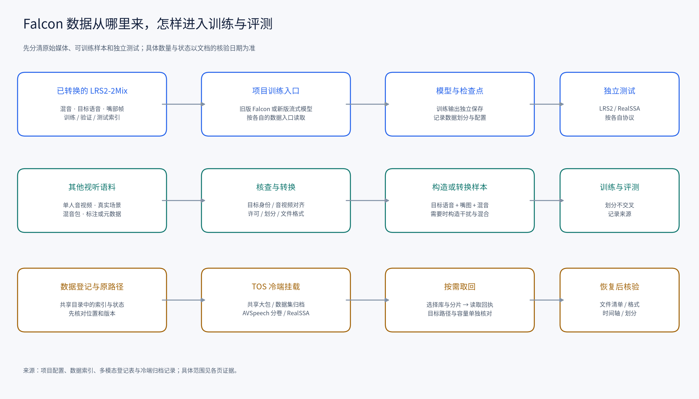

# Falcon 数据集全景

这套文档回答三个问题：项目目前用什么训练和测试；服务器上其他视听数据能否用于目标说话人提取；数据在冷端时，怎样找到需要的文件。盘点以 **2026-11-11** 服务器可见目录、项目代码、索引、登记表和历史归档记录为依据。

图中第一行是已转换数据进入项目的路径，第二行是其他视听数据转为目标提取样本的路径，第三行是从登记信息定位冷端并按需取回的路径。

## 从哪里开始

| 想解决的问题 | 文档 |
| --- | --- |
| 项目实际训练和测试用了什么？每条样本长什么样？ | [项目训练与测试数据](01-project-data.md) |
| 项目索引中的所有文件实际存在吗？ | [本机项目数据深查](07-project-resident-deep.md) |
| 共享盘上实际保留了哪些视听数据？ | [现存视听数据深查](06-hot-data-deep.md) |
| 多模态目录中每个数据集有什么，哪些可能用于 Falcon？ | [多模态数据集总览及 37 张逐库卡片](02-multimodal-datasets.md) |
| TOS 冷端文件在哪里，日后如何按需恢复？ | [冷端存储与按需恢复](03-storage-and-restore.md) |
| 挂载中还有哪些相邻会议、音频和视听数据？ | [相邻冷端数据](05-adjacent-cold-data.md) |
| 本机和共享盘有哪些噪声及房间响应？ | [现存噪声与 RIR](08-resident-noise-rir.md) |
| 冷端目前实际有哪些文件？ | [挂载目录直接清单](aispeech-cfs-direct-listing-20261111-v2.json) |
| 这些数量怎样统计，哪些是全量索引、哪些是抽查？ | [盘点口径与核验时间](04-inventory-method.md) |
| 想程序化查询登记状态、路径和历史回执？ | [机器可读登记快照](catalog-snapshot-20261111.json) |
| 核对盘点与工具的审查过程 | [媒体复核](review-20261111-media.md) · [冷端复核](review-20261111-cold.md) · [快照工具复核](review-20261111-catalog-tool.md) |

## 项目现在用什么

训练目标是一条人的声音。每个监督样本通常包含：多人**混音**、目标人的**参考语音**、同一时段的**嘴部画面**；旧版训练的对比项还可能使用干扰人的音频。新流式训练读取 `mix.json`、`target.json` 指向的混音、目标语音和嘴图，按 160 ms 分块运行。

| 数据 | 当前用途 | 已核对的规模 |
| --- | --- | --- |
| LRS2-2Mix 单方向 | 旧版训练、验证及已有全量测试；格式适合新流式入口 | 训练 20,000、验证 5,000、测试 3,000 条；每条 2 秒 |
| LRS2-2Mix 双方向 | 两位说话人分别作为目标的论文对齐配置 | 40,000／10,000／6,000 个目标方向，对应 20,000／5,000／3,000 个不同混音 |
| RealSSA-Sim | 仿真场景训练来源；本机已转换测试集 | 项目本机的四通道平均与第 0 通道转换各为同一测试集的 9,169 条；冷端 `tr/cv/tt` 可见 202／19／19 个原始 tar |
| RealSSA-Real | 真实场景测试 | 54 段推理录音、54 份嘴图、10 位说话人的参考语音；无同步干净目标波形 |

这些数量的单位不同：索引行、目标方向、不同混音、tar 分片和真实录音不能直接相加。每个数字的计算和抽查范围见[项目数据文档](01-project-data.md)。新流式模型当前只有随机初始化及少量链路测试步骤；数据入口可运行，分离效果需要正式训练后测量。

2026-11-11 进一步检查了现存项目的 8 组索引：102,338 行涉及的 229,964 个不同路径均可访问；抽样解码与文件名字段的跨划分检查见[本机项目数据深查](07-project-resident-deep.md)。共享盘也有 LRS3、VoxCeleb2、AVSpeech 的现存素材及派生清单，例如 AVSpeech `legacy_unmatched` 实见 229,520 个 MP4；音视频长度和旧链接检查见[现存视听数据深查](06-hot-data-deep.md)。

## 哪些其他数据值得先看

1. **RealSSA-Sim 原始训练集**：已有目标提取任务所需的混音、目标、嘴部与场景数据；冷端有训练分片，后续可以按转换脚本和通道策略准备训练索引。
2. **Mandarin AVSR**：冷端 `tr_all.tar.gz` 中的混音与目标索引已核查各 40,000 行，覆盖 1–5 mix；一条预览视频已实际解码首帧，音视频时长均为 10.68 秒。嘴部 `.npz`、切分、授权和完整配对仍需按目标实验核实与转换。
3. **VoxCeleb2-mix、AVCocktail、AVYT**：冷端有对应载荷或分片。前者抽查到干净音频与原视频同 ID，后两者分别有视频/标签和视听素材；能否作为一条完整的 Falcon 监督样本，要继续核对目标语音、嘴部、混音及时间轴。
4. **Real-World AVSE 及其他真实场景数据**：适合调查真实噪声、混响或评测场景；是否具备目标人物视频及同步参考语音需逐库核实，参见逐库卡片。

单人说话视频可以成为合成混音的素材，但要先确认目标语音质量和嘴部身份，再加入干扰、生成目标与混音配对。字幕、说话人标签或只有混音的视频，不能单独替代与混音同步的目标语音标签。

## 数据在哪里

- **项目已转换数据**：例如 `/root/data/falcon_lrs2_2mix/` 和 `/root/data/falcon_realssa_sim/`，按项目索引访问。
- **多模态登记与热端目录**：`/root/group-shared/voiceprint/data/multimodal`。快照记录了 37 个登记项，以及登记外的辅助目录和文件。
- **冷端挂载**：`/aispeech-cfs/voiceprint/data/multimodal`。其中既有各库单独归档，也有 LRS2、LRS3、AVSpeech、VoxCeleb2、AudioSet 共用的大包，以及另行归档的 AVSpeech 分卷和 RealSSA 目录。

`/aispeech-cfs` 已挂载，可直接 `ls`、读取目录和所需文件。服务器配置把该路径映射到 TOS 前缀；本次挂载路径可读，默认 `tosutil` 对共享大包的对象查询返回 403。后续取回时以可用的挂载、具体文件清单和权限为准，先选需要的库和分片，再核验恢复结果。位置映射和示例见[冷端说明](03-storage-and-restore.md)。本次直接读取挂载目录；为核对格式，读取了归档目录和少量样本，没有批量下载或恢复。
