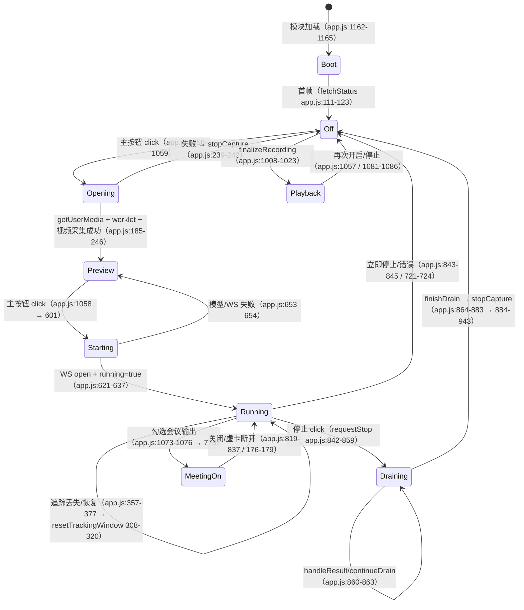

# 07 Studio 浏览器前端（Falcon Studio Web）

> 范围：`studio/web/` 全部非 vendor 文件（`app.js` 1165 行逐段读完、`audio-inspector.js`、`capture-worklet.js`、
> `playback-resampler.js`、`mouth-tracker.js`、`video-worker.js`、`spectrum-dsp.js`、`spectrum-worker.js`、
> `i18n*.js`、`index.html`、`style.css`、`audio-inspector.css`）+ `studio/web/*.test.cjs` + `studio/tests/browser/*`
> + `studio/tests/check_*.mjs/cjs` 对前端的约束。
> 基线：commit `7576854`（`Add the project page ...`），行号以此为准。
> 证据等级：`[代码]` 直接读源码确认；`[推断]` 由源码合理推断；`[验证]` 实际运行命令确认（命令与输出见 §8）。
> 本文**只写文档、不改源码**；仅新增本文件（`git status` 仍只有 `docs/` 未跟踪）。

**一句话结论**：Studio 前端是一个无框架（原生 ES Module）的浏览器应用，负责「设备采集 → 16 kHz 定钟音频重采样 →
25 fps 嘴部追踪/ROI 裁剪 → 2 s 窗口 / 0.5 s hop 组包 → WebSocket 推理 → 服务端 0.5 s 结果回放/录音/会议输出」，
所有实时参数（16 k/25 fps/32000/8000/1280）与 `studio/server.py`、`studio/falcon_runtime.py` 严格对齐；
但任务书/Lead 提示中的 `LEFT_CONTEXT=22400` 是**错误**的，代码实际为 `32000-8000-1280 = 22720`（1.42 s），
它与服务端 `OutputSlicer` 的切片起点 `WINDOW-GUARD-HOP` 恰好相同，是协议时间戳偏移的数值来源（见 §5.4、§7-Q1）。

---

## 1. 子系统职责与总体位置

### 1.1 职责

Falcon Studio 由「本地 FastAPI/WS 服务 + 纯前端浏览器应用」两部分组成；前端是**唯一的人机入口与采集端**：

1. 设备枚举/授权/切换（摄像头、麦克风、虚拟声卡）；
2. 麦克风 → 16 kHz 单声道采集（AudioWorklet 多相 FIR 重采样、时间戳补偿）；
3. 摄像头 → 25 fps 抓帧 → MediaPipe FaceLandmarker 嘴部追踪（Web Worker）→ 96×96 灰度 JPEG 裁剪；
4. 以 2 s 窗口 / 0.5 s hop 组织 `{audio, frames, end_sample, reset}` 请求，经 `ws://host/ws` 发给本地服务；
5. 接收 0.5 s 分离片段：时间戳校验、耳机监听（含重采样/淡入/抖动缓冲）、会议虚拟麦克风、录音与 WAV 导出；
6. 实时波形/频谱显示、录音细览（波形 + 频谱 + 进度条 + 缩放）、i18n（中/英）、错误与降级。

前端**不做模型推理、不做服务端交叉淡化**；它只负责采集、对齐、协议、播放和 UI。

### 1.2 在系统中的位置

```
浏览器（studio/web）
  index.html ── app.js (module)
                 ├─ i18n.js + i18n-{static,dynamic,errors,audio}.js
                 ├─ audio-inspector.js ── spectrum-worker.js ── spectrum-dsp.js
                 ├─ playback-resampler.js
                 ├─ capture-worklet.js        （AudioWorklet 线程）
                 ├─ video-worker.js           （Web Worker）── mouth-tracker.js + vendor/mediapipe
                 └─ WebSocket /ws  ⇄  studio/server.py（FastAPI，same-origin 限制）
                                        └─ Engine.infer → FalconRuntime（falcon_runtime.py）
```

静态资源由服务端挂载：`GET /` 返回 `web/index.html`（`studio/server.py:278-280`），`/static` 与 `/` 均挂
`web/` 目录（`studio/server.py:282-283`）。CSP 与 Permissions-Policy 由服务端中间件下发（`studio/server.py:198-211`），
前端所有资源（含 MediaPipe wasm/model）都本地化，无 CDN（`studio/web/vendor/mediapipe/manifest.json:2-4`）。

[代码] 入口链路：`index.html:62` 以 `<script type="module" src="/static/app.js">` 加载；`app.js:1-3` 静态 import
`i18n.js`、`audio-inspector.js`、`playback-resampler.js`；`app.js:1162-1165` 在模块末尾初始化 i18n、拉取状态、
每 4 s 轮询 `/api/status`、启动 rAF 波形动画。样式按需注入：`audio-inspector.js:40-43` 在 `#audioInspectorStyles`
不存在时插入 `/static/audio-inspector.css`（`index.html:11` 已预置该 link，正常情况下为 no-op；R2 评审遗漏 5）。

### 1.3 范围文件清单（运行上下文）

| 文件 | 行数 | 运行线程 | 职责 |
|---|---|---|---|
| `studio/web/index.html` | 64 行 / 22 KB | 主线程 | DOM/文案骨架；125 个 `data-i18n*` 绑定；仅加载 `app.js` |
| `studio/web/app.js` | 1165 | 主线程 | 状态机、设备、WS 协议、追踪 UI、录音/回放/会议、错误处理 |
| `studio/web/capture-worklet.js` | 71 | AudioWorklet | 任意采样率 → 16 kHz 多相 FIR 降采样，20 ms 包 + 时间戳 |
| `studio/web/playback-resampler.js` | 129 | 主线程 | 16 kHz → `AudioContext.sampleRate` 流式多相升采样（63 tap/2048 相） |
| `studio/web/mouth-tracker.js` | 149 | Worker（被 import） | 纯几何：嘴部 ROI/缩放/连续性/重锁状态机 |
| `studio/web/video-worker.js` | 166 | Web Worker | 25 fps 节流、MediaPipe 检测、96×96 灰度 JPEG、epoch/帧归属管理 |
| `studio/web/spectrum-dsp.js` | 208 | Worker（被 import） | 1024 点 FFT、128 行频谱、录音概览、epoch 传输协议 |
| `studio/web/spectrum-worker.js` | 9 | Web Worker | `SpectrumProcessor` 的薄壳 |
| `studio/web/audio-inspector.js` | 346 | 主线程 | 实时频谱插入、录音细览、缩放/进度条/定位、worker 调度 |
| `studio/web/i18n.js` | 124 | 主线程 | 合并字典、中英互译、DOM 绑定、语言持久化与监听 |
| `studio/web/i18n-static.js` | 123（120 条） | 主线程 | 静态界面文案 |
| `studio/web/i18n-dynamic.js` | 155（151 条） | 主线程 | 运行时状态/提示文案 |
| `studio/web/i18n-errors.js` | 58（55 条） | 主线程 | 服务端/Python 错误的中英互译 |
| `studio/web/i18n-audio.js` | 25（23 条） | 主线程 | 音频可视化文案 |
| `studio/web/style.css` | 54 行 / 41.6 KB（压缩） | 主线程 | 布局与主题（含 5 个媒体查询、`object-fit:cover`） |
| `studio/web/audio-inspector.css` | 2 行 / 6.9 KB（压缩） | 主线程 | 音频可视化专用样式 |
| `studio/web/vendor/mediapipe/` | 38 MB | Worker | MediaPipe Tasks Vision 1.0.1：`vision_bundle.mjs` 155 KB、`face_landmarker.task` 3.76 MB、wasm 10.9–11.8 MB |
| `studio/web/capture-worklet.test.cjs` | 51 | Node | worklet DSP 直测 |
| `studio/web/video-worker.test.cjs` | 46 | Node | worker 帧选择/灰度/所有权直测 |
| `studio/tests/check_i18n.mjs` | 200 | Node | i18n 真实模块 + 迷你 DOM |
| `studio/tests/check_spectrum.mjs` | 136 | Node | FFT/概览/worker 协议 |
| `studio/tests/check_playback_resampler.mjs` | 180 | Node | 播放重采样 DSP |
| `studio/tests/check_capture_dsp.cjs` | 64 | Node | 采集重采样 DSP（vm 沙箱） |
| `studio/tests/check_mouth_tracking.mjs` | 173 | Node | 几何 + worker 纯逻辑 mock |
| `studio/tests/check_tracking_ui.cjs` | 443 | Node | 真实 `app.js` + DOM stub 的控制流测试 |
| `studio/tests/browser/test.js` | 63 | Chrome | 真实 MediaPipe + 公共人像的浏览器验证（本环境不可跑） |

### 1.4 对 `00-project-map.md` 的校正（假设核实）

| 00-project-map 说法 | 核实结果 |
|---|---|
| `studio/web/` 约 3200 行 | 非 vendor 的 JS/HTML/CSS 合计约 2848 行（JS 2740 + HTML 64 + CSS 56；`wc -l`），加上 2 个前端测试 97 行约 2945；"~3200" 略高但量级正确 [验证] |
| `studio/tests/` 有 `check_*.mjs/cjs`（5 个） | 实际 **6 个**：`check_i18n/check_spectrum/check_playback_resampler/check_mouth_tracking`（.mjs）+ `check_capture_dsp/check_tracking_ui`（.cjs）；另有 `web/*.test.cjs` 2 个 [验证] |
| 4.3 流「浏览器 → … → WS 发送 {audio, frames}」 | 实际字段更多：`type/id/audio/frames/window_seconds/hop_seconds/end_sample/reset`（`app.js:593`，§5.2） [代码] |
| 4.3 流「前端 playback-resampler 重采样到设备率 + crossfade 拼接」 | crossfade 在**服务端** `OutputSlicer` 做（20 ms，`server.py:29,80-89`）；前端只做重采样 + 非连续块 5 ms fade-in（`app.js:753-759`） [代码] |
| 7-8「1.42 s 静音左上下文、80 ms guard、OutputSlicer 语义是否一致」 | 一致：`LEFT_CONTEXT=WINDOW-HOP-GUARD=22720`（1.42 s）= 服务端切片起点偏移；guard=1280=80 ms；见 §5.4 [代码]+[验证] |
| 4.3 首输出「~0.58 s 输入 + 1.42 s 静音左上下文」 | 正确：首窗 `HOP+GUARD=9280` 样本=0.58 s，左上下文 22720=1.42 s（`app.js:567-570,10`） [代码] |

---

## 2. 文件清单与逐文件解析

> 行数/大小见 §1.3。本节只写「职责、关键签名、输入输出、常数」，调用链见 §3。

### 2.1 `app.js`（1165 行，主控制器）

**常量**（`app.js:5-12`）：

| 名称 | 值 | 位置 | 含义 |
|---|---|---|---|
| `RATE` | 16000 | `app.js:6` | 全部内部音频的采样率 |
| `WINDOW` | `2*RATE` = 32000 | `app.js:7` | 模型窗口 2 s |
| `HOP` | `RATE/2` = 8000 | `app.js:8` | 输出步长 0.5 s |
| `GUARD` | 1280 | `app.js:9` | 80 ms 右上下文（服务端保留） |
| `LEFT_CONTEXT` | `WINDOW-HOP-GUARD` = **22720** | `app.js:10` | 1.42 s 合成左上下文，同时是协议时间戳偏移 |
| `FPS` | 25 | `app.js:11` | 视频帧率 |
| `MAX_RECORDING_SECONDS` | 300 | `app.js:12` | 录音上限 5 分钟 |

**全局状态** `state`（`app.js:13-31`）：50+ 字段，按用途分：设备/音频图（`stream/context/source/worklet/socket`）、
帧缓冲（`frames/ring/samples/audioOrigin`）、会话代际（`generation/sessionEpoch/inferenceEpoch/trackingEpoch/meetingEpoch/sequence`）、
运行标志（`running/starting/opening/loading/inFlight/draining`）、录音（`recording/mixture/recordingSamples/recordingUrl/mixtureUrl/recordingTrack/recordedEnd/recordingCapped/recordingFinalizedSamples`）、
追踪（`roi/lips/trackingMode/trackingStatus/requiresReacquire/searching/trackingMessage/detectionMs`）、会议（`monitorGain/meetingGain/meetingDestination/meetingActive/meetingOutputs`）、
UI 波形（`inputWave/outputWave/playAt/monitorSources`）。`cropCanvas` 固定 96×96（`app.js:32-34`）。

**函数清单与签名**（全部内部函数，无 export）：

| 函数 | 行 | 职责 |
|---|---|---|
| `notice(message, error=false, params={})` | 40-44 | 显示 i18n 提示条（可带参数） |
| `errorMessage(error)` | 45-53 | DOMException 名称 → 中文提示；否则 `message`/`String` |
| `setSession(title, subtitle)` | 54-57 | 会话标题/副标题 |
| `updateButtons()` | 58-78 | 所有按钮 disabled/文案/`running` 灯；核心状态映射 |
| `applyStatus(status)` | 79-110 | `/api/status` → 模型下拉/引擎 pill/设备/错误提示 |
| `fetchStatus()` | 111-123 | `GET /api/status`（5 s 超时），失败显示"服务未连接" |
| `loadModel(variant)` | 124-143 | `POST /api/load`（180 s 超时），跳过已就绪同款 |
| `enumerateDevices()` | 145-184 | 摄像头/麦克风/虚拟声卡枚举，`devicechange` 重入时保持选择 |
| `openCapture(deviceIds={})` | 185-246 | 建 AudioContext、getUserMedia、worklet、视频采集、枚举、ROI |
| `onPCM({samples,startTime})` | 247-271 | 采集包 → 8 s ring、样本计数、输入电平/波形、驱动 `maybeInfer` |
| `videoGeometry()` | 272-279 | `object-fit:cover` 的缩放/偏移计算 |
| `positionROI()` | 280-304 | ROI 框定位、ARIA、auto 时不写回、manual 时下发 worker |
| `trackingAllowsInference()` | 305-307 | `manual \|\| trackingStatus==='tracking'` |
| `resetTrackingWindow()` | 308-320 | 追踪代际切换：清帧/清输出/重置时间基准，保留 inFlight 但弃结果 |
| `refreshTrackingUI()` | 321-356 | 追踪状态文案/ROI/轮廓/会话提示 |
| `setTrackingStatus(message)` | 357-377 | 接收 worker 状态，过滤 epoch/模式；状态变化触发 `resetTrackingWindow` |
| `setTrackingMode(mode, reacquire=false)` | 378-392 | auto/manual 切换，epoch++，通知 worker |
| `startVideoCapture(generation)` | 393-477 | Worker+MSTP / Worker+主线程 / 无 Worker 三档降级 |
| `addFrame(time,data)` | 478-483 | 入帧队列，上限 `FPS*6`=150 帧或 6 s |
| `captureFrame()` | 484-522 | 主线程抓帧（Worker 位图模式 / 无 Worker 时 manual 自裁） |
| `frameWindow(startTime,endTime)` | 523-542 | 在 25 fps 网格上选 50 帧，合成历史、拒绝过期帧 |
| `encodeFloat32(samples)` | 543-550 | Float32 LE → base64 |
| `decodeFloat32(encoded)` | 551-563 | base64 → Float32Array，非有限值抛错 |
| `maybeInfer()` | 564-600 | 单飞调度：窗口边界、缺帧、跳窗、reset、发送 |
| `startSession()` | 601-658 | 等模型 → 连 WS → running=true、重置录音/计数 |
| `handleResult(raw)` | 659-725 | 校验/解码/时间戳/录音/频谱/电平/播放/继续调度 |
| `playSamples(samples,contiguous)` | 726-771 | 重采样、淡入、AudioBuffer 调度、接监听/会议 |
| `stopMonitoring()` | 772-777 | 停止并断开所有已调度 source |
| `enableMeeting()` / `disableMeeting()` | 778-837 | setSinkId 虚拟声卡输出 / 关闭 |
| `requestStop()` | 842-859 | 排空最后 0.6–1.1 s 后再停；二次点击立即停 |
| `continueDrain()` / `finishDrain()` | 860-883 | 排空完成判定；裁剪补零；等播放完再 `stopCapture` |
| `stopCapture()` | 884-943 | 全量释放（WS/worker/worklet/AudioContext/设备），finalize 录音 |
| `resetRecording()` | 944-960 | 清录音/URL/频谱 |
| `inputSpan(start,length,request)` | 963-971 | 从不可变请求快照取与输出对齐的 mixture 片段 |
| `showRecordingTrack()` | 973-990 | Target/Mixture 切换播放与频谱，保持位置 |
| `wavBlob(chunks,totalSamples)` | 991-1007 | 16-bit PCM 单声道 WAV |
| `finalizeRecording()` | 1008-1023 | 生成两个 blob URL（Separated/Mixture） |
| `drawWave` / `animate` | 1025-1054 | 24 段/秒的输入/输出波形条 |
| 事件绑定 | 1056-1161 | 见 §3.1 |
| bootstrap | 1162-1165 | i18n、状态轮询、rAF |

**输入输出契约**：唯一外部输入 = `/api/status`、`/api/load`、`/ws`、用户手势、`getUserMedia`/worker/worklet 消息；
唯一外部输出 = 上述请求 + 音频设备 + DOM。

### 2.2 `capture-worklet.js`（71 行）

- **职责**：在 AudioWorklet 线程把设备采样率（代码按 `ratio=sampleRate/16000` 对任意比例通用；已实测 16/44.1/48 kHz，96 kHz 未测、仅 [推断]）定钟降采样到 16 kHz，并在包边界给出
  AudioContext 时间戳。
- 关键参数：`targetRate=16000`（`:8`）、`ratio=sampleRate/16000`（`:9`）、`taps=63`（`:12`）、
  `groupDelay=(63-1)/2=31`（`:13`）、`cutoff=min(7200, 0.45*sampleRate)/sampleRate`（`:16`）——
  截止 7.2 kHz，44.1/48 k 输入时截止比例不同（7200/44100、7200/48000）。
- 预计算 128 个相位（`:17-28`）：Hamming 窗（`0.54-0.46cos`，`:23`）+ sinc，归一化到单位直流增益（`:26`）。
- `process(inputs, outputs)`（`:33-69`）：输出强制填 0（`:34-36`，原始麦克风绝不直通监听，测试
  `tests/check_capture_dsp.cjs:25-28` 验证）；时钟跳变（`expectedFrame!==currentFrame`）重置相位与包缓冲（`:38-42`）；
  多声道平均（`:45-48`）；每个输入样本内按 `nextPosition` 产生输出样本（`:51-65`）；
  `packetStart=(nextPosition-groupDelay)/sampleRate`（`:56`）补偿 FIR 群延迟；
  每 320 样本（20 ms）`postMessage({samples,startTime}, [buffer])`（`:29,59-64`）。
- 输出：`Float32Array(320)` + `startTime`（AudioContext 秒）；16 kHz 下 2 s 恰好 32000 样本（测试验证）。

### 2.3 `playback-resampler.js`（129 行）

- **职责**：把服务端 16 kHz 的 0.5 s 块升采样到设备 `AudioContext.sampleRate`（44.1k/48k/96k，支持非整数比
  2.75625），带显式低通，避免 Chrome `AudioBufferSourceNode` 的 2 点线性插值把 8 kHz 镜像泄漏出来
  （`:1-17` 注释）。
- 常数：`TAPS=63`（`:18`）、`PHASES=2048`（`:19`）、`CUTOFF_HZ=7400`（`:20`）。
- `buildPhases(cutoffRatio)`（`:22-38`）：同 capture-worklet 的 Hamming-sinc；`phaseCache` 按源率缓存（`:40-48`）。
- `class PlaybackUpsampler`（`:57-124`）：`ratio=target/source`、`step=source/target`（`:61-62`）、
  `reset()` 清 63 样本历史并把相位归零到群延迟 `groupDelay`（`:67-76`）、`push(chunk)` 流式输出
  （`:87-123`，量化相位 `:103-105`，tap 索引 `:112-117`）；`pendingOutputCount`（`:80-86`）供测试精确估算长度。
- `createPlaybackUpsampler(targetRate, sourceRate=16000)`（`:126-129`）：同率返回 `null`（调用方完全绕过重采样）。

### 2.4 `mouth-tracker.js`（149 行）

- **职责**：纯几何（无身份识别）——由 MediaPipe 478 点 landmarks 计算 96×96 嘴部裁剪框、平滑、丢失/重锁策略。
- 常量：20 个外唇点 `OUTER_LIP_INDICES`（`:2-3`）；`defaultPolicy`={graceMs:500, relockFrames:4,
  inconsistentRelockMs:2500, shiftLimit:.75, scaleLimit:1.8}（`:5-11`）。
- `newMouthTrack()`（`:17-20`）：`{roi,face,lastSeenMs,scaleRatio,lostSinceMs,priorTarget,holdRoi,candidateFace,candidateStreak,candidateStableMs}`。
- `clampROI(roi,w,h)`（`:29-36`）：size 限制 `.06–.75`，中心限制在画面内。
- `mouthGeometry(landmarks,w,h)`（`:38-54`）：校验 61/291/234/454/1 + 20 唇点有效（`:41`）；`faceWidth=d(234,454)`、
  `mouthWidth=d(61,291)`；拒绝 faceWidth<35 px、mouthWidth<8 px、mouthWidth>0.85*faceWidth（`:45`）；
  `scaleRatio=clamp(2.13*mouthWidth/faceWidth,.45,1.1)`（`:51`，2.13≈96/45 标定）；输出 center/face/lips。
- `updateMouthTrack(prev,landmarksList,w,h,nowMs,policy)`（`:83-109`）：先按帧内所有脸做几何（`:88`）；
  已锁定时选「最近且连续」的脸（`:91-100`），ROI 中心用 `1-exp(-Δt/65)`、尺寸用 `1-exp(-Δt/220)` 平滑
  （`:94-98`）；`graceMs(500)` 内丢脸 → 保持 ROI、`status='tracking'`、`coasted=true`（`:101-104`）；
  超过 grace → `reacquire`（`:105-106`）。
- `lost()`（`:22-27`）：若曾锁定过（`holdRoi`）→ 仍报 `tracking` + `searching=true`，输出不断（设计动机见 §4.4）。
- `reacquire`（`:111-124`）：无脸 → lost；与 priorTarget 一致 → `relock(requireStreak=true)`（4 帧确认）；
  多张脸且都不一致 → lost + "多个人脸"（`:118-119`）；单张不一致脸 → `relockSlow`（2.5 s 稳定后确认，`:138-149`）；
  从未锁定过 → 立即锁定（`:122`）。
- `consistent`（`:58-62`）：位置位移 ≤0.75 脸宽且尺度比 ∈[1/1.8,1.8]；`nearestConsistent`（`:64-71`）取最近者。

### 2.5 `video-worker.js`（166 行）

- **职责**：独立于页面渲染定时器，25 fps 取帧、MediaPipe 检测、裁剪/灰度/JPEG、帧归属（epoch）管理。
- 状态：`reader/active/processingBitmap/session/mode/trackingEpoch/manualROI/trackState/nextTimestamp/lastDetectTimestamp/detector/promise/error`（`:6-13`）；
  `OffscreenCanvas(96,96)`（`:12-13`）。
- `tracking(status,details,epoch)`（`:15-21`）：统一发出 `{type:'tracking',status,trackingEpoch,detectorReady,...}`；
  非 tracking 状态做 JSON 去重防止刷屏（`:18-20`）。
- `ensureDetector(epoch)`（`:22-49`）：动态 `import('./vendor/mediapipe/vision_bundle.mjs')`（`:29`）→
  `FilesetResolver.forVisionTasks('/static/vendor/mediapipe/wasm', true)`（`:30`）→
  `FaceLandmarker.createFromOptions(...)`（`:31-37`）：`delegate:'CPU'`、`runningMode:'VIDEO'`、`numFaces:2`、
  三个置信度阈值 0.6、关闭 blendshapes/transform matrix；失败进入 `error` 状态（`:48`）。
- `processFrame(frame,wallTime,epoch)`（`:53-103`）：`frame.timestamp`（µs）优先于 wallTime（`:56`）；
  25 fps 节流（`:57-59`，见 §4.3）；auto 模式 `detector.detectForVideo(frame, monotonicMs)`（`:67-70`）→
  `updateMouthTrack`（`:77`）→ 发 tracking 状态（`:81`）；manual 模式直接用本地 `manualROI`（`:84-87`）；
  裁剪 `roi` 到 96×96（`:88-89`）→ ITU-R 601 灰度 `.299/.587/.114`（`:91-94`）→ JPEG quality .88（`:96`）→
  `postMessage({type:'frame',jpeg,wallTime,trackingEpoch,...},[jpeg])`（`:98-101`），`frame.close()` 在 finally（`:102`）。
- `pump(readable,session)`（`:104-120`）：读取 MSTP `ReadableStream`，异常上报，finally `reader.cancel/releaseLock`、
  关闭 detector、发 `stopped`（`:114-119`）。
- `self.onmessage`（`:121-166`）：`roi`（`:123`）、`tracking`（`:124-133`，换 epoch/模式，auto 重新加载检测器）、
  `stop`（`:134-139`）、`frame`（`:140-155`，`processingBitmap` 单飞 + 始终 `ack`）、`start`（`:156-165`，
  先发 `ready` 再初始化 detector，若带 `readable` 则 `pump`）。

### 2.6 `spectrum-dsp.js`（208 行）

- **职责**：16 kHz 本地频谱分析。常数（`:5-11`）：`SAMPLE_RATE=16000`、`FFT_SIZE=1024`（64 ms）、
  `HOP_SIZE=640`（40 ms）、`FREQUENCY_ROWS=128`、`DB_FLOOR=-90`、`MAX_VIEW_COLUMNS=1600`、
  `MAX_RECORDING_SAMPLES=4,800,000`（5 分钟）。
- `class SpectrumDSP`（`:16-82`）：Hann 窗 `0.5-0.5cos(2πi/(N-1))`（`:27-29`），位反转表（`:30-32`），
  twiddle（`:34-37`）；`column(samples,offset)`（`:41-46`）/`circularColumn(ring,oldest)`（`:49-51`）/
  `transform()`（`:54-81`）：radix-2 FFT、Hann 增益 `1/windowSum`、DC 与 Nyquist 不翻倍（`:72`）、
  每显示行取该行 4 个 bin 的峰值（`:73-74`）、dB → `0..255` 量化（`:76-79`，`0=-90 dBFS,255=0 dBFS`）。
- `class LiveSpectrum`（`:84-113`）：1024 样本环形缓冲（`:87`），首次满 1024 出一列，之后每 640 样本一列
  （`:104-109`），输出 `{columns,width,height}`（列优先行`row*width+col`）。
- `recordingView(...)`（`:115-154`）：把整段录音按请求列数聚合；每列按 ≤50% 窗 hop 切多个 1024 窗取峰值
  （`:128-139`），波形取每列 min/max（`:141-151`），越界钳制（`:117-119`）。
- `class SpectrumProcessor`（`:158-207`）：worker 侧传输层，处理 `reset-live/live/clear-recording/recording/view`，
  校验 epoch 与大小（`:167-206`）。

### 2.7 `spectrum-worker.js`（9 行）

薄壳：`new SpectrumProcessor(msg => self.postMessage(msg, transfer))`，`try/catch` 把异常回成
`{type:'error',epoch,requestId,message}`（`:3-8`）。

### 2.8 `audio-inspector.js`（346 行）

- **职责**：向页面注入两块 UI：① 每个音轨下方的「实时频谱」（滚动 8 s、0–8 kHz、−90..0 dBFS）；
  ② 录音条后的「录音细览」（波形 + 频谱概览 + 缩放 + 播放进度条/定位）。
- 常数：`RATE=16000`（`:3`）、`LIVE_WIDTH=200`（`:4`，200 列 × 40 ms = 8 s）、`HEIGHT=128`（`:5`）、
  `MAX_LIVE_SAMPLES=RATE`（`:6`，待处理上限 1 s）；256 色调色板（`:12-23`）。
- `createAudioInspector({player,onError})`（`:38`）：校验 player 是 `HTMLMediaElement`（`:39`）、按需注入 CSS（`:40-43`）；
  为 `#inputWave/#outputWave` 插入频谱块（`:54-67`）；生成录音细览 DOM（`:75-117`）；注册
  worker/事件/rAF（`:239-297`）；返回 `{pushInput,pushOutput,resetLive,resetOutput,setRunning,clearRecording,setRecording,destroy}`
  （`:330-345`）。
- 关键内部：`canSeek()`（`:120`）、`updateControls/Labels/Position`（`:121-154`）、`seekTo`（`:155-159`）、
  `reportFailure`（`:160-167`，worker 失败只降级可视化）、`dispatchLive`（`:168-178`，input/output 轮转防饿死）、
  `push`（`:179-189`，拷入 1 s 上限缓冲）、`requestView`（`:196-201`，列数=plot 宽度 clamp 64–1600）、
  `setView`（`:202-206`）、`paintRecording`（`:207-224`）、`acceptLive`（`:225-238`，左移滚动）。
- Worker 消息处理（`:242-256`）：`error`→降级；`live`→滚动；`recording-ready`→请求视图；`view`→校验 requestId 后绘制。

### 2.9 i18n 五文件

- `i18n.js`（124 行）：合并 4 个字典（`:1-6`）、`STORAGE_KEY='falcon.language'`（`:7`）、支持 `en/zh`（`:8`）、
  可翻译属性白名单 `title/aria-label/aria-valuetext/placeholder`（`:9`）、`listeners`（`:10`）；
  启动读 localStorage，异常保持英文（`:13-16`）；反向表 EN→ZH（`:19`）；占位符模板 → 正则（`:20-33`）；
  `interpolate` 支持参数嵌套翻译（深度<4）（`:35-42`）；`translateMessage`（`:44-59`，精确键 → 反向键 → 模板匹配）；
  `t(key,params)`（`:61-66`）；`setText/setAttr` 把 key/params 写进 `data-i18n*` 便于切语言重放（`:74-86`）；
  `renderLanguage` 扫描 DOM+属性（`:88-104`）；`setLanguage` 持久化+通知（`:106-113`）；`initializeI18n` 绑定
  `#languageSelect`（`:118-124`）。
- 字典（合并顺序 static→dynamic→errors→audio，后者覆盖同名键；实际 12 个重复键值完全相同，无覆盖风险）：
  `i18n-static.js:1-123`（120 条）、`i18n-dynamic.js:1-155`（151 条）、`i18n-errors.js:1-58`（55 条）、
  `i18n-audio.js:1-25`（23 条）→ **349 条**（去重 337 键）[验证]。
- 键设计：**中文原文即 zh 译文**，值是英文译文；错误字典额外覆盖 Python/Worker 的中英文消息（见 §4.8）。

### 2.10 `index.html`（64 行 / 22 KB）

- `<html lang="en">`（`:2`），首屏文案为英文并可被 `data-i18n` 替换；`#languageSelect` 提供 English/中文（`:28`）；
- 结构：侧边栏 → 主工作区（相机卡 + 控制列）→ 会议条 → 提示条 → 音频区（A 输入/B 输出 canvas）→ 录音条 →
  页脚 → `dialog#guideDialog`；`app.js` 以 module 加载（`:62`）。
- 125 个 `data-i18n*` 绑定（120 个唯一键）[验证]；这些是 i18n 静态渲染的契约（`check_i18n.mjs:137-149` 校验）。
- 所有 96×96 嘴部框/ROI/进度条等都是 `div/canvas/input[type=range]`，无第三方 UI 框架。

### 2.11 `style.css`（54 行 / 41.6 KB，压缩）与 `audio-inspector.css`（2 行 / 6.9 KB，压缩）

- `style.css:1` 定义主题变量（`--bg/--panel/--lime/--orange/--sidebar:222px` 等）；`:2` 是 24 KB 的压缩主样式（含布局、
  `object-fit:cover`、响应式断点 1500/1150/940/740px、`prefers-reduced-motion`）；其余为少量未压缩规则。
- `audio-inspector.css:1-2` 是音频可视化专用样式（实时频谱、录音细览、播放游标、缩放控件）。
- 结论：无 JS 逻辑，仅视觉/布局；不影响数据流。

### 2.12 `vendor/mediapipe/`（38 MB，第三方，仅清单级）

- `manifest.json:2-4`：`@mediapipe/tasks-vision` **1.0.1**，来自 npm；`face_landmarker.task` 3.76 MB
  （float16/1，Google 官方 model URL），wasm 三种变体 10.9–11.8 MB，`vision_bundle.mjs` 155 KB。
- 由 `video-worker.js:29-32` 以同源相对路径动态加载；服务端 CSP 只放开 `'wasm-unsafe-eval'`（`server.py:210`），
  并有专门测试校验资产可达与 `application/wasm`（`studio/tests/test_server.py` 的 `test_local_tracking_assets_and_wasm_policy`）。

### 2.13 测试文件对前端的约束（摘要；详见 §8）

- `check_tracking_ui.cjs`：用真实 `app.js` 源码 + 迷你 DOM（`:17-83`）验证 **18 条**控制流断言（DOM id 全存在、
  丢脸不杀会话、单飞、旧结果丢弃、手动模式、epoch 丢弃、ROI 不写回、重捕窗口、5 分钟录音上限、mixture 对齐、
  停止排空/二次点击/首窗 inFlight/延迟响应/预览频谱/位图竞态）。为了可注入，它把 `app.js` 的三个 import 删除后
  `vm.runInContext`（`:13,81`）。
- `check_mouth_tracking.mjs`：几何 + worker mock 的 20+ 断言（`:21-173`）。
- `check_i18n.mjs`：迷你 DOM + 真实 `i18n.js`，8 组测试（`:84-198`），349 条字典全量审计。
- `check_spectrum.mjs`：6 组 DSP/worker 断言（`:13-134`）。
- `check_playback_resampler.mjs`：6 组（通带/镜像/分块一致性/长度/reset/identity）。
- `capture-worklet.test.cjs` / `check_capture_dsp.cjs`：真实 worklet 源码在 vm 中跑 16/44.1/48 kHz 音调。
- `video-worker.test.cjs`：真实 worker 源码（去 import）验证 30 fps→25 fps 采样、ROI、灰度、所有权、错误清理。
- `tests/browser/test.js`：真实 Chrome + MediaPipe + `portrait.jpg`（176 KB）；`serve_browser.py` 在 7866 端口把
  `/__test` 挂到浏览器测试目录；**本环境无 Chrome/MediaPipe，不可运行**（`§8.7`）。

---

## 3. 关键调用链与数据流（带 file:line）

### 3.1 前端状态机/生命周期（必做图）

#### 3.1.1 顶层生命周期图



```text
                 ┌────────────────────────────── 页面卸载：pagehide → stopCapture（app.js:1157-1160）
                 │                               页面隐藏：visibility → stop（非 worker 模式，app.js:1151-1156）
                 ▼
[Boot] ──► [Off] ──点击"开启设备"──► [Opening] ──成功──► [Preview] ──点击"开始分离"──► [Starting]
             ▲                         │  失败              │  ▲                         │ 成功
             │                         ▼                    │  │ 设备选择变更（1081-1086） │
             └──────────── [Stop/Off] ◄── stopCapture ◄──────┘  └──────────────────────► [Running]
                                ▲                                        │   ▲                │
                                │                            追踪被阻断 │   │ 追踪恢复       │ 停止
                                │                                        ▼   │                ▼
                                └──────── finishDrain ◄── [Draining] ◄── 停止请求（842）
                                                                     │ 二次点击直接 stopCapture（843）
                                                                     ▼
                                                             [Playback/Export]（1008-1023）
```

**状态变量**（`app.js:13-31`）：`stream/opening`；`running/starting/draining`；`loading` + `status.ready/loading/error`；
`trackingStatus∈{idle,loading,tracking,lost,error,manual}`（`app.js:324,360`）；`trackingMode∈{auto,manual}`（`app.js:27`）；
`recordingSamples/recordingCapped/recordingUrl/mixtureUrl`；`meetingActive`。

#### 3.1.2 状态与转换表（含每步 file:line）

| # | 状态 | 进入条件 & 关键动作 | 退出/异常 | 证据 |
|---|---|---|---|---|
| S0 | Boot | 模块求值：`initializeI18n()`；`fetchStatus()`；`setInterval(fetchStatus,4000)`；`rAF(animate)` | 首帧渲染 | `app.js:1162-1165` |
| S1 | Off（设备关） | `stream=null`；主按钮文案"开启设备"；追踪 `idle` | 点击主按钮 | `app.js:13-31,58-78,1056-1059` |
| S2 | Opening | `opening=true`；新建 `AudioContext({latencyHint:'interactive'})` 并 `resume()`；`getUserMedia`（1280×720 ideal / 25 fps / 单声道，关闭 EC/NS/AGC） | 失败 → 停轨道/关 context/`stopCapture` + notice | `app.js:185-246`（`186-201`） |
| S3 | Preview（设备就绪） | `state.stream/context` 赋值；`monitorGain`（默认 0）、`meetingGain`（0）；重置计数/ring/帧/频谱；`video.srcObject`；`audioWorklet.addModule('/static/capture-worklet.js')`；`MediaStreamSource→AudioWorkletNode`；`worklet.connect(destination)`（输出静音） | 设备 `ended`/切换设备/停止 | `app.js:202-238,218-224,1081-1086`（`225-227` 为 track `ended` 处理） |
| S3a | 模型未就绪 | `applyStatus` 显示"等待模型/加载中/失败"；`loadModel()` 可手动触发 | `/api/status` 轮询 4 s | `app.js:79-110,124-143,1164` |
| S4 | Starting | `starting=true`；`context.resume()`；若未 ready：`loadModel()` + 每 1.5 s 轮询最多 180 s；`new WebSocket(ws(s)://host/ws)`（10 s 超时）；`resetRecording()`；`running=true`；`inferenceEpoch++`；`sessionEpoch=sessionStart=samples`；`lastSentEnd=0` | 失败 → 关 socket + notice | `app.js:601-658`（`604-652`） |
| S5 | Running | `onPCM` 每 20 ms 驱动；`maybeInfer` 单飞发窗口；`handleResult` 播放/录音；`skipped` 统计 | 停止/错误/丢设备 | `app.js:247-271,564-600,659-725` |
| S5a | Running·追踪允许 | `trackingAllowsInference()`=true（auto 且 `trackingStatus==='tracking'`，或 manual） | — | `app.js:305-307` |
| S5b | Running·追踪阻断 | `setTrackingStatus` 状态变化 → `resetTrackingWindow()`：`inferenceEpoch++`、清帧、`sessionEpoch=samples`、`lastSentEnd=0`、清输出/频谱/监听；`maybeInfer` 直接 return；旧 inFlight 结果按 epoch 丢弃 | 追踪恢复（再次 reset） | `app.js:308-320,357-377,566,667-670` |
| S6 | Draining | `requestStop`：若正在排空/未运行/无新样本/无帧/追踪不允许 → 直接 `stopCapture`；否则把 `samples` 补零到 `target=sessionEpoch+GUARD+ceil((end-sessionEpoch)/HOP)*HOP`，复制最后一帧补齐，`draining={end,target,finished,timer:8 s}` | `finishDrain` 或 8 s 超时 | `app.js:842-859` |
| S7 | Draining·继续 | `handleResult` 尾部继续 `maybeInfer`（`end=min(newest,lastSentEnd+HOP)`）；`continueDrain` 判定 `recordedEnd>=drain.end` 或 `lastSentEnd>=drain.target` | → S8 | `app.js:571-573,719-720,860-863` |
| S8 | Stopped/Off | `finishDrain`：裁掉补零（`recording/mixture` 同步裁）、等已调度音频播完（≤2 s）→ `stopCapture`；`stopCapture` 释放 WS/worker/worklet/AudioContext/设备，`finalizeRecording()` | 回到 S1/S3 | `app.js:864-883,884-943` |
| S9 | Playback/Export | 录音 URL 就绪：试听/暂停、Progress/seek/缩放、Target/Mixture 切换、下载 WAV | 再次开启设备/开始会话清空 | `app.js:973-1023,1130-1150` |
| S10 | MeetingOn（正交） | `enableMeeting`：`player.setSinkId(deviceId)` → `MediaStreamDestination` → `player.play()` → `meetingGain=1`；`meetingActive=true` | 关闭/`meetingPlayer` error/设备断开 | `app.js:778-837,1073-1079,169-179` |
| S11 | Teardown | `visibilitychange`（非 worker 模式停）、`pagehide`（停 + 销毁 inspector + revoke URL）、`devicechange`（重枚举）、track `ended` | 页面级 | `app.js:225-227,1151-1161` |

#### 3.1.3 追踪子状态机（AUTO/MANUAL/REACQUIRE）

```text
AUTO 入口（startVideoCapture app.js:393-400 / setTrackingMode('auto') 378-392）
  → trackingStatus='loading'（app.js:395）
  → worker ensureDetector：loading → 加载 MediaPipe（video-worker.js:22-49）
      ├─ 失败：status='error'（:48；app.js:324,389 提示"自动检测不可用/请手动框选"）
      └─ 成功：status='lost'（video-worker.js:47）──等待第一张脸
  → 检测到脸且几何有效：updateMouthTrack → status='tracking'（mouth-tracker.js:90-100；worker:81）
      ├─ 丢脸 ≤ graceMs(500)：status 仍 'tracking'、coasted=true、ROI 保持不变（mouth-tracker.js:101-104）
      ├─ 丢脸 > graceMs 且曾锁定：status 仍 'tracking'、searching=true、沿用 holdRoi（mouth-tracker.js:22-27,105-106）
      ├─ 同目标一致：relock 4 帧后自动恢复（:128-137）
      ├─ 明显跳跃：coast 到 grace 结束，之后需稳定 2500 ms 才自动重锁（:138-149）
      └─ 多张不一致脸：lost + "多个人脸，无法确认目标，请点击重新捕捉"（:118-119）
  → 用户点"重新捕捉"：setTrackingMode('auto', true)（app.js:378-392,1089）→ trackingEpoch++ → 重置窗口
MANUAL 入口（点按钮 app.js:1088 / 拖动/方向键 1092-1115 / "居中" 1090）
  → setTrackingMode('manual') → trackingStatus='manual' → worker 收到 {type:'tracking',mode:'manual'}（app.js:388；worker:124-133）
  → 每帧用本地 ROI 裁剪并回 frame/tracking 消息（worker:84-87,131）
  → manual 永不因丢脸暂停（trackingAllowsInference 恒 true，app.js:305-307）
```

关键语义：`trackingEpoch` 由主线程自增并随每条 worker 消息回传；worker/主线程两侧都做 epoch 过滤
（`app.js:358,444`；`video-worker.js:15-21,55,98,126,141`），因此模式切换/重开设备后迟到的帧或状态不会污染新会话。

### 3.2 音频链路（getUserMedia → Worklet 重采样 → 16 kHz → 2 s 窗口/0.5 s hop → Float32 → base64 → WS）

```text
getUserMedia(audio:{channelCount:1, EC/NS/AGC:false})            app.js:198-201
  → MediaStreamAudioSourceNode                                  app.js:220
  → AudioWorkletNode('falcon-capture', 1 in / 1 out, 1ch)        app.js:218-224
      capture-worklet.js：
        deviceRate → 16 kHz（63-tap 多相 FIR，128 相位，截止 min(7200,0.45fs)） :8-28
        输出静音（原始麦克风不直通监听）                              :33-36
        20 ms 包：postMessage({samples:Float32Array(320), startTime}) :29,59-64
        群延迟补偿 startTime=(nextPosition-31)/sampleRate            :13,56
  → onPCM({samples,startTime})                                   app.js:247-271
      audioOrigin 初始化 / 漂移>80 ms 重新锚定并 resetTrackingWindow  :249-255
      8 s ring（128000 样本）写入                                     :15,258
      samples++、输入 RMS 电平（dB）、inputWave（140 点）             :256-265
      audioInspector.pushInput(samples)                            :266
      maybeInfer()                                                 :270
  → maybeInfer                                                   app.js:564-600
      条件：running、无 inFlight、WS OPEN、audioOrigin 已定、tracking 允许
            且 samples-sessionEpoch ≥ HOP+GUARD（=9280=0.58 s）     :565-567
      end = sessionEpoch+GUARD+floor((samples-sessionEpoch-GUARD)/HOP)*HOP :568
      首窗强制 end=sessionEpoch+HOP+GUARD                           :570
      排空中限制每次只前进一个 HOP                                  :572
      startTime = audioOrigin+(end-WINDOW)/RATE                     :574
      audio = Float32Array(32000)：ring[end-32000,end)，早于 sessionEpoch 填 0 :577-581
      跳窗统计 missed、reset=needsReset||missed>0                    :582-587
      encodeFloat32(audio) → little-endian Float32 → base64(128000 B → 170668 chars) :543-550
      WS 发送 JSON（见 §5.2）                                       :593
      记录 lastSentEnd、needsReset=false                            :594-595
```

要点：
- 音频**不是**发送 `ArrayBuffer`，而是 **base64 后的 little-endian Float32**（`app.js:543-550,593`；服务端
  `np.frombuffer(base64.b64decode(...), '<f4')`，`server.py:46`）[代码]。
- 窗口始终取**最新**的 2 s（ring 回读），不是队列；积压通过跳窗丢弃旧窗（`app.js:582-587`）。
- 采样时钟是 AudioContext 时钟；`startTime` 同时用于 A/V 对齐（见 §3.3）。
- 16 kHz 定钟由 worklet 完成（而不是 `AudioContext({sampleRate:16000})`），这样视频帧时间与音频时间同在
  设备 AudioContext 时间轴上。

### 3.3 视频/嘴部追踪链路（25 fps 抓帧 → 追踪框 → 96×96 灰度 → frameWindow 对齐 → WS）

```text
getUserMedia(video:{1280x720 ideal, frameRate ideal 25})          app.js:198-201
  → <video id=cameraVideo> srcObject+play()                       app.js:216-217
  → startVideoCapture(generation)                                 app.js:393-477
      能力探测：Worker+OffscreenCanvas 才可能走 worker             :401
        A. 'worker' = Worker + MediaStreamTrackProcessor：
             new MediaStreamTrackProcessor({track,maxBufferSize:1}).readable 转交 worker :410-413
        B. 'fallback' = Worker（无 MSTP）：主线程 setInterval(captureFrame,40ms)          :462-465
        C. 无 Worker：videoMode='fallback'，auto 直接报错，仅 manual 本地裁剪可用          :473-476
        握手：worker 先回 ready（5 s 超时），之后 tracking/frame/error 消息              :415-424
  → [worker] pump 读 VideoFrame（原生 30/60 fps）                   video-worker.js:104-120
      processFrame：25 fps 调度（距上次 ≥40 ms 才处理）             :57-59
        auto：FaceLandmarker.detectForVideo(frame, monotonicMs)    :64-83
              → updateMouthTrack（几何/平滑/重锁）                 mouth-tracker.js:83-109
        manual：clampROI(manualROI,w,h)                            video-worker.js:84-87
        裁剪：size=min(w,h)*roi.size；drawImage(...,96,96)         :88-89
        灰度：0.299R+0.587G+0.114B                                :91-94
        JPEG q=.88 → ArrayBuffer → postMessage(transfer)           :96-101
  → [主线程] onmessage 'frame'                                     app.js:446-453
      time = context.currentTime - max(0, wallNow-message.wallTime)/1000  :448-449
      btoa(jpeg) → addFrame(time, base64)                         :450-453
  → addFrame：frames.push({time,data})；上限 FPS*6=150 帧/6 s       app.js:478-483
  → maybeInfer → frameWindow(startTime,endTime)                    app.js:523-542
      50 个目标时刻 startTime+(n+.5)/25，取最近帧，|Δt|>160 ms 拒绝  :533-539
      首窗合成历史：targetTime<epochTime 时重复 epoch 后第一帧       :524-527,535
      帧覆盖不足（首帧晚于窗口+120 ms / 末帧早于窗口-120 ms）返回 null :528-530
  → sent 的 frames = 50 个 base64 JPEG（顺序 = 25 fps 网格）        app.js:593
```

服务端随后：50 个 base64 → PIL 解码校验 96×96 JPEG/PNG → `np.stack(..., uint8)` `(50,96,96)`（`server.py:51-63`），
`FalconRuntime.preprocess_mouth` 再 center-crop `[4:92,4:92]` → 88×88、`/255`、`(x-0.421)/0.165`
（`falcon_runtime.py:95-104`）。**服务端不校验帧时间戳**，A/V 对齐完全由前端的 `frameWindow` 负责 [代码]。

### 3.4 推理请求—响应时序（含排空）

```text
主线程                                     server.py(/ws)
  │ 每 20 ms: onPCM → maybeInfer
  │ 条件满足：单飞 inFlight 置位 +60 s 超时  app.js:588-591
  │── {"type":"infer", id, audio(b64 f32 32000), frames[50],              ──►
  │     window_seconds:2, hop_seconds:.5, end_sample:end+22720, reset}   app.js:593
  │                                              decode_request 校验     server.py:35-67
  │                                              busy 检查               server.py:258-259
  │                                              Engine.infer（串行锁）  server.py:160-172,260
  │                                              OutputSlicer.take      server.py:76-89,261
  │◄── {"type":"result", id, audio(b64 f32 8000), sample_rate:16000,     server.py:262-267
  │     inference_ms, rtf, window_rtf, device,
  │     start_sample:endpoint-1280-8000, end_sample:endpoint-1280,
  │     output_delay_ms:80, contiguous, clipped_samples}
  │ 校验 & 解码                                app.js:659-685
  │ 录音（Separated/Mixture 对齐）、频谱、电平、播放   app.js:686-718
  │ 继续 maybeInfer（下一 hop / 排空）           app.js:719-720
```

服务端回包的两道健壮性保护（**协议去重**）：`if (!state.inFlight || result.id !== state.inFlight.id) return;`
（`app.js:663`）先按请求 id 匹配；`if (result.end_sample <= state.lastResultEnd) return;`（`app.js:684-685`）再丢弃
重复/乱序（或旧代际）块，避免重复播放、重复写录音与时间轴倒退。若 WS 在会话中 `onclose`/`onerror`，前端走
“保留录音并停止”的路径（`app.js:631-632`），不会静默继续。

### 3.5 回放链路（监听 + 会议）

```text
handleResult → playSamples(samples, contiguous)                    app.js:726-771
  ├─ 抖动/排空：playAt > currentTime+1.5 s → stopMonitoring（丢积压） :729-731
  ├─ context.sampleRate≠16000：
  │    state.playbackUpsampler = createPlaybackUpsampler(context.sampleRate,16000) :745-746
  │    contiguous===false → upsample.reset()                        :747-749
  │    toPlay = upsample.push(samples)（63-tap/2048 相/7.4 kHz 截止） :750,playback-resampler.js:18-20,57-123
  ├─ 非连续或调度间隙：5 ms 线性淡入                                 :753-759
  ├─ AudioBuffer(1, len, context.sampleRate) + BufferSource          :760-763
  │    connect(monitorGain) + connect(meetingGain)                   :764-765
  ├─ when = max(currentTime+0.03, playAt)；playAt = when+duration     :766-768
  └─ 记录 source，onended 自动断开                                   :769-770
monitorGain（openCapture 时创建，gain=0/1 由耳机监听复选框控制）       app.js:205-207,1062-1067
meetingGain → MediaStreamDestination → <audio id=meetingPlayer setSinkId(虚拟声卡)>  app.js:798-803
```

服务端在每块开头用上一块的 `future`（后 320 样本=20 ms）做交叉淡化（`server.py:83-86`），所以服务端 `contiguous=true`
时前端不再需要块间淡化；`contiguous=false`（reset/跳窗）时前端做 5 ms 淡入防止爆音。
设备 `AudioContext.sampleRate===16000` 时 `createPlaybackUpsampler` 返回 `null`（`playback-resampler.js:126-127`），
`app.js:744` 的重采样分支整体跳过、样本直通 `AudioBuffer`（同率直通路径；`check_playback_resampler.mjs:173-178` 的
identity 用例覆盖该工厂行为）（R2 评审遗漏 3，R3 补充）。

### 3.6 会议输出链路（虚拟麦克风）

```text
enumerateDevices：筛选 kind==='audiooutput' 且 label 匹配
  /blackhole|loopback|vb[- ]?audio|virtual cable|cable input/i 且非 default/communications
                                                                    app.js:161-175
勾选 #meetingToggle → enableMeeting()                               app.js:1073-1076,778-818
  ├─ 前置：有 AudioContext/stream、浏览器支持 setSinkId、选择了目标设备            :786-790
  ├─ 拒绝虚拟麦克风作为输入（防反馈回路，label 正则）                              :789-790
  ├─ await player.setSinkId(deviceId)；校验 player.sinkId===deviceId               :795-797
  ├─ state.meetingDestination = context.createMediaStreamDestination()            :798-800
  ├─ meetingGain.connect(meetingDestination)；player.srcObject=stream；play()      :799-803
  └─ meetingGain.gain=1；meetingActive=true                                       :805-807
playSamples 的每个 BufferSource 同时接 monitorGain 与 meetingGain                  :764-765
disableMeeting：gain=0、断开、停 destination tracks、player 清空                    app.js:819-837
```

### 3.7 录音 / 导出链路

```text
handleResult（每块 8000 样本）：
  remaining = 300*16000 - recordingSamples；kept = samples[0:remaining]   app.js:687-688
  mixture = inputSpan(result.start_sample, kept.length, inFlightSnapshot)  app.js:690,963-971
  recording.push(kept)；mixture.push(mixture)；recordingSamples+=len；recordedEnd=start+len  :691-695
  达到 300 s：只提示一次，live 继续（不再写录音）                          app.js:696-701
停止：finishDrain 裁掉补零（recording/mixture 同步）                        app.js:869-878
stopCapture → finalizeRecording()：
  wavBlob(recording, recordingSamples) → recordingUrl（Separated）
  wavBlob(mixture,  recordingSamples) → mixtureUrl（Mixture）
  recordingFinalizedSamples 记录，避免重复重建/丢 seek 位置                 app.js:1008-1023
WAV：44 B 头，PCM16 单声道 16 kHz，RIFF size=36+2n，byteRate=32000，
     sample=clamp(x,-1,1)，负×32768/非负×32767                              app.js:991-1007
播放/定位：showRecordingTrack() 切 target/mixture，保持 currentTime/playing   app.js:973-990
下载：falcon-{separated|mixture}-<ISO>.wav                                  app.js:1141-1148
```

要点：Separated 与 Mixture 用同一 `start_sample`/长度切片，**逐样本对齐**；mixture 来自请求时的不可变
`inFlight.audio` 快照（不是 8 s ring），因此延迟响应/ring 被覆盖也不会错位（`app.js:963-971`，
测试 `check_tracking_ui.cjs:264-276` 验证）[代码]+[验证]。

### 3.8 显示链路（实时频谱 + 录音细览）

```text
实时频谱（每个通道独立）：
  onPCM → inspector.pushInput(samples)          app.js:266
  handleResult → inspector.pushOutput(samples)  app.js:686
  push：拷入 1 s 上限 pending，transfer 给 spectrum-worker        audio-inspector.js:179-189
  worker SpectrumProcessor.handle('live') → LiveSpectrum.push
    1024 点 Hann FFT（64 ms），每 640 样本（40 ms）一列，128 行        spectrum-dsp.js:84-113
  worker→main 'live' {columns,width,height} → 画布 200×128 左移滚动   audio-inspector.js:225-238
  画布 25 fps 重绘；document.hidden 时暂停                            audio-inspector.js:287-296
录音细览：
  setRecording(chunks,totalSamples) → worker 'recording' → recording-ready
  requestView(start,end,columns=plot宽 clamp 64..1600) → recordingView
    （每列按 ≤50% 窗 hop 聚合峰值，波形取 min/max）                   spectrum-dsp.js:115-154
  绘制波形+频谱；缩放 1/2/4/8/16；pan；进度条 input[type=range]；点击/拖动定位；
  ←/→/Home/End 键盘（Shift=5 s）；timeupdate/seeking/seeked 同步；ARIA
                                                                    audio-inspector.js:80-297
```

### 3.9 Worker/Worklet 通信协议矩阵

| 通道 | 方向 | 消息 | 字段 | 证据 |
|---|---|---|---|---|
| AudioWorklet port | worklet→main | PCM 包 | `{samples:Float32Array(320), startTime:number}`（transfer buffer） | `capture-worklet.js:59-64` |
| video-worker | main→worker | `start` | `{roi,tracking:'auto'\|'manual',trackingEpoch,readable?}`（readable 可 transfer） | `app.js:408-413`；`video-worker.js:156-165` |
| video-worker | main→worker | `frame` | `{bitmap:ImageBitmap, wallTime, trackingEpoch}`（bitmap transfer） | `app.js:497`；`video-worker.js:140-155` |
| video-worker | main→worker | `tracking` | `{mode:'auto'\|'manual', roi, trackingEpoch}` | `app.js:388`；`video-worker.js:124-133` |
| video-worker | main→worker | `roi` | `{roi}`（manual 拖动时） | `app.js:300`；`video-worker.js:123` |
| video-worker | main→worker | `stop` | `{}` | `app.js:901`；`video-worker.js:134-139` |
| video-worker | worker→main | `ready` | `{}`（握手，须早于 detector 初始化） | `video-worker.js:162` |
| video-worker | worker→main | `tracking` | `{type,status,trackingEpoch,detectorReady,roi?,lips?,message?,searching?,coasted?,detectionMs?,relocked?}` | `video-worker.js:15-21`；`mouth-tracker.js:99,103,132,144` |
| video-worker | worker→main | `frame` | `{type:'frame',jpeg:ArrayBuffer,wallTime,trackingEpoch,trackingStatus,roi,lips,detectionMs,coasted}`（transfer） | `video-worker.js:98-101` |
| video-worker | worker→main | `ack` | `{type:'ack',trackingEpoch}`（每帧必回） | `video-worker.js:150-153` |
| video-worker | worker→main | `error` / `stopped` | `{type:'error',message}` / `{type:'stopped'}` | `video-worker.js:48,73,112,149,51` |
| spectrum-worker | main→worker | `live` | `{type,channel:'input'\|'output',epoch,samples:Float32Array}`（transfer） | `audio-inspector.js:176` |
| spectrum-worker | main→worker | `reset-live` | `{type,channel?,epoch}` | `audio-inspector.js:302` |
| spectrum-worker | main→worker | `recording` | `{type,epoch,samples:Float32Array}`（transfer） | `audio-inspector.js:327` |
| spectrum-worker | main→worker | `clear-recording` | `{type,epoch}` | `audio-inspector.js:309` |
| spectrum-worker | main→worker | `view` | `{type:'view',epoch,requestId,start,end,columns}` | `audio-inspector.js:196-200` |
| spectrum-worker | worker→main | `live` | `{type,channel,epoch,columns,width,height}` | `spectrum-dsp.js:184-186` |
| spectrum-worker | worker→main | `recording-ready` | `{type,epoch,duration}` | `spectrum-dsp.js:194-201` |
| spectrum-worker | worker→main | `view` | `{type,epoch,requestId,start,end,width,height,pixels,waveMin,waveMax}` | `spectrum-dsp.js:203-206` |
| spectrum-worker | worker→main | `error` | `{type,epoch,requestId,message}` | `spectrum-worker.js:4-8` |
| WS `/ws` | 双向 | 见 §5.2/§5.3 | JSON 文本 | `app.js:593,630`；`server.py:233-276` |

---

## 4. 关键实现细节与设计动机

### 4.1 为什么自己写采集/播放重采样（而不是用浏览器默认）

`capture-worklet.js:1-4` 注释与 `playback-resampler.js:1-17` 注释给出两点动机：
1. 采集侧：44.1/48 kHz 麦克风直接丢样本会产生 >8 kHz 混叠，故用 63-tap Hamming-windowed sinc 多相 FIR，
   截止 `min(7200, 0.45*fs)`，并补偿 31 样本群延迟，使 `startTime` 与视频帧时间可对齐。
2. 播放侧：Chrome `AudioBufferSourceNode` 在 `buffer.sampleRate !== context.sampleRate` 时走
   `RenderFromBuffer/ProcessInterpolatedPath` 的 2 点线性插值、**无低通**（注释中点名 `audio_buffer_source_handler.cc`），
   16 kHz 音频的 8 kHz 镜像会几乎无衰减地进入输出、改变音色。因此前端先用显式低通升采样到
   `context.sampleRate`（`playback-resampler.js:18-20`，截止 7.4 kHz），再以同率创建 AudioBuffer，
   让 Chrome 走 `ProcessFastPath`（播放率 1、不再重采样）。
- `capture-worklet.test.cjs`/`check_capture_dsp.cjs` 实测：44.1/48 kHz 下 1 kHz 通带 RMS≈0.708（≈−3 dB 满幅正弦），
  12 kHz 混叠衰减 −60.1/−60.7 dB，时间戳与真实相位误差 RMS<0.001 [验证]（§8）。
- `check_playback_resampler.mjs` 实测：44.1/48 kHz 通带到 7 kHz 起伏 ≤0.1 dB；7.2 kHz 输入在 >8.5 kHz 的镜像
  ≤−60 dB；6 个 0.5 s 块拼接与一次性 push 逐位一致；reset 后无历史泄漏 [验证]（§8）。

### 4.2 为什么 GUARD=1280、LEFT_CONTEXT=22720 与 `end_sample` 偏移协议

- 服务端每窗预测 32000 样本，但只取 `pred[WINDOW-GUARD-HOP : WINDOW-GUARD]` = `[22720:30720]` 作为输出块
  （`server.py:80-81`），即输出块**结束于窗口末端的 80 ms 之前**；窗口末尾 1280 样本（80 ms）只作为切片/模型侧的
  “右上下文”**不发射**，其中**只有 `future = pred[30720:31040]` 的 20 ms（`FADE=320`，`server.py:86`）**参与下一块的
  块首交叉淡化（`server.py:83-86`；与 `06-studio-backend.md` §5.5 互证）。因此服务端至少落后 80 ms 才输出一个
  完整块，保证边界连续。
- 前端 `GUARD=1280` 与 `HOP=8000` 使 `LEFT_CONTEXT=WINDOW-HOP-GUARD=22720`（**不是 22400**）：
  - 首窗在距 `sessionEpoch` 0.58 s（9280 样本）时就可送出（`app.js:567-570`）；
  - 为满足服务端 `end_sample >= WINDOW` 的校验（`server.py:65`），前端发送
    `end_sample = end + LEFT_CONTEXT`（`app.js:593`），其中 `end` 是**绝对采样下标**（`state.samples`）；
    首窗 `end=sessionEpoch+HOP+GUARD`，故 `end_sample=sessionEpoch+32000`（`sessionEpoch=0` 时恰为 32000；
    先预览再开始分离时 `sessionEpoch>0`，协议时间戳相应平移，见 §5.5/§7-Q13）；
  - 服务端返回 `start_sample=endpoint-GUARD-HOP`、`end_sample=endpoint-GUARD`（`server.py:266`），前端减回
    偏移后得到真实时间轴 `[end-GUARD-HOP, end-GUARD)`（`app.js:677-683`）；
  - 数值巧合但语义关键：服务端切片起点 `WINDOW-GUARD-HOP` 恰等于 `LEFT_CONTEXT`，所以 `inputSpan()` 里
    `offset = start-(end-WINDOW)` 恒等于 22720，mixture 永远从请求快照的第 22720 样本开始取（`app.js:964-970`）。
    这就是“输入窗口与输出块逐样本对齐”的数学来源 [代码]+[验证]（§8.4）。
- 首窗窗口内 `sessionEpoch` 之前的 22720 样本在请求音频里填 0（`app.js:579-581`），视频侧用“epoch 后第一帧”重复填充
  （`app.js:524-527,535`），从而“不丢弃开头几个词”，代价是首窗分离质量可能低于真实上下文（README 亦说明）。

### 4.3 25 fps 节流、frameWindow 容差与跨时钟对齐

- 摄像头原生常为 30/60 fps；worker 用「距上次处理 ≥40 ms」的时间戳调度做 25 fps 重采样（`video-worker.js:57-59`），
  实测 30 fps×60 帧 → 恰好 50 帧输出（`video-worker.test.cjs:35`）[验证]。
- 主线程 `frameWindow` 不直接使用 worker 帧时间，而是按音频窗口计算 50 个严格 25 fps 目标时刻
  （`startTime+(n+.5)/25`），逐点取最近帧（`app.js:533-539`）。容差：单帧偏差 >160 ms → 整窗放弃；
  首帧晚于窗口起点+120 ms、末帧早于窗口终点−120 ms → 放弃（`app.js:528-530,538`）。这防止后台标签页
  定时器节流造成“静默错位”，宁可不出结果也不污染输出。
- 视频帧时间：`time = context.currentTime - max(0, wallNow - message.wallTime)/1000`（`app.js:448-449`），
  worker 与主线程都用 `performance.timeOrigin+performance.now()` 表达同一 epoch 毫秒轴（`video-worker.js:110,147`；
  `app.js:448`）[推断：同一进程内两线程共享墙钟基准]。音频帧时间来自 worklet 的 AudioContext 时间戳
  （`capture-worklet.js:56`），二者靠 `audioOrigin` 统一到同一 AudioContext 时间轴（`app.js:249-255`）。
- 页面隐藏：worker+MSTP 模式可后台继续（`visibilitychange` 只在 `videoMode!=='worker'` 时停止，`app.js:1151-1156`）；
  非 Chrome/无 MSTP 时前台采集，隐藏即停，避免定时器节流导致音视频错位（README 同述）。

### 4.4 追踪连续性策略（为什么丢脸不停）

- 设计目标：丢脸时**不暂停分离**，而是沿用最后一次裁剪继续出结果（`mouth-tracker.js:21-27` 注释、
  README "Face lost: separation does not pause"）。因此 `lost()` 在 `holdRoi` 存在时返回 `status:'tracking'` +
  `searching:true`，只是 `lips` 清空（绿轮廓消失）。
- 平滑：中心 `1-exp(-Δt/65ms)`、尺寸 `1-exp(-Δt/220ms)`，Δt 限制 1–160 ms（`:94-98`）——嘴部尺寸变化慢于位置，
  避免嘴张开导致裁剪框“呼吸”。
- 尺度标定：`scaleRatio = clamp(2.13*mouthWidth/faceWidth, .45, 1.1)`（`:51`），2.13 来自“平均脸 96 像素裁剪中
  嘴宽 45 像素”的训练数据比例（`:46-47` 注释）；之后尺寸只随脸宽变化，不随嘴张开变化（测试
  `check_mouth_tracking.mjs:27-28`）。
- 目标连续性（非身份识别）：位置 ≤0.75 脸宽、尺度比 ≤1.8（`:5-11,58-62`）。明显跳跃（换人/大幅移动）在
  grace 内不跟随，之后必须稳定 2.5 s 才自动重锁；多张不一致人脸则要求用户点“重新捕捉”
  （`:111-149`）。产品文案也明确“几何跟随而非身份识别”（`i18n-static.js:93-97` 使用指南）。

### 4.5 单飞（single-flight）+ 跳窗 + reset 的过载策略

- 前端同时最多 1 个 inFlight（`app.js:565,588`）；服务端 `Engine.infer` 用**非阻塞互斥**（`infer_lock.acquire(blocking=False)`，锁被占即抛“另一个窗口正在使用模型…”，**不排队**；`server.py:102,163-172`）。
  正常节奏：0.5 s 一次请求，前端必须在一个 hop 内完成解码/调度。
- 如果某次推理变慢（例如 CPU 650 ms），下一次 `maybeInfer` 算出的 `end` 会一次跨过多个 hop；
  `missed = round((end-lastSentEnd)/HOP)-1` 统计跳过的旧窗口（`app.js:582-587`），`state.skipped` 累加，
  UI 提示“已跳过 N 个旧窗口”。跳窗意味着输出时间不连续，因此 `reset=true` 通知服务端不要用上一块的 future
  交叉淡化（`server.py:82`），前端也不做淡化（`contiguous=false` → 5 ms fade-in）。
- `needsReset` 还用于追踪代际切换：`setTrackingStatus` 状态变化 → `resetTrackingWindow` 把 `needsReset=true`、
  `lastSentEnd=0`、`sessionEpoch=samples`（`app.js:308-320,363-366`）：下一窗从“当前样本”重新开始，
  旧 inFlight 结果按 `inferenceEpoch` 丢弃（`app.js:667-670`），避免把上一个目标/上一个模式的音频接进来。
- 为什么不清 inFlight：注释明确“清掉会让慢 GPU 任务无限堆积”（`app.js:318-319`）——保留一个在途请求，
  等它自然结束再发下一个，天然限流。

### 4.6 停止排空（drain）语义

- 点击停止时，最新 0.6–1.1 s 尚未分离（在途窗口 + 未满 hop 的样本 + 80 ms guard）。`requestStop` 用**补零 +
  重复最后一帧**把窗口补齐到 hop 边界（`app.js:847-853`），然后按顺序把剩余窗口全部送完
  （`app.js:571-573`：排空时 `end=min(end,lastSentEnd+HOP)`，不回退到“最新”），保证最后一段话不丢。
- 排空完成后 `finishDrain` 把补出来的静音/模型输出裁掉（`recordedEnd-drain.end` 的 excess 从尾部裁，
  `recording` 与 `mixture` 同步，`app.js:869-878`），等已调度音频播完（最多 2 s）再 `stopCapture`（`:879-882`）。
- 二次点击停止：`requestStop` 第一行 `if (state.draining || ...) { stopCapture(); return; }`（`:843-845`）→ 立即停。
- 排空定时器 8 s（`:855`），防止服务端无响应时挂死；inFlight 超时 60 s（`:589-591`）会直接停止并提示。
- 排空期间新到的麦克风包被**主动丢弃**：`onPCM` 开头 `if (!state.context || !samples?.length || state.draining) return;`
  （`app.js:247-248`），因此 drain 期间 ring/`samples` 不再前进，完全依赖补零 + 重复末帧 + 排空已有 inFlight；
  这也是“录音末尾 = 点击停止时刻”的实现基础（R2 评审遗漏 2，R3 补充）。

### 4.7 5 分钟录音上限

- `MAX_RECORDING_SECONDS=300`（`app.js:12`）：每块只保留 `remaining=300*16000-recordingSamples` 个样本
  （`:687-688`），达到上限后仅提示一次，**实时分离/会议输出/频谱继续**（`:696-701,718`；测试
  `check_tracking_ui.cjs:205-226` 验证上限后仍播放且频谱继续）[验证]。
- 独立于应用层，`spectrum-dsp.js:11` 的 `MAX_RECORDING_SAMPLES=4,800,000` 与 `audio-inspector.js:315`
  的 `RATE*300` 是同一上限的第二道（worker 与可视化侧）防线。

### 4.8 i18n 机制（4 字典、349 条审计、切语言不丢状态）

- **源语言即键**：键是中文原文，值是英文译文；切到 `zh` 时直接显示键本身（`i18n.js:46`），因此无需维护两份键。
  反向表 `reverse`（`:19`）让“英文输入”（来自 Python/Worker 的英文错误）也能翻回中文（`:47-48`）。
- **动态模板**：对含 `{name}` 的字典键预编译正则（`:20-33`），按“字面长度降序”排序（`:32`，避免短模板抢先匹配），
  翻译时抽取参数再插值（`:50-56`）；参数值若是字符串则递归翻译（深度<4，`:35-42`），所以
  `notice('模型加载失败：{message}',...,{message:'服务响应 500'})` 能同时翻译外层与内层（`:107`）。
- **DOM 绑定**：`setText/setAttr` 会把 key/params 写进 `data-i18n` / `data-i18n-<attr>` / `data-i18n-params`
  属性（`:74-86`），切语言时 `renderLanguage()` 只需重扫 DOM（`:88-104`）即可还原全部动态文案；属性白名单只有
  `title/aria-label/aria-valuetext/placeholder`（`:9,81`），避免把翻译写进任意属性。
- **持久化**：`localStorage['falcon.language']`（`:7,13-16,110`）；存储被禁用时静默保持英文（测试 `check_i18n.mjs:103-108`）。
- **首次语言**：默认英文，**不看 `navigator.language`**（`:12-16`；测试 `check_i18n.mjs:84-89` 明确“首启英文即使浏览器中文”）。
- **349 条审计**：`check_i18n.mjs:110-135` 汇总 4 个字典的全部条目（349），逐条断言英文译文不含汉字、所有占位符
  都被保留；`check_i18n.mjs:137-149` 断言 `index.html` 中 125 个绑定键都有英文译文；`:151-163` 验证服务端原始错误
  与嵌套翻译；`:165-198` 验证切语言只改文案/属性、设备选择与录音等状态不变（`changes===2`）。
- 运行时覆盖率自查（本次额外脚本 [验证]）：`app.js` 153 个含汉字字符串字面量、`video-worker.js` 5 个、
  `mouth-tracker.js` 4 个、`audio-inspector.js` 23 个，除 `${}` 模板插值（运行时会命中字典的模板模式）外，
  全部能在合并字典中找到，未发现“写死中文无法翻译”的文案。
- 已知覆盖缺口/风险：未知中文兜底会原样显示（`t` 未命中返回原文，`i18n.js:61-66`）；若新增文案忘记加字典，
  英文模式下会显示中文——需要靠 `check_i18n` 的 HTML 键校验与代码评审约束。

### 4.9 安全与降级设计

- `getUserMedia` 前检查 `window.isSecureContext`（`app.js:187`）：`127.0.0.1` 视为安全上下文；否则提示用启动脚本地址。
- 所有 wasm/模型/脚本同源（CSP `'self'`，无 CDN）；服务端 CSP 只额外放开 `'wasm-unsafe-eval'`（`server.py:210`），
  并对 `/ws`、`/api/*` 做 same-origin 校验（`server.py:175-179,198-211,235-237`）。
- 隐私：录音只在内存（Blob URL），页面卸载时 revoke（`app.js:1159`）；无任何上传（除本地服务）。
- 降级矩阵见 §4.10/§5.5 与 §7-Q6。

### 4.10 已知死代码、未使用字段与风险（供 R2 评审/后端确认）

| 项 | 证据 | 说明 | 级别 |
|---|---|---|---|
| `requiresReacquire` 无人置真 | 仅 `app.js:28,328,339,342,367,385,396,910` 读/清；worker 与 mouth-tracker 都不产生该字段 | 当前代码里“目标变化，请重新捕捉”文案分支**不可达**；可能是旧 worker 协议残留 [代码] | P2 |
| `state.lastOutput` | 只在 `app.js:702` 赋值，无读取 | 死字段（可能曾用于超时/延迟显示） | P2 |
| `state.frameId` | 只在 `app.js:20` 声明 | 死字段 | P2 |
| `state.backendReachable` | 只在 `app.js:81,117` 赋值，无读取 | 死字段（UI 用文字/按钮状态表达） | P2 |
| `frame-done` 消息 | `app.js:438-443` 处理，但 worker 只发 `ack`（`video-worker.js:152`） | 兼容分支；无功能影响 | P2 |
| 录音时间轴省略跳窗 | `app.js:963-971`、`audio-inspector.js:114` 文案 | 跳窗时 WAV 按块顺序拼接，`recordedEnd` 与实际采集时间的 gap 不补齐；文档已提示“时间轴可能省略跳过的窗口” | P2/产品语义 |
| ring 仅 8 s | `app.js:15` | 单次推理 >8 s 时（inFlight 超时 60 s 才判死），下一次窗口读 ring 可能已被覆盖；正常路径不会（总是取最新 2 s），但极端慢推理下 mixture 对齐仍用快照、录音不丢，只是音频内容可能重复/错位风险 [推断] | P2 |
| 帧消息长度无前端上限 | `app.js:450-453`；服务端单帧 ≤40000 字符（`server.py:55`）、整条 ≤2 MB（`:30`） | 实测 96×96 灰度 JPEG 质量 0.88 约 0.4–7 KB（base64 0.6–9.5 KB），整包 ~0.2–0.64 MB，远低于上限；无实际风险 [验证]（§8.6） | P3 |
| 服务端英语错误依赖 i18n 反向映射 | `i18n-errors.js:44-57`（英文值即 runtime 英文消息） | `falcon_runtime.py` 抛英文异常（如 `Falcon checkpoint not found: ...`），前端 `notice(errorMessage(error))` 会经 `translateMessage` 模板反查成中文；覆盖良好，但新增英文错误若未入字典会原样显示 | P2 |
| `modelSelect` 每 4 s 重建选项 | `app.js:82-94` + `setInterval(fetchStatus,4000)`（`:1164`） | 状态轮询会 `replaceChildren` 重建下拉，可能打断用户正在展开的菜单；`requestedVariant` 机制保证加载中选择不丢 | P2 |

---

## 5. 对外接口契约

### 5.1 HTTP 接口（前端 → `studio/server.py`）

| 方法/路径 | 请求 | 响应 | 前端用法 | 证据 |
|---|---|---|---|---|
| `GET /api/status` | 无 | `{ready,loading,error,device,model,checkpoint,variant,variants:[{id,name,available,source,checkpoint,repo}],sample_rate,video_fps,window_seconds,hop_seconds,output_delay_ms,busy,mode,app,...}` | 每 4 s 轮询（5 s 超时）；用 `ready/loading/error/device/variant/variants` | `app.js:111-123,79-110,1164`；`server.py:105-116,213-215` |
| `POST /api/load` | `{"variant":"small"\|"big"}`（body ≤1024 B） | 同 status；错误 400/409/413 `{detail}` | 手动/自动加载，180 s 超时；`body.detail\|\|body.error` | `app.js:124-143`；`server.py:217-231` |
| `GET /` | 无 | `web/index.html` | 页面入口 | `server.py:278-280` |
| `GET /static/*` | 无 | `web/` 文件（含 worker/worklet/vendor） | 所有模块/worker/wasm/模型加载 | `server.py:282-283`；`app.js:218,406`；`audio-inspector.js:40-43,240`；`video-worker.js:29-32` |

### 5.2 WebSocket `/ws` 客户端 → 服务端（必须与 `decode_request` 一致）

前端唯一一次发送（`app.js:593`）：

```json
{
  "type": "infer",
  "id": 1,
  "audio": "<base64 little-endian Float32，32000 样本 = 128000 B → 170668 chars>",
  "frames": ["<base64 JPEG #0>", "... 共 50 个 ..."],
  "window_seconds": 2,
  "hop_seconds": 0.5,
  "end_sample": 32000,
  "reset": true
}
```

| 字段 | 前端类型/值 | 前端位置 | 服务端校验 | 一致性 |
|---|---|---|---|---|
| `type` | `"infer"` | `app.js:593` | 必须等于 `"infer"`，否则 ValueError"未知请求类型。"（`server.py:36`） | ✅ |
| `id` | 正整数 `++state.sequence` | `app.js:588,593` | str/int、`len(str)<=80`、int 绝对值 ≤2^53−1（`server.py:252-256`） | ✅ |
| `audio` | base64(Float32 LE ×32000) | `app.js:543-550,593` | base64 长度必须 `4*((32000*4+2)//3)=170668`；`validate=True`；`<f4`；shape=(32000,)；finite；`max\|x\|<=4`（`server.py:42-50`） | ✅ [验证] |
| `frames` | `string[50]` base64 JPEG | `app.js:523-542,593` | list 长度必须 50；每项 str 且 `len<=40000`；PIL 可解码、尺寸 96×96、格式 JPEG/PNG；转 `L` 后 stack (50,96,96) uint8（`server.py:51-63`） | ✅（解码路径未在本次环境实测，见 §8.7） |
| `window_seconds` | 字面量 `2` | `app.js:593` | 缺省 2；必须 `==2`（`server.py:38-39`） | ✅ |
| `hop_seconds` | 字面量 `.5` | `app.js:593` | 缺省 .5；必须 `==0.5`（`server.py:38-39`） | ✅ |
| `end_sample` | `end+22720`（int，end 为绝对采样下标） | `app.js:593` | 非 bool 的 int；`32000<=end_sample<=2^53-1`；缺省 32000（`server.py:64-66`） | ✅（`sessionEpoch=0` 时首窗 32000；一般首窗 = `sessionEpoch+32000`）[验证] |
| `reset` | bool `needsReset\|\|missed>0` | `app.js:583,593` | 缺失默认 False；必须 bool（`server.py:40-41`） | ✅ |
| —（隐式） | 整条 JSON 文本 | `app.js:593` | `len(raw)<=2,000,000`，否则 close 1009（`server.py:30,244-246`）；uvicorn `ws_max_size` 同值（`:333`） | ✅（实测 ~0.2–0.64 MB）[验证] |

**endpoint 语义链**：`end_sample = end_real + LEFT_CONTEXT`（`app.js:593`）→ 服务端 `endpoint` 即此值
（`server.py:64-67`）→ 服务端返回 `start_sample=endpoint-GUARD-HOP`、`end_sample=endpoint-GUARD`（`:266`）
→ 前端校验并减偏移（`app.js:677-683`）→ 得到真实时间轴 `[end-GUARD-HOP, end-GUARD)`。
服务端 `start_sample` = 22720+… 恰好使减偏移后的块起点与请求音频的 `WINDOW-GUARD-HOP=22720` 索引对齐 [代码]+[验证]。

**注意：这是客户端-服务端私有契约。** `LEFT_CONTEXT` 只存在于前端（`app.js:10`），服务端 `decode_request` 只校验
`WINDOW<=end_sample<=2^53-1`（`server.py:64-66`）、并不编码/校验该偏移；若第三方客户端按“真实采样轴”直接发送
`end_sample=end_real`，服务端仍会回包，但返回的 `start_sample/end_sample` 会整体偏小 22720，前端 `app.js:677-683`
的校验会拒绝。`06-studio-backend.md` §5.5 对此有对应说明（R2 评审跨模块 1 / Q8，R3 补充）。

### 5.3 WebSocket `/ws` 服务端 → 客户端（前端逐字段校验）

| 字段 | 服务端值 | 服务端位置 | 前端校验/用法 | 证据 |
|---|---|---|---|---|
| `type` | `"result"` / `"error"` | `server.py:262,269,272` | 白名单；`error` 触发停止 | `app.js:662,672` |
| `id` | 回显请求 id | `server.py:262,269` | 必须等于 inFlight.id | `app.js:663` |
| `audio` | base64(Float32 LE ×8000) | `server.py:263` | 解码、非有限值即抛错 | `app.js:674,551-563` |
| `sample_rate` | 16000 | `server.py:263` | 必须 `===16000` | `app.js:673` |
| `inference_ms` | round(ms,1) | `server.py:264` | 显示耗时（缺省用本地计时） | `app.js:710-712` |
| `rtf` | round(ms/500,3) | `server.py:264` | 显示 RTF（缺省 ms/500） | `app.js:711-713` |
| `window_rtf` | round(ms/2000,3) | `server.py:265` | 前端未使用 | — |
| `device` | 计算设备 | `server.py:265` | 前端未使用（由 status 显示） | — |
| `start_sample` | `endpoint-GUARD-HOP` | `server.py:266` | 必须整数且 `===end_sample-HOP` | `app.js:678-679` |
| `end_sample` | `endpoint-GUARD` | `server.py:266` | 必须整数且 `===inFlight.end+LEFT_CONTEXT-GUARD`；减偏移→真实 end | `app.js:678-683` |
| `output_delay_ms` | 80 | `server.py:267` | 性能提示文案参数（缺省 80） | `app.js:714` |
| `contiguous` | bool（reset 或非相邻 hop 为 false） | `server.py:82,267` | 传给 `playSamples` 决定是否 reset 重采样器/淡入 | `app.js:718,747-755` |
| `clipped_samples` | 截断样本数 | `server.py:88-89,267` | 前端未使用 | — |
| `message`（error） | 中文/英文错误文本 | `server.py:269,272` | `throw` → catch → `stopCapture` + notice（经 i18n） | `app.js:672,721-724` |

客户端侧另有**两道去重**：请求 id 匹配（`app.js:663`）与 `lastResultEnd` 时间轴去重（`app.js:684-685`，详见 §3.4）；
`type:"error"` 走 `throw → stopCapture + notice`（`app.js:672,721-724`）；WS `onclose/onerror` 走“保留录音并停止”
（`app.js:631-632`）。

### 5.4 关键常量表（前端 ↔ 服务端 ↔ runtime，逐项一致/不一致）

| # | 常量 | 前端值/位置 | 用途 | 后端对应 | 结论 |
|---|---|---|---|---|---|
| C1 | `RATE` | 16000 `app.js:6`（另 `audio-inspector.js:3`、`spectrum-dsp.js:5`、`playback-resampler.js:126` 默认值） | 内部音频采样率 | `server.SR=16000`（`server.py:28`）、`falcon_runtime.SAMPLE_RATE=16_000`（`:24`） | ✅ 一致 |
| C2 | `WINDOW` | 32000 `app.js:7`（2 s） | 模型输入窗口 | `server.WINDOW=32000`（`:28`）；`falcon_runtime.WINDOW_SAMPLES=32_000`（`:26`）；`decode_request` 音频长度（`:43`） | ✅ 一致 |
| C3 | `HOP` | 8000 `app.js:8`（0.5 s） | 输出步长/请求间隔 | `server.HOP=8000`（`:28`）；`OutputSlicer` 切片宽 `stop-start`（`:80`）；`window/hop_seconds` 校验（`:38`） | ✅ 一致 |
| C4 | `GUARD` | 1280 `app.js:9`（80 ms） | 服务端保留的右上下文 | `server.GUARD=1280`（`:29`）；`start_sample/end_sample`（`:266`）；`FADE=320`（`:29`）是其内 20 ms 交叉淡化 | ✅ 一致 |
| C5 | `LEFT_CONTEXT` | **22720** `app.js:10`（`WINDOW-HOP-GUARD`，1.42 s） | 合成左上下文 + **协议时间戳偏移** | 无同名常量；数值 `== WINDOW-GUARD-HOP` = `OutputSlicer` 切片起点（`server.py:80`） | ✅ 数值/语义一致；**任务书写的 22400 错误**（正确值 22720，1.42 s） |
| C6 | `FPS` | 25 `app.js:11` | 视频帧率 | `server.FPS=25`（`:28`）；`falcon_runtime.VIDEO_FPS=25`（`:25`）、`WINDOW_FRAMES=50`（`:27`）；`frames` 长度必须 50（`server.py:51`） | ✅ 一致（50 = 2 s×25） |
| C7 | `MAX_RECORDING_SECONDS` | 300 `app.js:12` | 录音上限 5 min | 无后端常量（仅浏览器内存限制）；`spectrum-dsp.MAX_RECORDING_SAMPLES=4_800_000=300×16000`（`:11`）、`audio-inspector.js:315` `RATE*300` | ✅ 前端内部一致；与后端无契约 |
| C8 | 帧数/窗口 | `FPS*2=50` `app.js:533`；帧缓存 `FPS*6=150` `app.js:481` | frameWindow 取 50 帧 | `frames` 必须 50（`server.py:51`）；`WINDOW_FRAMES=50`（`falcon_runtime.py:27`） | ✅ 一致 |
| C9 | 右上下文交叉淡化 | 前端无（只 5 ms fade-in `app.js:757`） | 服务端 20 ms crossfade | `server.FADE=320`（`server.py:29`）；`OutputSlicer.take`（`:83-86`） | ✅ 职责分离，非不一致 |
| C10 | 协议超时 | 状态 5 s（`app.js:113`）、加载 180 s（`:130`）、WS 10 s（`:624`）、worker 5 s（`:416`）、位图 10 s（`:503`）、推理 60 s（`:591`）、排空 8 s（`:855`）、模型轮询 180 s（`:612`）、播完等待 2 s（`:881`） | 各级容错 | uvicorn 无对应请求超时；服务端 `ws_max_queue=1`（`server.py:333`） | ✅ 客户端策略，无冲突 |
| C11 | 播放调度 | 提前 30 ms `app.js:766`；积压丢弃阈值 1.5 s `:729`；淡入 5 ms `:757` | 抖动缓冲 | 服务端 `output_delay_ms=80`（`:111,267`） | ✅ 互补 |
| C12 | 频谱显示 | FFT 1024（64 ms）、hop 640（40 ms）、128 行、−90 dBFS、1600 列、实时 200 列（8 s） | 显示 | 无后端对应（纯前端） | ✅ 内部一致 |
| C13 | 图像契约 | 96×96 灰度 JPEG q=.88（`video-worker.js:12,91-96`） | 嘴部裁剪 | `decode_request` 要求 96×96 JPEG/PNG（`server.py:59`）；runtime center-crop 88×88 + 归一化（`falcon_runtime.py:102-104`） | ✅ 一致 |
| C14 | WS 消息上限 | 前端无硬限制 | 单条 ≤2 MB | `server.MAX_MESSAGE_BYTES=2_000_000`（`server.py:30`）+ uvicorn（`:333`） | ✅ 实测 0.2–0.64 MB，安全 [验证] |
| C15 | 采样时间戳 | worklet `startTime=(nextPosition-31)/sr`（`capture-worklet.js:56`） | A/V 对齐 | 无（服务端不感知时间戳） | ✅ 前端内部契约 |

### 5.5 降级矩阵（无设备/无模型/无脸/overload/网络断）

| 场景 | 检测 | 行为 | 用户可见文案（i18n 键） | 证据 |
|---|---|---|---|---|
| 非安全上下文/无 getUserMedia | `!isSecureContext \|\| !navigator.mediaDevices?.getUserMedia` | 抛错 → notice | 设备访问需要安全连接… | `app.js:187` |
| 设备权限拒绝/找不到/被占用 | `NotAllowedError/NotFoundError/NotReadableError/OverconstrainedError` | 停轨道、关 context、`stopCapture`、notice | 摄像头或麦克风访问被拒绝… | `app.js:45-53,239-242` |
| 设备中途断开 | track `ended`；devicechange | `stopCapture` + notice；`enumerateDevices` 重枚举 | 设备连接已结束… | `app.js:225-227,1161` |
| 无模型/加载失败 | `/api/status.status.error`、`/api/load` 非 2xx | 引擎 pill 红/失败文案；`startSession` 轮询 180 s 后抛错 | 模型加载失败：{message}/模型仍未就绪… | `app.js:105-108,608-619` |
| 服务未连接 | `fetch` 失败/超时 | "服务未连接"、引擎 pill 清除 ready/loading | 请保持本地 Falcon 服务运行… | `app.js:116-122` |
| WS 连不上/中途断 | open 10 s 超时、onerror/onclose | 停止采集、保留录音、notice | 无法连接分离服务…/分离服务连接已关闭… | `app.js:623-632` |
| 自动追踪不可用（无 Worker） | `'Worker' in window && 'OffscreenCanvas' in window` 为假 | 自动→error；手动裁剪仍可用；提示用 Chrome | 当前浏览器无法运行自动嘴部检测… | `app.js:401-402,473-476` |
| 无 MediaStreamTrackProcessor | 探测失败 | 主线程 40 ms 抓帧 + Worker 检测；页面隐藏即停 | 当前浏览器使用前台视频采集… | `app.js:402,462-465,1151-1156` |
| 无脸/丢脸 | MediaPipe 返回空 | 不暂停：沿用最后 ROI 输出；status 仍 tracking + searching；绿轮廓隐藏 | 未检测到人脸 · 沿用上次取景 | `mouth-tracker.js:22-27,101-106`；`app.js:328-339` |
| 多次找不到/多脸/跳跃 | 几何判定 | 保持旧 ROI，需稳定 2.5 s 或点"重新捕捉" | 目标位置变化较大…/检测到多个人脸… | `mouth-tracker.js:111-149` |
| MediaPipe 加载/推理失败 | worker `error` | `trackingStatus='error'`；分离不允许；提示切手动 | 自动跟踪无法加载…/自动跟踪失败… | `video-worker.js:48,71-75` |
| 视频初始化超时/无响应 | 5 s 握手超时、10 s 位图超时 | `stopCapture` + notice（保持 A/V 同步） | 视频采集初始化超时/视频处理未响应… | `app.js:415-424,498-503` |
| 帧流结束 | worker `stopped` | terminate + `stopCapture` + notice | 摄像头帧流已结束… | `app.js:429-436` |
| 推理过载（>0.5 s/窗） | `missed>0` | 跳过旧窗、`reset=true`、提示；录音只保留完成片段 | 已跳过 {count} 个旧窗口… | `app.js:582-587,714` |
| 单次推理 >60 s | inFlight 超时 | `stopCapture` + notice | 本次推理超过 60 秒… | `app.js:589-591` |
| 服务端返回错误消息 | `type:'error'` | 停止采集（录音保留） | 模型忙…/推理失败…（经 i18n） | `app.js:672,721-724` |
| 输出采样率/长度/时间戳不符 | 校验失败 | 停止，避免错位/重复播放 | 输出采样率不受支持…/服务返回的音频长度…/模型输出时间戳… | `app.js:673-681` |
| 输出含 NaN/Inf | `decodeFloat32` | 停止 | 模型输出包含无效数值… | `app.js:559` |
| mixture 快照失效 | `inputSpan` 越界 | 停止并提示重新开始 | 原始音频窗口已失效… | `app.js:966` |
| 实时可视化 worker 失败 | `worker.onerror`/error 消息 | 只降级可视化，分离/播放继续 | 音频可视化暂不可用… | `audio-inspector.js:160-167` |
| 无虚拟声卡/无 setSinkId | 设备枚举/能力探测 | 会议开关禁用 + 提示；不影响监听/录音 | 未找到虚拟声卡…/当前浏览器不支持指定输出声卡… | `app.js:69-70,161-182,786-790` |
| 虚拟麦克风当输入 | label 正则 | 拒绝（反馈回路） | Falcon 输入需要选择物理麦克风… | `app.js:789-790` |
| 虚卡断开/输出失败 | devicechange、player error | `disableMeeting` + notice | 会议虚拟声卡已断开…/虚拟声卡输出失败… | `app.js:176-179,1077-1079` |
| 页面隐藏 | visibilitychange | 非 worker 模式停止并保留片段 | 页面进入后台，已停止采集… | `app.js:1151-1156` |

### 5.6 其它契约

- **DOM id 契约**：`app.js` 中所有 `$('id')` 必须存在于 `index.html`；`check_tracking_ui.cjs:92-95` 断言
  所有字面量 id 都在 HTML 中（`index.html` 共 69 个唯一 id，`app.js` 中 66 处不同的字面量 `$('...')` 引用，
  全部匹配；其余引用经变量/id 循环）[验证]。
- **Worklet 契约**：`addModule('/static/capture-worklet.js')` 后必须能 `new AudioWorkletNode(ctx,'falcon-capture',
  {numberOfInputs:1,numberOfOutputs:1,outputChannelCount:[1]})`（`app.js:218-221`；worklet `registerProcessor`
  `capture-worklet.js:71`）；端口消息形状见 §3.9。
- **Worker 契约**：模块 worker（`{type:'module'}`），`video-worker` 必须先 `ready` 再收 `frame`；
  `spectrum-worker` 消息必须带非负整数 `epoch`（`spectrum-dsp.js:167-169`）。
- **MediaPipe 资产契约**：`/static/vendor/mediapipe/{vision_bundle.mjs,face_landmarker.task,wasm/*}` 必须同源可访问，
  CSP 允许 `wasm-unsafe-eval`；服务端测试 `test_local_tracking_assets_and_wasm_policy` 校验 4 个资产与 MIME。
- **WAV 契约**：16 kHz / 单声道 / 16-bit PCM；`RIFF/WAVE/fmt /data`；Separated 与 Mixture 同长度、同时间轴
  （`app.js:991-1007`）。
- **本地存储契约**：`falcon.language ∈ {en,zh}`；非法值回退 en（`i18n.js:8,106-108`）。

---

## 6. 可验证断言表

> 编号 A1…A55；`[代码]`=静态读码；`[推断]`=合理推断；`[验证]`=本次实际运行（§8）。

| # | 断言 | 证据 | 验证方式 | 置信度 |
|---|---|---|---|---|
| A1 | 前端常量 `RATE=16000/WINDOW=32000/HOP=8000/GUARD=1280/FPS=25/MAX_RECORDING_SECONDS=300` 与后端逐项一致 | `app.js:6-12`；`server.py:28-30`；`falcon_runtime.py:24-27` | 读码 + §8.4 脚本断言 | [代码][验证] |
| A2 | `LEFT_CONTEXT` 实际为 22720（=32000−8000−1280，1.42 s），**不是** 22400 | `app.js:10` | §8.4 脚本打印 + node 计算 | [代码][验证] |
| A3 | `LEFT_CONTEXT` 数值等于服务端 `OutputSlicer` 切片起点 `WINDOW−GUARD−HOP` | `app.js:10`；`server.py:80` | §8.4 脚本输出 | [代码][验证] |
| A4 | 首窗在距 `sessionEpoch` 9280 样本（0.58 s）时发送；`end_sample=sessionEpoch+32000`（`sessionEpoch=0` 时即 32000） | `app.js:567-570,593` | `check_tracking_ui.cjs:346-355`（该测试用例 sessionEpoch=0）通过 | [验证] |
| A5 | 音频以 base64(little-endian Float32×32000) 发送，非 ArrayBuffer | `app.js:543-550,593`；`server.py:43-50` | §8.4 长度 170668 断言 | [代码][验证] |
| A6 | 视频以 50 个 base64 JPEG 发送；服务端要求 96×96 JPEG/PNG、长度 50 | `app.js:523-542,593`；`server.py:51-63` | `check_mouth_tracking`/`video-worker.test` 间接 + 读码 | [代码] |
| A7 | 服务端时间戳公式 `start=endpoint−GUARD−HOP`、`end=endpoint−GUARD`，前端逐字段校验并减偏移 | `server.py:266`；`app.js:677-683` | §8.4 OutputSlicer 脚本 | [代码][验证] |
| A8 | 采集 worklet 用 63-tap 多相 FIR 降到 16 kHz，截止 `min(7200,0.45fs)`，时间戳补偿 31 样本群延迟 | `capture-worklet.js:8-28,56` | `check_capture_dsp.cjs`/`capture-worklet.test.cjs` 通过 | [验证] |
| A9 | 44.1/48 kHz 输入 12 kHz 混叠衰减优于 −60 dB，通带 RMS≈0.707，时间戳误差 <0.001 | 同上测试输出 | §8.2 | [验证] |
| A10 | worklet 输出（连到 destination）恒为 0，原始麦克风不监听 | `capture-worklet.js:34-36` | `tests/check_capture_dsp.cjs:25-28` | [验证] |
| A11 | 采集包 320 样本（20 ms），`startTime` 为 AudioContext 时间 | `capture-worklet.js:29,56-64` | 读码 + 测试 | [代码] |
| A12 | `onPCM` 维护 8 s ring；漂移 >80 ms 时重锚 `audioOrigin` 并重置追踪窗口 | `app.js:15,249-255` | 读码 | [代码] |
| A13 | 请求窗口取最新 2 s（ring 回读），`sessionEpoch` 前填 0 | `app.js:577-581` | `check_tracking_ui.cjs:346-369`（首窗 22720 个 0） | [代码][验证] |
| A14 | 单飞：同时最多 1 个 inFlight；慢推理不清 inFlight | `app.js:565,588,318-319` | `check_tracking_ui.cjs:97-117` | [验证] |
| A15 | 跳窗统计 `missed` 并置 `reset=true`；旧窗丢弃、提示 | `app.js:582-587` | 读码 | [代码] |
| A16 | 视频 25 fps 调度：30 fps×60 帧 → 50 帧输出 | `video-worker.js:57-59` | `video-worker.test.cjs:35` 通过；node 模拟 50 | [验证] |
| A17 | 裁剪后 96×96 灰度（.299/.587/.114），JPEG q=.88 | `video-worker.js:12,88-96` | `video-worker.test.cjs:37-38`（灰度 124/124/124） | [验证] |
| A18 | `frameWindow` 严格 25 fps 网格取最近帧，单帧 >160 ms 或覆盖不足则放弃整窗 | `app.js:533-539,528-530` | 读码 + `check_tracking_ui` 首窗用例 | [代码] |
| A19 | 首窗/重捕窗口的合成历史只用本目标 epoch 后第一帧，不用旧目标/预览帧 | `app.js:524-527,535` | `check_tracking_ui.cjs:325-369`（断言不含 old-target） | [验证] |
| A20 | 追踪丢失时 `trackingAllowsInference()`=false，暂停推理但保持会话 | `app.js:305-307,566` | `check_tracking_ui.cjs:97-117` | [验证] |
| A21 | 追踪恢复/模式变化重置 `inferenceEpoch`/`sessionEpoch`/`lastSentEnd`，旧结果按 epoch 丢弃 | `app.js:308-320,667-670` | `check_tracking_ui.cjs:154-166` | [验证] |
| A22 | 丢脸 ≤500 ms 沿最后 ROI 输出（coasted），>500 ms 仍沿最后 ROI 但 `searching=true`，不暂停 | `mouth-tracker.js:6,22-27,101-106` | `check_mouth_tracking.mjs:30-41` 通过 | [验证] |
| A23 | 同目标重锁需 4 个连续一致帧；跳跃目标需稳定 2500 ms；多张不一致脸要求“重新捕捉” | `mouth-tracker.js:7-10,111-149` | `check_mouth_tracking.mjs:42-82` 通过 | [验证] |
| A24 | 嘴张开不改变裁剪尺寸（尺度只随脸宽） | `mouth-tracker.js:46-51` | `check_mouth_tracking.mjs:27-28` | [验证] |
| A25 | 自动模式默认开启；手动/自动状态以 `aria-pressed` 与 `data-status` 暴露 | `index.html:34`；`app.js:325-337` | `check_tracking_ui.cjs:138-152` | [验证] |
| A26 | 无 Worker 时自动追踪不可用、手动裁剪仍可用 | `app.js:401-402,473-476,510-521` | 读码 | [代码] |
| A27 | MediaPipe 本地加载（同源 bundle+wasm+task，CPU delegate，numFaces=2，VIDEO 模式，阈值 .6） | `video-worker.js:29-37`；`manifest.json` | 读码；真实浏览器不可跑（§8.7） | [代码] |
| A28 | 播放重采样 63-tap/2048 相/7.4 kHz 截止；44.1/48 k 通带 ≤0.1 dB 起伏、镜像 ≤−60 dB、分块逐位一致 | `playback-resampler.js:18-20,57-123` | `check_playback_resampler.mjs` 全 PASS | [验证] |
| A29 | 非连续块/重排后 5 ms 淡入；`contiguous=false` 时 reset 重采样器 | `app.js:747-759` | 读码 | [代码] |
| A30 | 抖动缓冲：提前 30 ms 调度、积压 >1.5 s 丢弃 | `app.js:729-731,766-768` | 读码 | [代码] |
| A31 | 耳机监听默认关闭（gain=0），勾选后 gain=1 | `app.js:206,1062-1066`；`index.html:45` | 读码 | [代码] |
| A32 | 会议输出用 `setSinkId` 选虚拟声卡，`MediaStreamDestination` → `<audio>`；输入拒绝虚拟麦克风 | `app.js:778-818,789-790` | 读码 | [代码] |
| A33 | 录音达到 300 s 后停止写入但实时分离/会议/频谱继续 | `app.js:687-701,718` | `check_tracking_ui.cjs:205-226` | [验证] |
| A34 | Separated 与 Mixture 同起止样本、逐样本对齐；mixture 取请求时不可变快照 | `app.js:690,963-971` | `check_tracking_ui.cjs:228-262,264-276` | [验证] |
| A35 | WAV 为 16 kHz/单声道/16-bit PCM，44 B 头；两个独立 Blob URL | `app.js:991-1007,1018-1019` | `check_tracking_ui.cjs:228-262`（URL 不同） | [代码][验证] |
| A36 | 停止先排空最后 0.6–1.1 s，裁剪补零后结束；二次点击立即停 | `app.js:842-883` | `check_tracking_ui.cjs:278-323` | [验证] |
| A37 | 排空后录音末尾是“点击停止”的真实时刻，无补零/多余尾部 | `app.js:869-878` | `check_tracking_ui.cjs:297-314,371-383` | [验证] |
| A38 | 录音 Target/Mixture 切换保持播放位置与播放状态 | `app.js:973-990` | `check_tracking_ui.cjs:228-262` | [验证] |
| A39 | 实时频谱 1024 点 Hann FFT（64 ms）、640 hop（40 ms）、128 行覆盖 0–8 kHz、−90..0 dBFS | `spectrum-dsp.js:5-11,27-29,70-79` | `check_spectrum.mjs:13-31,33-56` | [验证] |
| A40 | 录音概览每列多窗取峰，长录音（300 s/1600 列）覆盖有界（9600 次 FFT）且不丢短音 | `spectrum-dsp.js:115-154` | `check_spectrum.mjs:77-99` 输出 fft_windows=9600 | [验证] |
| A41 | 实时频谱画布 200×128=200 列×40 ms=8 s；输入/输出独立滚动 | `audio-inspector.js:4-5,54-67,287-296` | 读码 + `check_spectrum` 的 worker 协议测试 | [代码] |
| A42 | 录音细览支持 1/2/4/8/16× 缩放、pan、点击/拖动/键盘定位、进度条与时间同步 | `audio-inspector.js:85,92,259-285` | 读码（控制流测试未覆盖 UI 交互） | [代码] |
| A43 | 可视化 worker 失败只降级显示，不影响分离/播放 | `audio-inspector.js:160-167,241` | 读码 | [代码] |
| A44 | i18n 合并 4 字典共 349 条（去重 337 键），12 个同名键值完全一致 | `i18n.js:1-6`；`i18n-*.js` | §8.5 脚本计数；`check_i18n.mjs` 输出 349 | [验证] |
| A45 | 首启默认英文（与浏览器语言无关）；保存的 zh 生效；非法值回退 en；存储禁用不崩溃 | `i18n.js:12-16,106-113` | `check_i18n.mjs:84-108` | [验证] |
| A46 | 切语言只重渲染文案/属性，不改变设备选择/录音/session 等状态 | `i18n.js:88-113`；测试 | `check_i18n.mjs:165-198` | [验证] |
| A47 | 服务端/Worker 的中文错误与英文 runtime 错误可双向翻译，占位符/嵌套参数保留，未知文本原样透传 | `i18n.js:19-59`；`i18n-errors.js` | `check_i18n.mjs:151-163` + §8.5 手测 | [验证] |
| A48 | 仅 `title/aria-label/aria-valuetext/placeholder` 可被翻译，非法属性抛错 | `i18n.js:9,80-86` | 读码 | [代码] |
| A49 | `index.html` 125 个 i18n 绑定（120 唯一键）全部有英文译文；初始 HTML 无中文展示文本（除语言选项「中文」外） | `index.html:7-61` | `check_i18n.mjs:137-149` | [验证] |
| A50 | `app.js` 中所有字面量 DOM id 均存在于 `index.html` | `app.js` 全文 | `check_tracking_ui.cjs:92-95` | [验证] |
| A51 | 所有前端 JS 文件语法合法（ESM） | `studio/web/*.js` | §8.3 `node --check` 13/13 OK | [验证] |
| A52 | 单条 WS 消息实测 ~0.2–0.64 MB，低于服务端 2 MB 上限 | `app.js:593`；`server.py:30` | §8.6 JPEG 估算脚本 | [验证] |
| A53 | 结果去重：id 不匹配或 `end_sample<=lastResultEnd` 的重复/乱序回包被静默丢弃 | `app.js:663,684-685` | 读码 + `check_tracking_ui` 间接 | [代码] |
| A54 | 排空期间 `onPCM` 直接丢包，ring/`samples` 不再前进（drain 依赖补零+重复末帧） | `app.js:247-248,847-853` | `check_tracking_ui.cjs:278-323,371-383` | [验证] |
| A55 | 设备 AudioContext 为 16 kHz 时完全绕过播放重采样（工厂返回 `null`） | `playback-resampler.js:126-127`；`app.js:744` | `check_playback_resampler.mjs:173-178` | [验证] |

---

## 7. 未解疑问 / 需其它子系统确认的问题

| # | 疑问 | 需谁确认 | 现状/建议 |
|---|---|---|---|
| Q1 | **`LEFT_CONTEXT` 到底是 22720 还是 22400？** 代码 `WINDOW-HOP-GUARD=22720`（1.42 s），但任务书与 Lead 提示写 22400（1.4 s）。 | Lead / studio-backend | **R3 状态：已由 `06-studio-backend.md` §1.3/§5.9 独立互证一致（22720）**；本文以代码 22720 为准，并与服务端切片起点、README "1.42 s" 三方互证。任务书 22400 仍待 Lead 在最终文档统一更正（无任何代码依据）。 |
| Q2 | `requiresReacquire` 由谁置 true？worker/mouth-tracker 当前都不产生该字段，UI 分支不可达。是否曾有旧版 worker 发送、或规划中功能？ | studio-backend（是否服务端曾下发）、Lead | 记为死路径（P2）；不影响功能。若确认废弃，可在 R3 文档注明“历史残留”。R3 状态：仍未获确认。 |
| Q3 | 服务端 `OutputSlicer` 的 20 ms `FADE` 与前端 5 ms fade-in 的分工是否是有意设计？`contiguous=false` 时前端应否也做更长淡化？ | studio-backend | 读服务端 `server.py:82-89` 与前端 `app.js:753-759` 后判断为“服务端负责连续块、前端负责不连续块”。**R3 状态：`06-studio-backend.md` §4.2/§5.5 给出同一分工结论，互证一致**；产品口径仍建议 Lead 确认。 |
| Q4 | 排空时若积压超过 ring 长度（极端慢推理 >8 s），请求窗口会读到被覆盖的 ring 数据；是否需要把 ring 扩大到 >60 s（inFlight 超时）？ | studio-backend / Lead | 正常路径（跳窗取最新）不受影响；极端情况录音仍用快照不会错位，但分离内容可能不连续。建议 R4 用实测慢 GPU 场景确认。 |
| Q5 | 服务端返回 `type:'error'`（如“模型忙”）时前端直接停止整场会话（`app.js:672,721-724`）；这是否过严？是否应跳过该窗（服务端文案本身也建议“跳过此窗口后重试”）？ | studio-backend / Lead | 前端单飞+单标签页下“模型忙”基本不可达；多标签页/异常时会把一次可恢复错误升级为停止。建议产品层确认。 |
| Q6 | 浏览器真实 MediaPipe 路径（`tests/browser/test.js`）在本环境无法运行，追踪质量/检测耗时（README 声称 M5 Pro）无 [验证] 证据。 | ops-tests-docs / Lead（有 Chrome 的环境） | R4 建议安排一次真实 Chrome 跑 `serve_browser.py` + `/__test/`。 |
| Q7 | `index.html` 初始为英文（`lang="en"`），若用户是中文环境，首屏会先英文后由 localStorage/setLanguage 切换；是否需要按浏览器语言自动选择？ | 产品/Lead | 当前测试明确要求“首启英文”（`check_i18n.mjs:84-89`），属于设计选择，不是 bug，但需要在最终文档中明确口径。 |
| Q8 | 录音时间轴在跳窗/追踪重置时采用“按块拼接”（省略 gap），与真实墙钟时间不一致；UI 已提示，但导出 WAV 的时长语义是否需要与“从开始到停止”一致？ | 产品/Lead | 当前语义：WAV 时长 = 已完成分离片段总长；`recordingSamples` 亦然。测试 `check_tracking_ui.cjs:264-276` 覆盖快照对齐，但未覆盖“gap 累计时长”语义。 |
| Q9 | `frameWindow` 用 wallTime 近似视频帧在 AudioContext 时间轴上的位置；摄像头/编码/传输链路延迟是否会造成系统性偏移，需要实测？ | studio-backend / 追踪方向 | 代码用 `context.currentTime-(wallNow-wallTime)` 补偿 worker→主线程投递延迟，但不含相机曝光/ISP 延迟；README 未给量化数据。 |
| Q10 | `modelSelect` 每 4 s 被 `replaceChildren` 重建，是否会造成可访问性/交互抖动？是否应改为差量更新？ | 前端/R4 评审 | 读码发现（`app.js:82-94`），功能上 `requestedVariant` 已兜底；影响面小。 |
| Q11 | `i18n-errors.js` 中部分键（如“目标已暂停，请点击「重新捕捉」…”）在当前源码中找不到生产者；是历史残留还是其他分支（如未来版本）使用？ | studio-backend / Lead | `grep` 全仓（除 i18n 自身）无命中；记为字典冗余（P3），不影响功能但影响“349 条审计”的实际价值。 |
| Q12 | `spectrum-dsp.js` 的调试输出/长录音概览耗时（本次 300 s 概览约 0.7–1.9 s，随 CPU 波动）是否会阻塞实时频谱 worker？ | 前端/R4 | `SpectrumProcessor` 单线程按消息串行处理；概览只在停止后请求，实时路径不受影响。若停止后立刻请求大视图，可能短暂占用 worker。 |
| Q13 | **`sessionEpoch>0` 时协议时间戳整体平移**：若用户先预览再点“开始分离”，`sessionEpoch` 是当时的绝对采样下标，首窗请求 `end_sample=sessionEpoch+32000`（而非恒 32000），输出块折回绝对采样坐标仍是 `[sessionEpoch, sessionEpoch+8000)`。06 v2 §5.5 的双坐标表与数值例默认 `sessionEpoch=0`，是否需在后端文档显式注明该一般情形？ | studio-backend / Lead | **R5 前已关闭**：R4 复核发现该问题并作为 P2-R1/R2 提交；06 **v3**（1252 行）已将 §5.5 改为“绝对采样坐标 + 协议坐标”（`P = s + 22720`，与 `sessionEpoch` 无关），并补 `sessionEpoch=0/160000` 对照数值例（首窗 192000 → 182720/190720 → 绝对 `[160000,168000)`），见 `docs/reviews/round2/06-studio-backend-round2-review-by-studio-frontend.md` §9。07 侧 §4.2/§5.3/A4 已同步限定，无剩余问题。 |

---

## 8. 本轮验证活动记录

> 环境：Linux，`node v22.23.3`；`/root/.venvs/falcon/bin/python` = 3.10.18（fastapi/torch/numpy/pytest；
> **无 PIL**）；`/usr/bin/python3` = 3.8.10（有 PIL 10.4.0、numpy 1.24.4，无 fastapi）。仓库 commit `7576854`。
> 全部命令在 `/root/code/github_repos/Falcon-fork` 执行；未修改任何源码（`git status` 仅 `docs/` 未跟踪）。

### 8.1 Node 测试（实际运行，全部 rc=0）

| # | 命令 | 结果摘要 |
|---|---|---|
| 1 | `node studio/tests/check_i18n.mjs` | rc=0；8 项全部 PASS；末行 `8 localization checks passed (349 dictionary entries audited).` |
| 2 | `node studio/tests/check_spectrum.mjs` | rc=0；JSON `"test":"PASS"`，6 项 checks；`fft=1024, hop=640, frequency_rows=128, sample_rate=16000, matrix_layout="rows-major, highest frequency at row 0"`；5 分钟概览 `samples=4800000, columns=1600, fft_windows=9600`；耗时仅性能观测、随负载波动（R1 首测≈1889 ms，R2/R3 复测 671–689 ms；结论“有界、不阻塞实时”不受影响） |
| 3 | `node studio/tests/check_playback_resampler.mjs` | rc=0；6 段 PASS：通带 ±0.1 dB@44.1/48 k、镜像 ≤−60 dB、6×0.5 s 分块与一次性 push 逐位一致、每 hop 长度误差 ≤1 样本、reset 清历史、identity 返回 null；末行 `ALL PASS` |
| 4 | `node studio/tests/check_capture_dsp.cjs` | rc=0；`"test":"PASS"`；44100：passband_rms 0.70795、alias_attenuation −60.68 dB、timestamp_error_rms 0.00099；48000：0.70672、−60.13 dB、0.00039；`clock_gap_reset:true` |
| 5 | `node studio/tests/check_mouth_tracking.mjs` | rc=0；`PASS: mouth geometry, stable scale/articulation, continuous output without a face, automatic re-lock, jump confirmation, multi-face choice, fallback ownership, epoch races, encoding failure and stop.` |
| 6 | `node studio/tests/check_tracking_ui.cjs` | rc=0；`18 tracking UI control-flow checks passed.`（真实 `app.js` 源码 + DOM stub） |
| 7 | `node studio/web/capture-worklet.test.cjs` | rc=0；`PASS: 16/44.1/48 kHz clocks, 1 kHz passband, 12 kHz alias rejection, FIR timing, clock-gap recovery.` |
| 8 | `node studio/web/video-worker.test.cjs` | rc=0；`PASS: 25 fps sampling, grayscale ROI, wall-clock messages, VideoFrame closure, error cleanup.` |

### 8.2 语法检查（实际运行，全部 OK）

```bash
for f in studio/web/*.js; do node --check "$f"; done
```

13 个文件全部通过：`app.js`、`audio-inspector.js`、`capture-worklet.js`、`i18n-audio.js`、`i18n-dynamic.js`、
`i18n-errors.js`、`i18n-static.js`、`i18n.js`、`mouth-tracker.js`、`playback-resampler.js`、`spectrum-dsp.js`、
`spectrum-worker.js`、`video-worker.js`。（另将各 ESM 文件复制为 `.mjs` 后再 `node --check` 复核，同样 13/13 OK。）

### 8.3 i18n 计数与覆盖率（实际运行）

自写 node 脚本（`/tmp`，不落仓库）统计：

```text
i18n-static.js 120 条；i18n-dynamic.js 151 条；i18n-errors.js 55 条；i18n-audio.js 23 条
合计 349 条；去重 337 键；12 个重复键且值完全一致（AUTO/嘴部、加载本地模型、尚未加载、开启设备、待开启设备、
摄像头、等待模型、等待真实模型输出、自动选择、试听、首次加载需要片刻…、麦克风）
index.html data-i18n* 绑定 125 个（120 唯一键）
app.js 含汉字字符串字面量 153 个；除 ${} 模板（运行时命中模板模式）外全部在字典中（0 条缺失）
video-worker.js 5 个 / mouth-tracker.js 4 个 / audio-inspector.js 23 个，同样 0 条缺失
```

另用 `translateMessage` 实测（导入真实 `i18n.js`）：
`'服务响应 500'→'Service returned HTTP 500'`、`'模型加载请求失败 (502)'→'Model load request failed (502)'`、
`'尚未安装 Falcon Big 权重：models/falcon-big.pt'→'Weights for Falcon Big are not installed: models/falcon-big.pt'`、
`'等待目标面部。'→'Waiting for a face.'`、`'自动跟踪无法加载，请重试或切换手动模式。ReferenceError: x'` 保留 `ReferenceError: x`、
`'模型加载失败：E_TEST_DISK example.ckpt'` 保留技术细节。

### 8.4 WS 协议/常量交叉验证（PIL stub 下实际运行）

由于 venv 缺 PIL（`ModuleNotFoundError: No module named 'PIL'`），`python -m pytest studio/tests/test_server.py`
无法收集；`pytest` 还会与 `typeguard` stub 的插件入口冲突（`ModuleNotFoundError: typeguard._pytest_plugin`，
用 `PYTEST_DISABLE_PLUGIN_AUTOLOAD=1` 可绕过，但仍缺 PIL）。因此用**最小 PIL stub**（仅提供
`Image.open(...).size/format/convert('L')`，不解码真实图片）在 `/tmp` 写脚本
`/tmp/verify_frontend_protocol.py`，运行：

```bash
PYTHONPATH=/tmp/pil_stub:$PWD/docs/verification/stubs:$PWD \
  /root/.venvs/falcon/bin/python /tmp/verify_frontend_protocol.py
```

输出摘要：

```text
server constants: {'SR':16000,'FPS':25,'WINDOW':32000,'HOP':8000,'GUARD':1280,'FADE':320,'MAX_MESSAGE_BYTES':2000000}
decode_request OK: (32000,) float32 (50,96,96) uint8 endpoint=32000
audio base64 length (client formula): 170668 == 170668
reject OK: window_seconds=3 / hop_seconds=0.4 / reset=1 / reset="false" / type missing / frames=49 /
           audio short / audio NaN / end_sample=bool / end_sample=-1 / end_sample=31999 /
           end_sample=32000.5 / end_sample=2**53 / frame too long
slicer first: len=8000 contiguous=False clipped=0 future_len=320 last_endpoint=32000
slicer second: contiguous=True joined_len=16000（与连续预期数组 allclose）
slicer gap reset OK, zero chunk len=8000
frontend constants match server; LEFT_CONTEXT=22720 samples=1.42 s; slicer start offset=22720
PROTOCOL-VERIFY PASS（frame image bytes were PIL-stubbed; JPEG decode/format check NOT exercised）
```

局限（须如实标注）：**JPEG 真实解码、96×96 尺寸/格式校验未被本次执行覆盖**（`server.py:54-63` 仅静态核对；
`test_server.py` 在具备 PIL 的环境可覆盖）。其余字段/长度/时间戳/切片/交叉淡化逻辑均为真实执行 [验证]。

### 8.5 JPEG/消息体量估算（实际运行，`/usr/bin/python3` 3.8 + PIL 10.4.0）

96×96 灰度 JPEG、quality=0.88，按 `app.js` 编码方式（每帧 base64）+ 170668 字符音频 + JSON 开销：

| 图像内容 | JPEG 字节 | base64 字符 | 估算整条消息 | <2,000,000? |
|---|---|---|---|---|
| 纯灰 107 | 439 | 588 | 200,268 B | ✅ |
| 梯度+噪声 | 4,315 | 5,756 | 458,668 B | ✅ |
| 纯噪声（最坏） | 7,097 | 9,464 | 644,068 B | ✅ |

结论：真实 96×96 灰度裁剪的单条 WS 消息约为上限的 10–32%，`MAX_MESSAGE_BYTES=2,000,000` 有充足余量 [验证]。
（理论上 50 帧都接近服务端单帧上限 40000 字符时会超 2 MB，但真实灰度 JPEG 不会接近该值。）

### 8.6 未能运行/未覆盖的验证（如实记录）

| 项 | 原因 | 替代/建议 |
|---|---|---|
| `python -m pytest studio/tests/test_server.py` | venv 缺 PIL；系统 3.8 无 fastapi | 用 §8.4 的 PIL-stub 协议脚本覆盖字段/时间戳/切片；真实 JPEG 解码建议在有 PIL 的环境跑 pytest |
| `python -m pytest studio/tests/test_device.py` 等 | 需要 torch/权重/设备 | 属 studio-backend 范围 |
| `tests/browser/test.js`（真实 MediaPipe + 人像） | 本环境无 Chrome/浏览器/MediaPipe 运行时 | 需 `FALCON_QA_PORT=8766 python tests/serve_browser.py` 后在 Chrome 打开 `/__test/`；建议 R4 安排 |
| 真实摄像头/麦克风/虚拟声卡端到端 | 无设备、无 GUI | 只能静态+单测；产品行为以 README 与代码为准 |
| `audio-inspector` 的 UI 交互（缩放/拖拽/键盘） | 无 DOM/浏览器；`check_tracking_ui` 只覆盖控制流 | 读码 + 用真实浏览器 R4 手测 |
| i18n 全量 `renderLanguage` 在真实 DOM 的渲染 | 单测用迷你 DOM | `check_i18n.mjs` 已覆盖绑定/属性/状态保持 |

### 8.7 未做的事项（遵守约束）

- 未 `pip install`、未下载模型/媒体资源、未 `git commit/checkout/clean`、未修改任何源码；
- 未调用需要真实权重的推理（`FalconRuntime.from_pretrained` 会联网下载，按要求不执行）。

---

## 9. 变更日志（Changelog）

### 9.1 对 R2 评审意见的逐条响应（R3 修订）

> 评审文件：`docs/reviews/round1/07-studio-frontend-review-by-ops-tests-docs.md`（P0=0、P1=3、P2=6）。
> 处理原则：P1 全部修正；P2 全部采纳或标注；Q1–Q10 逐条回答；评审指出的 5 条遗漏已补入正文。

| 评审条目 | 处理结果 | 落位 |
|---|---|---|
| P1-1 静音测试引用错误 | ✅ 已改：两处引用改为 `studio/tests/check_capture_dsp.cjs:25-28`；`capture-worklet.test.cjs` 仅作整套 worklet 测试入口 | §2.2、A10 |
| P1-2 `/static/*` 证据含无效行号（240/621） | ✅ 已改：`server.py:282-283；app.js:218,406；audio-inspector.js:40-43,240；video-worker.js:29-32` | §5.1 |
| P1-3 `worklet.connect` 行号错位 | ✅ 已改：`app.js:218-224`（创建+连接静音）与 `225-227`（track `ended`）分开引用 | §3.1.2 S3 |
| P2-1 频谱概览耗时范围不可复现 | ✅ 已改：删除“710–1889 ms”具体范围，改为“≈0.7–1.9 s，随负载波动（R1 1889 ms；R2 671–684；R3 683–689）” | §8.1#2 |
| P2-2 “串行化”措辞 | ✅ 已改：“非阻塞互斥（锁被占即抛‘另一个窗口…’，不排队）” | §4.5 |
| P2-3 A49 中文选项豁免 | ✅ 已加“（除语言选项「中文」外）” | A49 |
| P2-4 96 kHz 无实测 | ✅ 已标 [推断]，注明已测 16/44.1/48 kHz | §2.2 |
| P2-5 “1280 右上下文”精确机制 | ✅ 已补：仅 `future=pred[30720:31040]` 的 20 ms 参与交叉淡化，其余 60 ms 仅作模型上下文不发射 | §4.2 |
| P2-6 闭区间行号（spectrum-dsp） | ✅ 已改 `:41-46`/`:49-51`；`check_mouth_tracking` 的“20+ 断言”保留（保守表述） | §2.6 |
| Q1–Q5、Q9（直接修正项） | ✅ 全部采纳（见上 5 行） | — |
| Q6 96 kHz 实测 | ⏳ 本环境未测；已标 [推断]，R4 如需可补 Node 测例 | §2.2/§7-Q13 |
| Q7 遗漏 1/2（`lastResultEnd` 去重、draining 丢包） | ✅ 已补 §3.4“协议去重”段、§4.6 排空丢包条目，并新增断言 A53/A54 | §3.4、§4.6、A53-54 |
| Q8 `LEFT_CONTEXT` 私有契约 | ✅ 已补 §5.2“客户端-服务端私有契约”段，并引用 `06-studio-backend.md` §5.5 | §5.2 |
| Q10 `FADE` 精确机制 | ✅ 已补（同 P2-5） | §4.2 |
| 遗漏 3（16 kHz 同率直通） | ✅ 已补 §3.5 段 + 断言 A55 | §3.5、A55 |
| 遗漏 4（WS `onclose/onerror` 保留录音路径） | ✅ 已补 §3.4 段 | §3.4 |
| 遗漏 5（`audio-inspector.css` 按需注入） | ✅ 已补 §1.2 | §1.2 |
| R4 自校（`sessionEpoch` 约定） | ✅ 已补 §4.2/§5.3/A4 的“绝对采样下标 + `sessionEpoch` 平移”限定，并新增 §7-Q13；同时作为 P2 提交 R4 复核 06 v2 §5.5 | §4.2/§5.3/A4/Q13 |
| 跨模块 1–5 | ✅ 采纳：§5.2 标注私有协议；§4.2/§4.6 与 06 互证；未消费字段、A/V 时间戳边界、测试矩阵维持原结论并与 08 文档一致 | §4.2/§5.2/§5.3 |

### 9.2 变更记录

| 日期/轮次 | 变更 | 说明 |
|---|---|---|
| 2026-10-21 / R1 | 初版落盘：8 节模板 + 52 条断言 + 状态机/音频/视频/WS/回放/显示/i18n/worker 全链路 | 范围：`studio/web/` 全部非 vendor 文件 + 前端测试；实际运行 8 个 node 测试（全 PASS）、13 个 `node --check`、i18n 349 条审计、PIL-stub 协议交叉验证、JPEG 消息体量估算；**纠正任务书/Lead 的 `LEFT_CONTEXT=22400` 为 22720**；指出 `requiresReacquire` 死路径、`lastOutput/frameId/backendReachable` 未使用、服务端 80 ms guard 与前端 22720 偏移的数学关系；对 `00-project-map.md` 提出 5 处校正（`.mjs/cjs` 测试数量、WS 字段、crossfade 归属、常量核对等）。 |
| 待 R2 | 等待评审 `06-studio-backend.md`（task-6，协议专项） | 计划重点核对：`decode_request`/`OutputSlicer`/`result` 字段与本文 §5.2/§5.3 是否互证；`LEFT_CONTEXT`/endpoint 语义；服务端 busy/error 语义（Q5）；`contiguous`/`reset` 语义（Q3）。 |
| 2026-10-21 / R3 | 按 R2 评审（P1×3、P2×6）逐条修订并回答 Q1–Q10；补 5 条遗漏（协议去重、draining 丢包、16 kHz 直通、WS 断线保留录音、样式注入）；新增断言 A53–A55（共 55 条）；§5.2 标注 `LEFT_CONTEXT` 为客户端私有契约并引用 `06-studio-backend.md` §5.5；§8.1#2 性能数字改为可复现区间。 | 采纳评审 P1-1/2/3 与 P2-1/2/3/4/5/6；Q1–Q5/Q9/Q10 直接修正，Q6 标 [推断]，Q7/Q8 已补正文；详见 §9.1。 |
| 2026-10-21 / R4 | 复核 `06-studio-backend.md` v2（协议专项，第二评审人；见 `docs/reviews/round2/06-studio-backend-round2-review-by-studio-frontend.md`）；自校发现 `sessionEpoch>0` 时协议时间戳平移，补 §4.2/§5.3/A4 限定与 §7-Q13（**06 v3 已按此修正 §5.5 并补 `s>0` 数值例，Q13 关闭**）。 | 执行级验证 5 项：前端常量矩阵（5/5 一致 + LEFT_CONTEXT=22720=slicer 起点）、前端 `encodeFloat32` → 服务端 `decode_request` 音频 bit-exact 往返、双窗协议链（32000/40000 → 22720/30720/38720 → 采样 [0,8000)/[8000,16000)，拼接 max\|Δ\|=4.28e-8）、R3 修复静态复核、部署矛盾 same_origin/Host/Origin 执行级复核；回归 pytest 33 passed/4 skipped。 |
| 待 R5 | Lead 汇总 / 最终一致性检查 | 96 kHz worklet、真实 Chrome+MediaPipe、audio-inspector UI 手测可留作 R5 可选验证。 |
