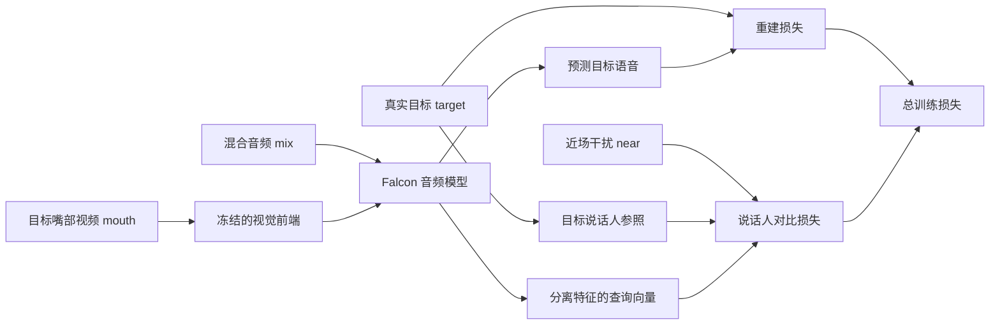
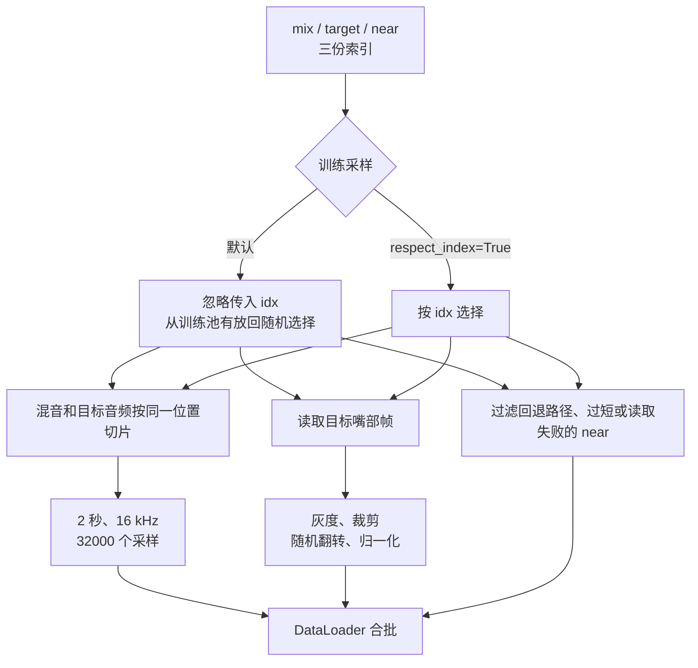
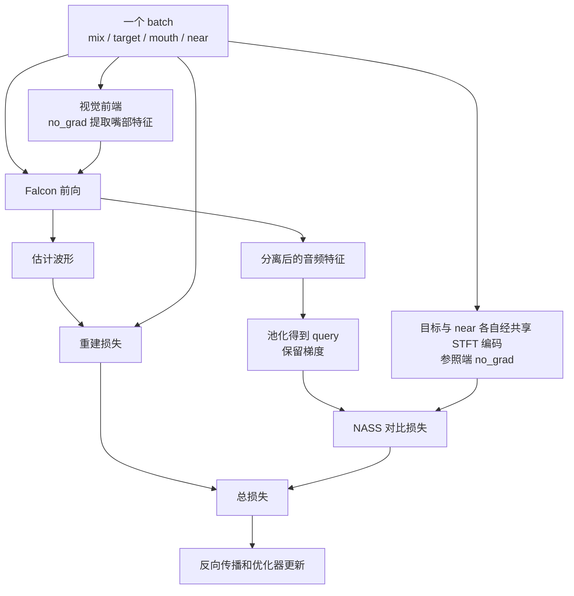

# 数据和训练：从一条混合语音到一个检查点

Falcon 的训练样本由混合音频、目标语音、目标说话人的嘴部视频，以及可选的近场干扰音频组成。模型根据混音和目标嘴部视频预测一条目标语音；训练时再用真实目标和干扰音频计算损失。五套开源数据各自的文件、本机目录和实际用于训练或测试的划分见[数据集说明](20261110-datasets.md)。本文以 [`LRS2_2Mix_Paper_v2.yml`](../../configs/LRS2_2Mix_Paper_v2.yml) 和当前训练入口为主线，介绍文件怎样对应、一个 epoch 实际抽了什么、损失怎样计算，以及历史结果能说明什么。

> 本文以 `6e5c1b5` 为源码基线，形状与数据数量对应服务器上的 LRS2 数据。训练前核对数据、设备、输出目录和配置。

## 1. 一条样本是什么

假设同一段混音里有甲和乙。目标是甲时，模型输入混音和甲的嘴部画面，期望输出甲的声音。将目标换成乙时，混音可以不变，但目标音频、嘴部画面以及 near（近场干扰）应随之交换。



训练数据目录的每个划分都有三份按行对应的索引：

| 文件 | 每一行保存什么 | 训练时的作用 |
|---|---|---|
| `mix.json` | 混音路径、采样点数 | 读取模型的音频输入 |
| `target.json` | 目标音频路径、目标嘴部 `.pt` 路径、采样点数 | 读取监督目标及视觉条件 |
| `near.json` | 零个或多个 `[干扰音频路径, 采样点数]` | 生成对比损失中的负参照 |

这些文件依靠**相同位置的行**对应；行数相同不自动证明身份相同。数据集加载器也不会替用户逐条验证目标声音和嘴部是否属于同一人。入口见 [`AVSpeechTrainDatasetWithNear`](../../look2hear/datas/avspeech_dataset_near.py)，双方向索引生成见 [`build_lrs2_paper_data.py`](../../tools/repro/phase2/build_lrs2_paper_data.py)。

以一个混音文件 `M.wav` 为例，paper 版索引会构造两条训练方向：

| 方向 | mix | target | mouth | near |
|---|---|---|---|---|
| 甲为目标 | `M.wav` | `s1/M.wav` | 甲的嘴部 | `s2/M.wav` |
| 乙为目标 | `M.wav` | `s2/M.wav` | 乙的嘴部 | `s1/M.wav` |

默认构建可以直接引用源包中的 WAV，而把嘴部转换到 Falcon 目录；`--copy-wavs` 则会复制音频。因而不同目录的索引可能指向同一个底层源文件，迁移时需要一起核对引用关系。

### 1.1 数量：混音和目标方向是两个分母

本机已构建的两套 LRS2 索引规模如下。paper 版为每个混音建立两个目标方向。

| 划分 | 源混音数 | 单目标索引条目 | paper 双方向索引条目 |
|---|---:|---:|---:|
| `tr` 训练 | 20,000 | 20,000 | 40,000 |
| `cv` 验证 | 5,000 | 5,000 | 10,000 |
| `tt` 测试 | 3,000 | 3,000 | 6,000 |

服务器上的两套数据路径为 `/root/data/falcon_lrs2_2mix` 和 `/root/data/falcon_lrs2_2mix_paper`。历史 LRS2 测试结果使用 **3,000 条单方向**；paper 索引的测试集包含 6,000 条目标方向。

### 1.2 源音频已经包含混合比例

当前源包的 `s1`、`s2` 文件已是混音分量；在 40 条 paper 训练样本的审查抽样中，`mix - target - near` 的 RMS 约为 `1.45e-5` 至 `1.54e-5`，与 PCM16 量化误差处于同一量级。这一抽样表明，所查 near 波形已经包含混合增益；外部数据集的缩放方式需按其生成过程核对。

文件名中的增益差描述混合权重；实际全段能量比还取决于源信号的能量。对 paper `tr` 中 **1,000 个按固定间距选取的不同混音**计算后，48 个样本的实测 RMS 比超出 `[0, 10] dB`，其中 26 个的 `s1` RMS 低于 `s2`。该统计采用固定间距抽样，度量的是波形 RMS 能量比；总体比例和主观响度需另行测量。抽样脚本、逐条哈希及汇总见 [2026-11-10 能量比核查](../verification/deepdive-20261110/能量比审查/summary.json)。

## 2. 数据是怎样送进模型的



### 2.1 随机采样与一个 epoch

默认 `respect_index=False`。`__getitem__(idx)` 从训练索引随机取一条，`shuffle=True` 控制的列表顺序不会决定实际抽样顺序。`train_samples: 10000` 定义一个 epoch 的抽样次数，而不是训练池有 10,000 条数据。

paper 训练池包含 40,000 个方向条目，属于 20,000 个不同混音。如果理想化为 **独立、均匀、有放回地抽 10,000 次**，至少被抽到一次的期望比例是：

```text
方向条目：1 - (1 - 1/40000)^10000 ≈ 22.12%
不同混音：1 - (1 - 1/20000)^10000 ≈ 39.35%
```

两行使用不同分母：第二行把同一混音的两个目标方向合并计算。数值为数学期望；多卡 sampler、`drop_last`、提前中断与随机状态会改变实际次数。

`respect_index=True` 可以让数据集按索引取样，但这是改变训练顺序与 epoch 定义的选项，不应将新旧运行的 epoch 数直接当作等量训练。参数传递位置见 [`AVSpeechDataModuleWithNear`](../../look2hear/datas/avspeech_dataset_near.py)。

### 2.2 音频片段和嘴部画面

v2 配置使用 16 kHz、2 秒片段，也就是 32,000 个采样点。当前 paper 索引中每条音频均为 32,000 点，因而随机音频切片起点只能是 0；这不意味着视频增强也没有随机性。

训练中的嘴部管线包括灰度化、裁剪到 `88×88`、随机水平翻转和归一化；评估使用中心裁剪。对 `96×96` 输入，中心裁剪固定偏移 `(4, 4)`，随机裁剪可在不同位置取图，二者形状相同但画面通常不同。具体变换见 [`transform.py`](../../look2hear/datas/transform.py)。

嘴部起始帧当前按 `mouth_start = int(rand_start / mouth_ref_sr * mouth_fps)` 计算，默认参考采样率为 16,000、帧率为 25 fps。音频采样率不是 16 kHz 时，需要核对数据和参考时钟的真实关系；加载器读取 WAV 时并没有把输入文件自动重采样。嘴部帧不足时，默认会报错；`pad_mouth=True` 才会复制末帧补齐。

### 2.3 near 为零、一个或多个时会怎样

`near.json` 中把混音路径写作回退哨兵时，加载器会跳过这个条目；过短文件和读取异常也可能被跳过。实际加载出的 near 数由哨兵、长度和读取结果共同决定。数据加载完成后，样本实际读取到的 near 数记为 `K`：

- `K=0`：没有负参照，NASS 的负项为零；正项仍然存在。
- `K=1`：单个负参照直接计算惩罚，不经过 β 加权。
- `K≥2`：用 `softmax(β × 相似度)` 给多个负参照分配权重。

本机 paper 索引中每条记录标记一个 near；当对应文件正常读取时，`K=1`。配置中的 β 虽从 0 向 1 变化，当前单负样本分支却不使用它。对损失和梯度的固定输入对照已观察到：`K=1` 时 β 取 0、1 或 100，结果相同；`K=2` 时结果随 β 变化。实现见 [`NASSContrastiveLoss`](../../look2hear/losses/nass_contrastive_loss.py)。

## 3. 一次训练前向和损失

[`audio_train.py`](../../audio_train.py) 读取配置、创建数据模块、音频模型、视觉模型、优化器和 Lightning 系统。当前入口直接构造 `AVSpeechDataModuleWithNear` 与 `AudioVisualLightningModuleNASSv2`；配置里的 `datamodule.data_name` 和 `training.system` 不是这个入口的动态分派开关。修改这两个名字本身不会切换实现。



在 [`AudioVisualLightningModuleNASSv2.training_step`](../../look2hear/system/av_litmodule_nass_v2.py) 中，视觉前端推理和正、负参照特征的构造在 `no_grad` 下运行；query 分支保留梯度。实际损失可以写成：

```text
总损失 = 重建损失 + loss_weight × 对比损失
对比损失 = alpha_pos × (1 - cos(query, positive))
         + alpha_neg × 加权的负样本惩罚
```

`margin` 控制负样本相似度超过多少才产生惩罚。v2 配置的 `loss_weight=1.0`、`margin=0.5`、`alpha_pos=alpha_neg=1.0`。β 是多个负样本之间的权重参数，总损失权重由 `loss_weight` 设置。历史短训练日志中，某个 margin 长期处于激活状态；后续训练的行为需结合实际日志观察。

重建损失也要看实际配置。v2 使用 `pairwise_neg_sisdr`；旧 LRS2 配方使用 `pairwise_neg_snr`。当前只有一个目标源，PIT 包装器没有多源排列可选择；这不意味着不同重建损失彼此等价。模型自身的 `VideoBlock` 默认存在批次维度解释问题，批量中后面的样本可能受前面样本的视频影响，训练结果应结合这一实现边界理解。

## 4. 配置文件之间有什么不同

表中列出源码配置值。`accum` 为梯度累积步数；全局批量还取决于实际进程数、分片和丢弃策略。

| 配置 | 每卡 batch | accum | 最大 epoch | 训练损失 | β 退火 epoch | 用途和限制 |
|---|---:|---:|---:|---|---:|---|
| [`LRS2_2Mix.yml`](../../configs/LRS2_2Mix.yml) | 4 | 默认 1 | 100 | −SNR | 200 | 历史 LRS2 配方 |
| [`LRS2_2Mix_Paper_2gpu.yml`](../../configs/LRS2_2Mix_Paper_2gpu.yml) | 4 | 5 | 1000 | −SNR | 200 | 两卡降级配置；理论全局 batch 40 |
| [`LRS2_2Mix_Paper_2gpu_smoke.yml`](../../configs/LRS2_2Mix_Paper_2gpu_smoke.yml) | 4 | 5 | 3 | −SNR | 200 | 缩短周期的流程检查，不是收敛实验 |
| [`LRS2_2Mix_Paper_8gpu.yml`](../../configs/LRS2_2Mix_Paper_8gpu.yml) | 5 | 1 | 1000 | −SNR | 200 | 旧版 8 卡配方，理论全局 batch 40 |
| [`LRS2_2Mix_Paper_v2.yml`](../../configs/LRS2_2Mix_Paper_v2.yml) | 4 | 1 | 1000 | −SI-SDR | 1000 | 论文表格参数的本地配置；8 卡时理论全局 batch 32 |

`Falcon.yml` 是通用配置，列有十张设备并使用旧损失；在双卡服务器使用时需调整设备和训练配置。实际 DDP 分片、每轮样本数与训练时长取决于运行设置。

v2 还设置 AdamW 学习率 `1e-3`、weight decay `0.01`，以及验证损失触发的 `ReduceLROnPlateau`。`Trainer` 的 `gradient_clip_val=5.0` 在训练入口设置，而不在 Lightning 模块内部；只搜索模块文件会漏掉它。早停和 checkpoint 监听验证损失；训练代码将 `val` 与 `test` 都挂在验证阶段，其中测试损失只在每十个 epoch 计算；最终评测可使用独立测试协议。

### 4.1 检查点、参数和恢复

训练目录由**运行时工作目录**和 `exp.exp_name` 共同决定：

```text
<运行时目录>/Experiments/checkpoint/<exp_name>/
├── conf.yml                 训练开始前保存的配置快照
├── epoch=*.ckpt / last.ckpt  Lightning 检查点
├── best_k_models.json       最优 checkpoint 的路径与分数
└── best_model.pth           完成后导出的音频模型
```

Lightning checkpoint 与仅含音频模型的导出文件用途不同。续训使用 `--ckpt_path` 时，入口会先检查路径是否存在；评测时还要确认该文件是否包含所需的视频状态。`best_k_models.json` 记录 checkpoint 路径；本轮在已查位置未找到 ep86、ep99、ep124 对应文件。

当前服务器对完整 8 卡 DDP 的行为仍待验证。源码中，集合通信取决于各 rank 的局部桶是否为空；训练结束后的导出路径也缺少显式 rank-zero 守卫。这两处需要通过多卡运行检查同步和输出行为。

## 5. 数据构建与检查：先确认正在处理哪份输出

本项目同时保留旧单目标转换和 paper 双方向构建。它们解决的问题不同：

| 工具 | 目的 | 使用边界 |
|---|---|---|
| [`lrs2_2mix_to_falcon.py`](../../tools/repro/lrs2_2mix_to_falcon.py) | 将源包转换为单目标 Falcon 目录 | 复用输出目录时按已有文件大小跳过；从 `s1` 切到 `s2` 有旧音频与新嘴部索引错配的条件性风险 |
| [`build_lrs2_paper_data.py`](../../tools/repro/phase2/build_lrs2_paper_data.py) | 每个混音构造两个目标方向及对侧 near | 路径检查覆盖索引关系；逐条波形与人脸身份需另行核对。复制模式会复用已有文件 |
| [`realssa_to_falcon.py`](../../tools/repro/realssa_to_falcon.py) | 将 RealSSA 转成可读取的音频、嘴部与索引 | `--overwrite` 会递归删除指定输出目录；中断可能留下部分文件 |
| [`process_lrs23.py`](../../DataPreProcess/process_lrs23.py) | 从目录生成通用索引 | 独立排序 mix 和 target，文件集合不一致时可能按行错配 |

对首个工具，同一输出目录先生成 `s1`、之后改用 `s2` 且保留已有目标文件，在满足相应嘴部文件存在的条件下，隔离测试复现了目标音频未变、嘴部索引改变。现有单目标 LRS2 索引的 28,000 个嘴部 ID 已按名称核对，600 条目标音频抽样与源 `s1` 相符；paper 版 56,000 行路径关系也已核对。现有数据是否发生错配尚未证实；其余样本的人物身份与波形可逐条核验。

单方向目录的 `conversion_stats.json` 写着 `near_mode: fallback`。2026-11-10 读取该目录三个划分的 `near.json`，第一条都指向源包里的 `s2`，采样点数为 32,000。统计文件和当前索引不一致时，以索引路径为准。样本内容、硬链接和 RealSSA 目录见[数据集说明](20261110-datasets.md)。

旧版 `conversion_stats.json` 将文件数除以采样率，未按每条音频的采样长度加权。例如，20,000 条各 2 秒的训练音频共 40,000 秒，旧统计文件记录约 1.2 秒。音频和索引中的采样长度保持原值；转换日志、数据本体与现用索引可分别核对。

下面的命令只读显示索引条数和第一条内容，不改写数据：

```bash
REPO=/root/code/github_repos/Falcon-fork
PY=/root/miniforge3/envs/falcon/bin/python
DATA=/root/data/falcon_lrs2_2mix_paper
cd "$REPO"
DATA_ROOT="$DATA" "$PY" - <<'PY'
import json, os
from pathlib import Path
root = Path(os.environ['DATA_ROOT'])
for split in ('tr', 'cv', 'tt'):
    for name in ('mix.json', 'target.json', 'near.json'):
        path = root / split / name
        with path.open(encoding='utf-8') as f:
            rows = json.load(f)
        print(split, name, '条数:', len(rows), '首条:', rows[0] if rows else None)
PY
```

全量核查还包括文件存在性、采样率、ID 唯一性和音画身份。部分历史脚本会写入固定目录、覆盖日志或删除已迁移源文件；复跑时可先阅读脚本并设置独立输出目录。

## 6. 历史指标能回答什么

| 记录 | SI-SNRi / SDRi | 样本与限定 | 结论 |
|---|---:|---|---|
| LRS2，公开 `falcon.pt` | 7.029 / 7.713 dB | 3,000 条单方向 `tt` | 该权重在本地测试集上的记录；其完整训练谱系未由 checkpoint 自身证明 |
| LRS2，本机 `ep124` | 8.858 / 9.270 dB | 3,000 条单方向 `tt`，旧训练配方 | 历史自训记录，不等同新版 8 卡配方 |
| 论文 LRS2 表格 | 14.1 / 14.7 dB | 论文协议 | 当前未完成同条件复现 |
| RealSSA-Sim，四通道均值 | 7.774 / 8.479 dB | SI-SNRi 9,169 条，SDRi 9,166 条 | 数值接近论文表格，但权重与通道协议尚未同条件确认 |

比较时同时使用数字、数据范围和评价含义。LRS2 历史 `ep99` 到 `ep124` 不只改变了 near 条件，还多训练了 25 个 epoch；因此这组结果同时包含训练步数与 near 条件的变化。历史 CSV 在本轮做过均值和有效数复算；四份关键全量 CSV 的 ID 也与**当前**索引集合一致。逐条模型输出可用确定的权重与协议重新推理核对。

## 7. 开始新实验前需要记录什么

一次可比较的实验，至少应保存：

1. **代码与环境**：提交号、工作区差异、Python/torch 版本、设备和实际进程数。
2. **数据身份**：索引文件哈希、划分、目标方向、near 的实际 K 分布、音频采样率、视频帧率及缺帧处理。
3. **训练设置**：损失、实际有效 batch、累积步数、随机种子、β 和 margin，以及是否启用改变模型行为的开关。
4. **输出与恢复**：独立实验目录、配置快照、完整 checkpoint、训练曲线、继续训练所用的 checkpoint。
5. **评测协议**：整段或分窗、视觉处理、batch 组成与顺序、每项指标的有效样本数。

只改变一个变量时，也要控制训练步数和样本。例如要判断 near 的作用，应比较相同起点、训练预算和评测集下的 `K=0` 与目标 `K≥1` 对照，而不是仅比较不同时长的两个 checkpoint。代码已经支持的开关会改变输出语义；是否改善质量需要新实验回答。

## 8. 代码与证据入口

- 数据采样和 near 过滤：[`look2hear/datas/avspeech_dataset_near.py`](../../look2hear/datas/avspeech_dataset_near.py)。
- 视频裁剪和归一化：[`look2hear/datas/transform.py`](../../look2hear/datas/transform.py)。
- 训练入口、优化器和保存：[`audio_train.py`](../../audio_train.py)。
- NASS 查询、参照与日志：[`av_litmodule_nass_v2.py`](../../look2hear/system/av_litmodule_nass_v2.py)；损失分支：[`nass_contrastive_loss.py`](../../look2hear/losses/nass_contrastive_loss.py)。
- 旧版训练与指标记录：[`P2D-report.md`](../verification/phase2/P2D-report.md)、[`P2D-eval-epoch124-contrastive.csv`](../verification/phase2/P2D-eval-epoch124-contrastive.csv)、[`P2D-eval-falcon-full.csv`](../verification/phase2/P2D-eval-falcon-full.csv)。这些是历史记录，关于 near 收益的因果推断应结合上述限制阅读。
- 数据存放、访问和历史迁移说明：[`DATA_ACCESS_GUIDE.md`](../DATA_ACCESS_GUIDE.md)。25 fps 的每帧视频对应 640 个 16 kHz 音频采样，音频 STFT hop 为 128。
