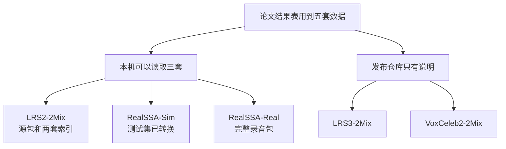
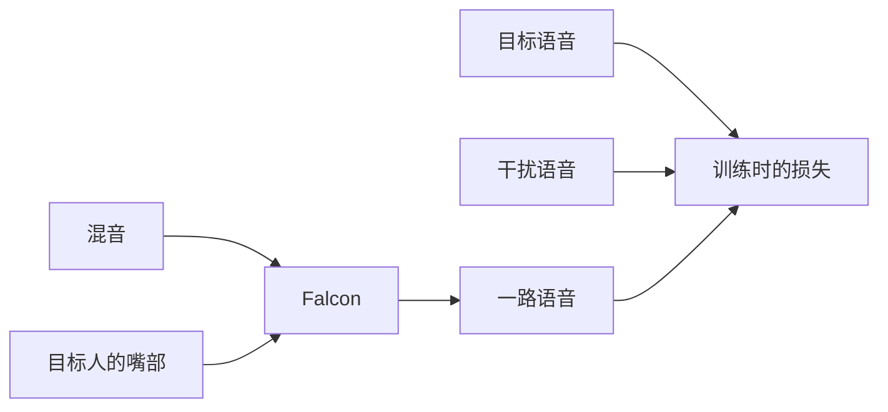
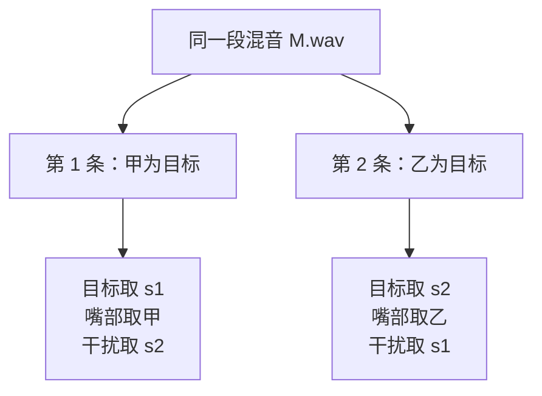
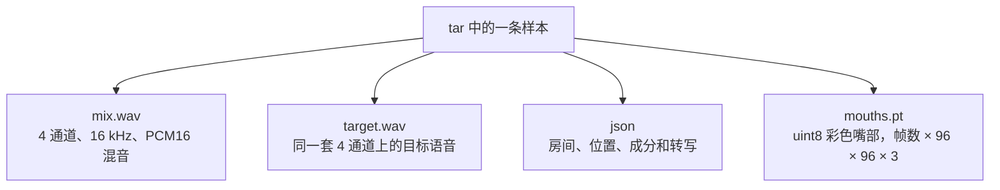
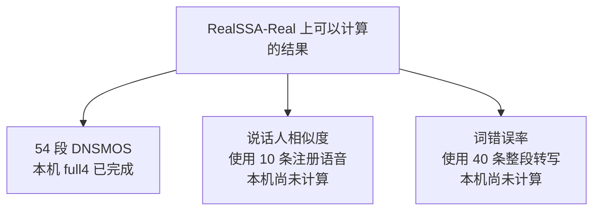
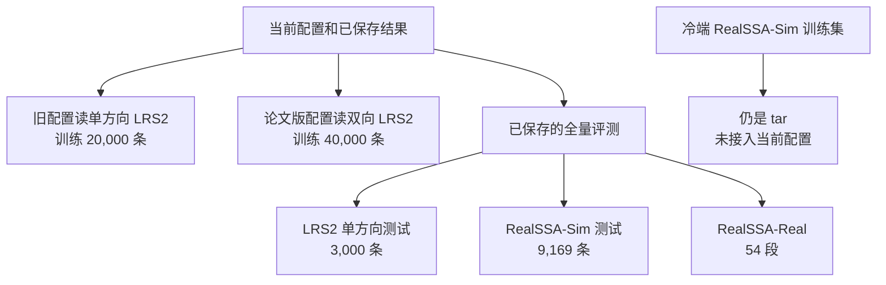

# 项目里的数据

Falcon 从一段混合语音里抽出一个指定说话人。每条可训练或可评测的样本因此包含混音、目标语音、这个人的嘴部画面，训练时还可以带上另一路干扰语音。论文结果表用到五套开源数据。2026-11-10 这台机器上能够直接读取的是其中三套：公开的 LRS2-2Mix，以及需要审批的 RealSSA-Sim、RealSSA-Real。LRS3-2Mix 和 VoxCeleb2-2Mix 的发布仓库里只有说明。

本文说明每套数据是什么、一条样本里有哪些文件、本机和冷存储各放了哪一层。采样、损失和检查点见[数据准备与训练](20261110-data-and-training.md)；指标、切窗和演示见[评测、Studio 与 Space](20261110-evaluation-and-apps.md)；下载命令和历史获批记录见[数据访问说明](../DATA_ACCESS_GUIDE.md)。

## 1. 先看五套数据分别做什么

| 数据 | 发布位置 | 论文里的用途 | 2026-11-10 本机状态 |
| --- | --- | --- | --- |
| LRS2-2Mix | [JusperLee/LRS2-2Mix](https://huggingface.co/datasets/JusperLee/LRS2-2Mix)，公开 | 双人混合评测。论文 Falcon 为 14.1 / 14.7 dB | 源包已解压，并做成单方向、双向两套索引 |
| RealSSA-Sim | [JusperLee/RealSSA-Sim](https://huggingface.co/datasets/JusperLee/RealSSA-Sim)，人工审批 | 主仿真训练和测试。论文 Falcon 为 7.7 / 8.2 dB | 冷端有全部 tar；本机只转换了测试集 |
| RealSSA-Real | [JusperLee/RealSSA-Real](https://huggingface.co/datasets/JusperLee/RealSSA-Real)，人工审批 | 真实场景评测。论文 DNSMOS 为 3.276 | 本机和冷端都有完整包 |
| LRS3-2Mix | [JusperLee/LRS3-2Mix](https://huggingface.co/datasets/JusperLee/LRS3-2Mix)，公开 | 论文 Falcon 为 16.4 / 16.7 dB | 仓库只有 622 字节说明 |
| VoxCeleb2-2Mix | [JusperLee/VoxCeleb2-2Mix](https://huggingface.co/datasets/JusperLee/VoxCeleb2-2Mix)，公开 | 论文 Falcon 为 10.5 / 11.8 dB | 仓库只有 756 字节说明 |

SI-SNRi 和 SDRi 的单位是 dB。它们表示抽出的语音比混合语音更接近目标多少，每条先和干净目标比较，再减去这条混合语音自己的分数。上表的论文数字和后文的本机数字使用的权重、通道和训练过程不同，放在一起是为了看清各自的条件。



名称里的 `2Mix` 表示这段音频由两个说话人混成。当前模型配置是 `n_src: 1`，输出仍然是一路语音。把目标从甲换成乙时，混音可以不变，目标语音、嘴部画面和干扰语音要一起换。



推理只需要混音和嘴部。目标语音用来计算有参考指标和重建损失；干扰语音只在训练的说话人对比损失里使用。Studio 和 Space 接收当时采集的麦克风与摄像头画面，仓库里没有附带固定的示例音视频。

## 2. LRS2-2Mix：固定 2 秒的双人混合

这套数据来自牛津 BBC LRS2。数据卡写的是沿用前人工作：随机选取两个不同说话人，按 −5 到 5 dB 混合，训练、验证、测试大约 11、3、1.5 小时。Hugging Face 标签是 `apache-2.0`。内容仍受 BBC LRS2 研究条款约束，这个标签不能代替源数据许可。数据卡副本在 [LRS2-2Mix-README.md](../verification/phase1/dataset-cards/LRS2-2Mix-README.md)。

压缩包 `lrs2.tar.gz` 为 16,470,508,590 字节，sha256 是 `ebdfdf31335f288cc2e4b1690a0cc2f260e1826a68a020723ad4ce59a033767e`。2026-11-10 本机保留的是解压目录 `/root/data/lrs2_2mix/lrs2_rebuild`，`du -sh` 约 17G；压缩包本身已经不在这个目录。

### 2.1 源包里有什么

| 内容 | 训练 | 验证 | 测试 | 一条文件 |
| --- | ---: | ---: | ---: | --- |
| `mix`、`s1`、`s2` | 20,000 | 5,000 | 3,000 | 16 kHz、单声道、PCM16、正好 2.000 秒 |
| 同一套 8 kHz 副本 | 同样条数 | 同样条数 | 同样条数 | 当前训练配置不读它 |
| 混音前的 `raw_audio` | 19,649 | 476 | 267 | 合计 20,392 条，同样是 2 秒 |
| 嘴部、人脸、68 点 | 与 20,392 个原片段一一对应 | | | 嘴部是灰度 uint8，50 帧，96×96 |

按条数乘 2 秒，三段是 40,000、10,000、6,000 秒，也就是 11.11、2.78、1.67 小时。数据卡上的 11、3、1.5 小时是沿用旧划分的说法。本机文件的时长以每条 2.000 秒为准。转换记录里出现过约 1.2 秒的训练时长，那是把文件个数除以采样率，没有按每条 2 秒累加。

```text
/root/data/lrs2_2mix/lrs2_rebuild/
├── raw_audio/{train,val,test}/          混音前的原片段
├── audio/wav16k/min/{tr,cv,tt}/{mix,s1,s2}/
├── audio/wav8k/min/{tr,cv,tt}/{mix,s1,s2}/
├── mouths/<片段编号>.npz                 灰度嘴部
├── faces/<片段编号>.mp4                  224×224，25 帧/秒，50 帧
├── landmark/<片段编号>.npz               逐帧 68 个点
└── create_mix/                           混音清单和当时的脚本
```

`audio/` 下还有 `wav16k` 约 5.2G、`wav8k` 约 2.6G。嘴部 npz 约 5.6G，人脸约 1.9G，特征点约 322M，原片段约 1.3G。模型训练读的是嘴部裁剪。人脸视频和 68 点留在源包里，当前配置不读。

`s1` 和 `s2` 已经乘过混合增益。2026-10-21 的结构抽查里，`mix − s1 − s2` 的最大误差约 `3.05e-5`，和 16 bit 量化误差同一量级。恢复现有混音时，把这两路相加即可。原片段目录是混音之前的素材。训练索引用的是 `audio/wav16k/min/` 里已经切好的三路。`audio_process/mix_2_spk_tr.txt` 有 50,000 行旧绝对路径，和现在这 20,000 对对不上。

训练混合用到 18,691 个训练原片段。19,649 减 18,691，还有 958 个训练原片段没有进入混合清单。验证和测试把 476、267 个原片段都用完。三个划分使用的原片段没有交叉，依据是 [数据访问说明](../DATA_ACCESS_GUIDE.md) 里 2026-10-21 的结构核对。

### 2.2 文件名里的数字和实际响度

一条混合的文件名直接写出两个人和增益标签：

`5535415699068794046_00004_2.4022_6160231649911868423_00015_-2.4022.wav`

| 片段 | 含义 |
| --- | --- |
| `5535415699068794046_00004` | 说话人甲的原片段编号，也是甲的嘴部文件名 |
| `2.4022` | 甲相对乙的增益标签，单位 dB |
| `6160231649911868423_00015` | 说话人乙的原片段编号 |
| `-2.4022` | 乙的标签，与甲相反 |

甲的标签落在 (0, 5]，两边合起来覆盖数据卡所说的大约 −5 到 5 dB。这个数字是制作混音时写下的增益差。2026-11-10 对训练混音按固定间隔抽了 1,000 条，用整段波形的均方根再算能量比，有 48 条不在 0–10 dB，其中 26 条甲比乙更轻。原声本身的响度会改变最终能量比。逐条路径和哈希在 [能量比审查](../verification/deepdive-20261110/能量比审查/summary.json)。

### 2.3 本机的两套索引

模型不直接读源包。它读三个按行号对齐的 JSON：`mix.json` 保存混音路径和采样点数，`target.json` 保存目标语音、目标嘴部和采样点数，`near.json` 保存干扰语音。加载器不会再检查这张嘴是不是这段目标语音的人。



2026-11-10 读到的双向训练索引就是这样成对排列的。第 0 条和第 1 条使用同一个混音文件，第 0 条目标在 `s1/`、干扰在 `s2/`，第 1 条对调。

| | 单方向 `/root/data/falcon_lrs2_2mix` | 双向 `/root/data/falcon_lrs2_2mix_paper` |
| --- | --- | --- |
| 单独 `du -sh` | 约 24G | 约 26G |
| 训练 / 验证 / 测试条目 | 20,000 / 5,000 / 3,000 | 40,000 / 10,000 / 6,000 |
| 一条混音 | 只把 `s1` 当目标 | 甲、乙各做一次目标 |
| 音频放在哪 | 复制到本目录的 `mix/`、`target/` | 索引直接指向源包，没有复制 wav |
| 嘴部 `.pt` | 训练 14,773，验证 476，测试 267 | 训练 18,691，验证 476，测试 267 |
| 干扰语音 | 当前索引指向源包的 `s2` | 对侧分量 |

两边都能对上的嘴部文件是硬链接。抽查的训练嘴部 `5535415699068794046_00004.pt` 在两个目录中 inode 相同、链接数为 2、大小 1,384,252 字节。同日按文件名对照，训练里两边都有的 14,773 个、验证 476 个、测试 267 个都是同一个 inode。双向训练集另外 3,918 个嘴部只在双向目录里，因为单方向转换只保存作为 `s1` 出现过的人。改其中一个硬链接文件的内容，另一个目录同时改变。两个目录放进同一次 `du` 时，双向目录新增的体积约 5.1G。

单方向 `conversion_stats.json` 写着 `target: s1`、`near_mode: fallback`，生成时间是 2026-10-21。2026-11-10 的 `near.json` 第一条已经指向：

`/root/data/lrs2_2mix/lrs2_rebuild/audio/wav16k/min/tr/s2/5535415699068794046_00004_2.4022_6160231649911868423_00015_-2.4022.wav`

采样点数是 32,000。以当前索引为准，这条干扰是另一个说话人。文件能正常读取时，负样本数 K=1。统计文件里的 `fallback` 和现索引不一致，使用前要看 JSON 里的路径。

`configs/LRS2_2Mix.yml` 指向单方向目录。`configs/LRS2_2Mix_Paper_v2.yml` 指向双向目录。历史全量测试用的是单方向测试集的 3,000 条。双向测试集的 6,000 条还没有做过同样的全量评测。

## 3. RealSSA-Sim：论文的主仿真集

这是人工审批数据，许可是 CC BY-NC-ND 4.0，目标语音和嘴部来自 TED/LRS3，只允许非商业学术研究。嘴部裁剪和分离结果都不能再分发。各噪声源还有自己的条款。数据卡副本在 [RealSSA-Sim-README.md](../verification/phase1/dataset-cards/RealSSA-Sim-README.md)。

全量 521,532,645,652 字节，242 个文件，其中 240 个 tar。冷端清单写着仓库 `JusperLee/RealSSA-Sim`，更新时间 2026-10-23。`du -sh` 显示 486G，是这批字节的二进制显示。

| 划分 | 条数 | tar 数 | 清单体积 | 数据卡时长 |
| --- | ---: | ---: | ---: | ---: |
| 训练 `tr` | 100,826 | 202 | 441.42 GB | 129.2 小时 |
| 验证 `cv` | 9,133 | 19 | 39.97 GB | 11.7 小时 |
| 测试 `tt` | 9,169 | 19 | 40.14 GB | 11.7 小时 |

每个 tar 最多 500 条，最后一个会少一些。有 4 条训练样本缺少 JSON 或嘴部，没有计入 100,826：`00001_01_87828`、`00002_05_59973`、`00020_00_46434`、`50007_35934`。论文表的平均时长是 4.61 秒，平均约 13.2 个声源，近场信干比约 8.5 dB，远场约 27.5 dB。

### 3.1 一条样本的四个成员



目标语音和嘴部来自 LRS3，数据卡写明占 100% 的样本。干扰语音来自 LibriSpeech `train-clean-360`，也是 100%。噪声按数据卡列出的出现比例包括：

| 噪声来源 | 含有它的混合比例 |
| --- | ---: |
| WHAM! | 77.8% |
| BBC Sound Effects | 64.5% |
| AudioSet | 28.4% |
| VGGSound | 20.5% |
| Clotho v2 | 9.2% |
| FreeSound | 6.3% |
| 其余来源 | 各约 0.1%–1.8% |

一条样本里的成分类型有 `near`、`far`、`env`、`sudden`。场景是四类静态房间。论文给出的混响时间是：小型会议 0.3–0.6 秒、中型室内 0.5–0.9 秒、大型公共空间 1.0–2.0 秒、户外 0.05–0.1 秒。JSON 里的文件路径只记录生成时用过哪个素材，本机没有这些原始干扰波形。

本机转换后的第一条测试样本 `00001_00_10182` 属于 `large_public`。房间混响时间约 1.35 秒，成分是 2 个近场、13 个远场、2 个环境声和 1 个突发声。对齐后有 92,800 个采样、145 帧，也就是 5.8 秒。这是这一条的长度，整体平均仍是论文所记的 4.61 秒。它的转写字段是空的。

### 3.2 本机只转换了测试集

| 位置 | 2026-11-10 内容 |
| --- | --- |
| `/aispeech-cfs/voiceprint/data/multimodal/realssa_sim` | 训练、验证、测试全部 tar。`du -sh` 约 486G |
| `/root/data/RealSSA-Sim` | 只有测试集 19 个 tar，`du -sh` 约 38G |
| `/root/data/falcon_realssa_sim` | 测试集 9,169 条，四通道取平均后的单声道，约 30G |
| `/root/data/falcon_realssa_sim_ch0` | 同样 9,169 条，取第 0 通道，单独统计约 30G |

两个转换目录的嘴部 `.pt` 全部硬链接。抽查 `00001_00_10182.pt` 的 inode 相同，大小 4,010,586 字节。波形文件各存一份。放进同一次 `du` 时，`ch0` 目录新增约 2.7G。小写的 `/root/data/realssa_sim` 不存在。下载脚本示例里的小写目录名和磁盘上的 `RealSSA-Sim` 不是同一个路径。

通道策略写在每条 `*_meta.json` 的 `provenance.channel_policy`。平均目录是 `mean`，另一套是 `0`。论文实验写的是阵列第一通道，并曾把发布波形描述成单通道。数据卡写的是 4 通道。本地两套都保留着，比较时要带上这一项。

两套 `near.json` 都指回各自的混音。加载器会跳过这种自引用，实际负样本数 K=0。发布包没有近场说话人的单独波形。这套转换结果可以做有参考评测；若要按论文使用近场负样本，还需要别的波形来源。

训练配置目前指向 LRS2 索引。RealSSA-Sim 的 100,826 条训练样本还在冷端 tar 里，没有进入 `mix.json` 这套目录。

## 4. RealSSA-Real：真实录音

这也是人工审批数据。它没有单独的通用数据集许可证，按数据卡的研究用途和参与者授权使用。里面有可识别的人脸、嘴部、声音和转写，不能再识别参与者，也不能转发。数据卡副本在 [RealSSA-Real-README.md](../verification/phase1/dataset-cards/RealSSA-Real-README.md)。

本机 `/root/data/RealSSA-Real` 的 `du -sh` 约 12G。2026-11-10 数到 423 个文件、12,843,107,273 字节。更早的记录是 422 个文件、12,843,582,409 字节。包内校验报告写 `inventory_files=421`。三次计数还没有逐文件对上。冷端有一份同骨架归档，`du -sh` 也约 12G；本地和冷端的 metadata、scripts 体积不完全相同，没有逐文件比对。

评测入口是 `inference` 视图：

| 对象 | 数量 | 内容 |
| --- | ---: | --- |
| 物理片段 | 54 | 双声道、16 kHz、PCM16，配合同名嘴部、人脸和特征点 |
| 逻辑录音 | 40 | 有的录音被切成多段。词错误率按整段录音拼接后再对转写 |
| 说话人 | 10 | 每人一条独立注册语音，单声道 PCM16 |
| 场景 | 8 | `small_indoor`、`mid_indoor`、`big_indoor`、`outdoor`，每组两个地点 |
| 总时长 | 83.99 分钟 | 数据卡写 83.9905 分钟 |

另外有 34 条原始抽取录音，71.12 分钟，以及 `raw/` 里约 11G 的原始视频。这 34 条不能当成 54 段 inference 的配对输入。嘴部是灰度，形状为帧数 × 96 × 96。人脸是 224×224、25 帧/秒。场景目录的一个例子是 `audio/inference/mid_indoor/internet_cafe/1.wav`。清单使用相对路径，例如 `faces/big_indoor/large_mall/1.mp4`，不能靠裸数字文件名跨场景猜测是谁。

没有与场景时间对齐的干净目标波形。10 条注册语音用来计算说话人相似度，不能拿来算 SI-SDR。数据卡允许的是 DNSMOS、词错误率和说话人相似度。本地完成的是 DNSMOS：修正窗口起点后的 full4，在 54 段上 OVRL 为 2.7941，P.808 为 3.3365。论文的 3.276 来自在 RealSSA-Sim 上训练的模型；本地用的是发布权重 `falcon.pt`。两份分数的训练来源还没有被检查点本身证明是同一个。



## 5. 两套只有说明的数据

LRS3-2Mix 的说明写：从 LRS3 的 TED 和 TEDx 句子里随机抽两个说话人，比 LRS2 更干净，训练、验证、测试约 28、3、1.5 小时。VoxCeleb2-2Mix 写：从 VoxCeleb2 开发集取 5%，三段约 56、3、1.5 小时，噪声和混响更重。

`tools/repro/fetch_data.py` 只下载 LRS2-2Mix、RealSSA-Sim 和 RealSSA-Real。对这两个空仓库做快照只会得到 README。用原始 LRS3 或 VoxCeleb2 自己重混，混合时的随机种子和说话人对是未知的，得到的是相近分布，对不上论文那一张测试表。原始 LRS2、LRS3、VoxCeleb2 也要另向牛津 VGG 申请。

## 6. 训练和测试实际用的是哪一套



一个 epoch 的 `train_samples: 10000` 是抽取次数。默认每次忽略传入下标，从整个训练池有放回地随机抽。双向池有 40,000 个方向、20,000 个不同混音。按独立、均匀、有放回抽 10,000 次估算，期望覆盖约 22.12% 的方向、39.35% 的不同混音。多卡分片和丢掉不满的一批会改变实际次数。LRS2 每条正好 2 秒，音频切片起点只能是 0；嘴部仍会随机裁成 88×88，并有 50% 概率水平翻转。评测使用中心裁剪。采样和损失的分支见[数据准备与训练](20261110-data-and-training.md)。

| 记录 | 数据 | 权重和通道 | SI-SNRi / SDRi |
| --- | --- | --- | ---: |
| 本机全量 | LRS2 单方向测试，3,000 条整句 | 发布 `falcon.pt`，目标固定为甲 | 7.029 / 7.713 |
| 本机全量 | 同上 | 旧配方自训 epoch 99 | 8.726 / 9.122 |
| 本机全量 | 同上 | 旧配方自训 epoch 124 | 8.858 / 9.270 |
| 本机全量 | RealSSA-Sim 测试，整句 | 发布 `falcon.pt`，四通道平均 | 7.774 / 8.479 |
| 本机全量 | 同上 | 发布 `falcon.pt`，第 0 通道 | 7.977 / 8.452 |
| 论文报告 | RealSSA-Sim | 论文训练权重，第一通道 | 7.7 / 8.2 |
| 论文报告 | LRS2 / LRS3 / VoxCeleb2 | 论文各自的训练协议 | 14.1/14.7、16.4/16.7、10.5/11.8 |

RealSSA-Sim 的 SI-SNRi 用 9,169 条。SDRi 和 PESQ 有 3 条计算失败，有效数是 9,166，分别是 `00003_02_41188`、`00012_02_84551`、`50016_74250`。LRS2 的验证集有 5,000 或 10,000 条，随单方向或双向索引变化，用来挑选检查点。对外分数来自事后在测试集上重跑。

论文还报告了词错误率和说话人相似度：RealSSA-Sim 上 Falcon 为 25.47% 和 43.05，RealSSA-Real 上为 32.74% 和 42.23。本地没有跑这两项。识别器是 Mega-ASR，相似度模型是 WeSpeaker ResNet34。

发布权重 `falcon.pt` 的配置快照有 LRS3 线索。检查点里没有足够的训练元数据，不能据此断定它是在某一套本地索引上训出来的。本机做过的旧训练使用单方向 LRS2 和旧损失。论文那份 8 卡、双向索引、SI-SDR 损失的完整训练没有跑完。

## 7. 目录、相邻数据和模型权重

2026-11-10 把上面几套本地目录放进同一次 `du`、硬链接只算一次时，合计约 128G。分开看时，共享嘴部会在两个目录里各算一遍。

| 路径 | 单独 `du -sh` | 现在能直接用于什么 |
| --- | --- | --- |
| `/root/data/lrs2_2mix/lrs2_rebuild` | 约 17G | LRS2 源包。双向索引的音频指向这里 |
| `/root/data/falcon_lrs2_2mix` | 约 24G | 单方向训练、验证和已有全量测试 |
| `/root/data/falcon_lrs2_2mix_paper` | 约 26G | 双向训练索引。音频仍在源包 |
| `/root/data/RealSSA-Sim` | 约 38G | 未转换的测试 tar |
| `/root/data/falcon_realssa_sim` | 约 30G | 9,169 条，四通道平均 |
| `/root/data/falcon_realssa_sim_ch0` | 约 30G | 9,169 条，第 0 通道 |
| `/root/data/RealSSA-Real` | 约 12G | 54 段真实录音评测 |
| 冷端 `.../multimodal/realssa_sim` | 约 486G | RealSSA-Sim 全量 tar |
| 冷端 `.../multimodal/realssa_real` | 约 12G | RealSSA-Real 归档 |

同一冷端父目录里还有几份没有接进 Falcon 配置的包：`AVSpeech_Vox2_LRS2_LRS3_AudioSet.tar`（1,980,009,103,360 字节）、`voxceleb2_mix`（约 525G，状态记录写的来源是 `alibabasglab/VoxCeleb2-mix`）、`darknsu_lrs3`（约 59G）和 `ellipsis_lrs3`（约 24G）。它们的来源记录和 `JusperLee/LRS3-2Mix`、`JusperLee/VoxCeleb2-2Mix` 这两个发布仓库不同。

`/root/.cache/falcon_weights/` 里的文件是模型，不是训练集：

| 文件 | 字节 |
| --- | ---: |
| `falcon.pt` | 47,156,343 |
| `falcon-big.pt` | 49,645,087 |
| `frcnn_128_512.backbone.pth.tar` | 44,830,218 |
| `frcnn_128_512.backbone.big.pth.tar` | 44,830,790 |

视觉骨干在训练时冻结，用来把嘴部画面变成特征。DNSMOS 的 ONNX 模型只给真实录音打感知分。

## 8. 使用前要分开看的几件事

- 代码和发布权重的许可，与 LRS2、RealSSA-Sim、RealSSA-Real 的数据许可是三件事。RealSSA 的嘴部、声音和分离结果按数据卡不能再分发。
- 单方向统计文件写 `fallback`，当前 `near.json` 指向 `s2`。以索引路径为准。
- RealSSA-Sim 的 `near.json` 指向混音自身，加载后 K=0。
- 比较论文表格时同时写出数据、通道、权重和整句或分窗。第 0 通道对应论文所说的 channel 1；四通道平均是另一套本地结果。
- 小写路径 `/root/data/realssa_sim`、`/root/data/realssa_real` 在 2026-11-10 不存在。现用目录是 `RealSSA-Sim` 和 `RealSSA-Real`。
