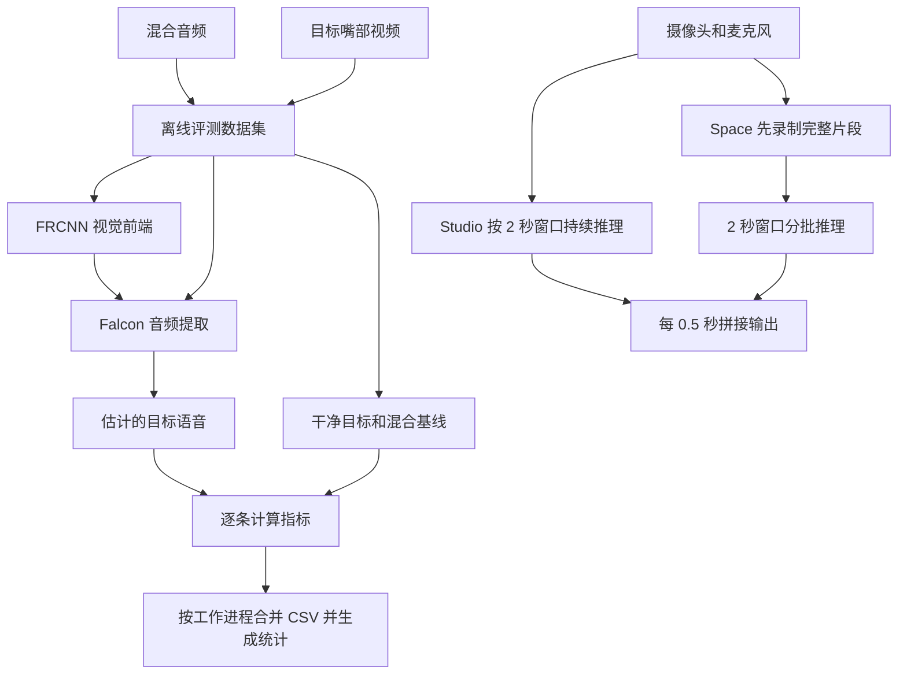
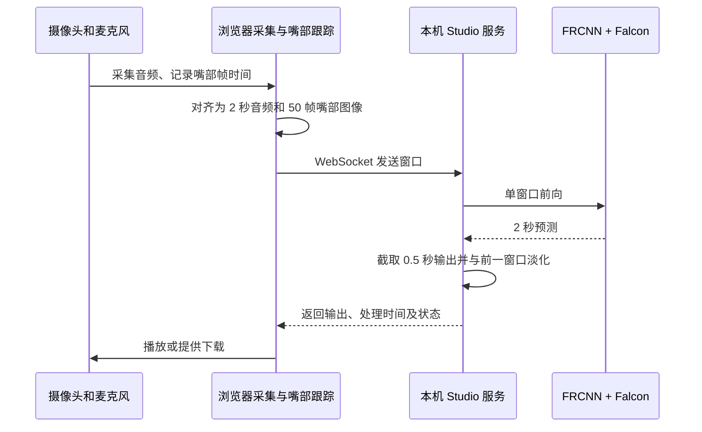

# 评测、Studio 与 Space：同一模型的三种运行方式

这份文档回答三个问题：项目如何计算论文风格的评测指标、浏览器演示如何把连续音视频送进模型，以及这些结果什么时候可以比较。它依据当前代码和 2026-11-10 的项目检查编写；历史实验的路径与数字保留原始口径。

**离线评测整句一次前向，Studio 逐窗处理，Space 先录制，再把多个窗口组成批次处理。**三种模式的输入窗口、归一化统计和批处理方式各有差异，结果应按对应模式解读。

项目结构、模型和训练流程分别见[项目入口](../../README_zh.md)、[模型与流式处理](20261110-model-and-streaming.md)和[数据与训练](20261110-data-and-training.md)。`docs/verification/` 按日期保存实验记录。

## 1. 从输入到结果



| 路径 | 音频如何进入模型 | 输出和用途 | 不应遗漏的条件 |
|---|---|---|---|
| 离线评测 | 每条样本整段一次前向，通常 batch 为 1 | SI-SNRi、SDRi、PESQ、STOI 等逐条结果和汇总 | 模型、目标说话人、通道、样本集合和音频长度 |
| RealSSA-Real 评测 | 长录音切成 2 秒窗口，步长 0.5 秒 | 拼接后的 DNSMOS 无参考评分 | 视觉首窗补零、无输出交叉淡化，和 Studio 有边界差异 |
| Studio | 浏览器持续采集，服务端每次推理一个窗口 | 边录边听或保存输出 | 0.5 秒出块、80 ms 窗尾余量、20 ms 输出淡化；窗口可能跳过 |
| Space | 先录音，再对同一片段构造多个窗口，默认每批最多 32 窗 | 一次请求返回一段输出音频 | 批次组成会影响默认模型输出；没有在线逐块返回 |
| 文件推理 | 已有 WAV 和嘴部文件整段一次前向 | 输出单个 WAV | 输入格式和时长匹配；长音频内存需求上升 |

这些产品与评测入口分别位于 [`audio_visual_test.py`](../../audio_visual_test.py)、[`tools/repro/phase2/eval_realssa_real.py`](../../tools/repro/phase2/eval_realssa_real.py)、[`studio/server.py`](../../studio/server.py)、[`space/clip.py`](../../space/clip.py) 和 [`studio/infer_file.py`](../../studio/infer_file.py)。最后一行的“文件推理”提供离线模型调用；论文基准还包括数据集和指标计算流程。

## 2. 离线评测实际执行什么

### 2.1 样本和权重

[`audio_visual_test.py`](../../audio_visual_test.py) 根据配置创建音频网络、视觉网络和测试数据集。`--data_dir` 可以指向包含 `mix.json`、`target.json` 的目录，也可以指向其父目录，程序会寻找 `tt/`。每个样本依次完成以下步骤：

1. 读取混合波形、目标波形和目标说话人的嘴部帧。
2. 视觉网络从嘴部帧生成特征；音频模型接收该特征和完整混合波形。
3. 输出与同一条样本的目标和混合基线一起计算指标。
4. 各进程先写各自的 CSV，主进程合并并写统计文件。

视觉状态优先取 checkpoint 中的 `video_model.*`；如权重没有视觉分支，且配置中的预训练视觉骨干实际存在，才回退加载该骨干。音频和视觉状态按相应代码路径严格加载。音频网络导出文件和包含音视频状态的训练 checkpoint 格式不同。缺少视觉状态时，可检查 checkpoint 内容与视觉骨干配置。

读取 checkpoint 时，评测代码先尝试 `torch.load(weights_only=True)`，出错后会回退到 `weights_only=False`。后者涉及 Python 对象反序列化；使用来源可信且可识别的 checkpoint，才能知道实际加载的是什么。

数据读取代码使用配置中的采样率，但 `sf.read` 返回的文件采样率没有在该路径中自动用于重采样。更换数据时应核对文件头和目标的实际采样率、声道和时间对应关系；配置写着 16 kHz 不会自动将任意文件变成 16 kHz。

### 2.2 指标是什么

| 名称 | 计算思路 | 读数方式 |
|---|---|---|
| SI-SNR / SI-SDR | 将估计与目标比较，同时消除整体比例变化的影响 | 越大通常表示相对目标的失真越小；值可以为负 |
| SI-SNRi | 每条估计的 SI-SNR 减该条混合音频对同一目标的 SI-SNR | 正数表示相对混合基线有改善；不是输出本身的绝对分数 |
| SDR / SDRi | 使用 `fast_bss_eval`，本项目的 SDR 滤波器长度为 512；改善量同样逐条减混合基线 | 与 SI-SNRi 是不同定义，不能互换 |
| PESQ / STOI | 单目标语音质量及可懂度指标 | 需要相应后端；错误会记为 NaN，汇总时要看有效数 |
| DNSMOS P.835 / P.808 | 不需要干净参考的语音感知质量预测 | 是模型预测分数，不是人工听测；模型版本和切窗方式会影响结果 |

实现与指标参数见 [`look2hear/metrics/core.py`](../../look2hear/metrics/core.py) 和 [`look2hear/metrics/allwrapper.py`](../../look2hear/metrics/allwrapper.py)。每个指标的平均数使用该列有效样本；PESQ 或 SDR 计算失败时，该列有效数会少于测试集条数。

### 2.3 结果文件与覆盖范围

每个工作进程先生成 `metrics_rank<rank>.csv`。合并后，结果目录包含：

- `metrics_combined.csv`：逐样本行以及 `avg`、`std`；平均和标准差按各列独立汇总。
- `metrics_counts.json`：每列有效数、NaN 数、覆盖报告和基线恒等式检查。
- 合并成功后，代码会删除分片 CSV 和临时覆盖计划文件。

结果目录由**运行时的当前工作目录**及配置中的实验名决定。再次运行相同实验名会复用该位置，因此评测不同 checkpoint 或不同参数时，应让每次运行使用独立工作目录，并保存命令、模型指纹和数据索引。

`--limit N` 在多卡分片前先限制总样本数。例如总共取 5 条、两卡时会分为 3 条和 2 条，而不是每卡 5 条。只要截断了原数据集，`metrics_counts.json` 会标明 `is_subset=true`、`verified=false`；这些均值只描述选出的子集。

`verified` 检查计划行数、每个 rank 的行数和合并行数；样本 ID 的唯一性与计划集合关系需要另行检查。2026-11-10 的隔离实验构造计划 A/B/C/D、实际 A/B/A/D，行数正确但 A 重复、C 缺失，结果仍显示 `verified=true`；这揭示了行数检查无法识别的重复和遗漏。对四份关键全量结果，本轮又将 CSV ID 与**当前**测试索引比较，LRS2 两份各 3,000 条、RealSSA-Sim 两份各 9,169 条，未发现重复、缺失或多出。相关合成检查及记录见 [`falcon_eval_coverage_inf_probe_20261110.txt`](../verification/deepdive-20261110/falcon_eval_coverage_inf_probe_20261110.txt) 和 [`评测ID集合核查.log`](../verification/deepdive-20261110/评测ID集合核查.log)。历史运行时索引是否与当前逐字节相同，还需要对应时点的索引证据。

还有一个统计边界：分片指标跟踪器用 `isfinite` 统计有效数，但均值使用 `nanmean`；合并器用 `notna` 计数。如果将来出现 `+Inf` 或 `-Inf`，计数和均值使用的集合可能不一致。此前检查的相关历史 CSV 未发现 Inf。

### 2.4 用一个子集检查评测链

下面的示例在 CPU 上评测 5 条 LRS2 数据，将结果写入新建的临时工作目录。

```bash
REPO=/root/code/github_repos/Falcon-fork
PY=/root/miniforge3/envs/falcon/bin/python
RUN_DIR=$(mktemp -d "${TMPDIR:-/tmp}/falcon-eval.XXXXXX")
cd "$RUN_DIR"

PYTHONPATH="$REPO" OMP_NUM_THREADS=4 "$PY" "$REPO/audio_visual_test.py" \
  --conf_dir "$REPO/configs/LRS2_2Mix.yml" \
  --ckpt_path /root/.cache/falcon_weights/falcon.pt \
  --data_dir /root/data/falcon_lrs2_2mix \
  --gpus cpu --limit 5

printf '结果工作目录：%s\n' "$RUN_DIR"
```

数据或权重不在以上位置时，先检查文件实际位置。`--allow-partial` 只把计划行数检查降为警告，不能把子集结果变成全量；调试后查看 `metrics_counts.json` 的 `coverage` 和各 `n_*` 字段，再决定数值能说明什么。

## 3. 已有结果怎样比较

表中列出仓库保存的历史结果。RealSSA-Sim 结果使用的发布权重有本地配置线索，其完整训练过程和作者实际训练语料仍待确认。论文对应结果的权重与通道协议也需核对；当前可比较已记录的数字和协议。

| 结果 | SI-SNRi / SDRi（dB） | 样本与解释 |
|---|---:|---|
| LRS2，发布 `falcon.pt` | **7.029 / 7.713** | 测试集 3,000 条单目标方向，整段一次前向；[逐条 CSV](../verification/phase2/P2D-eval-falcon-full.csv) |
| LRS2，自训 epoch 124 | **8.858 / 9.270** | 3,000 条；旧单卡配方。[逐条 CSV](../verification/phase2/P2D-eval-epoch124-contrastive.csv)；与 epoch 99 之间还有额外训练，差值不能单独归因于 near |
| RealSSA-Sim，四通道均值 | **7.774 / 8.479** | SI-SNRi 9,169 条；SDRi 9,166 条。[逐条 CSV](../verification/phase2/P2E-realssa-sim-metrics_combined.csv) |
| RealSSA-Sim，ch0 | **7.977 / 8.452** | SI-SNRi 9,169 条；SDRi 9,166 条。[逐条 CSV](../verification/phase2/P2E-realssa-sim-ch0-metrics_combined-20261030.csv) |

这些 CSV 的平均值和有效数已经重新统计，四份关键结果的 ID 集合也已与当前索引核对。论文中 LRS2 的 14.1 / 14.7 使用其论文协议，以上表格记录的是各自行列出的数据与权重。

RealSSA-Real 保存过多个 DNSMOS 版本：**full3 因窗口起点错误作废**，full4 在 54 段上得到 OVRL 2.7941、P808 3.3365。它使用项目记录中的窗口化、权重和打分设置；论文结果应结合对应协议比较。full4 的原始目录为 [`DNSMOS-realssa-real-mean-full4-20261031`](../verification/phase2/DNSMOS-realssa-real-mean-full4-20261031/)。

## 4. Studio：怎样持续处理音视频

Studio 的浏览器采集麦克风和摄像头；人脸/嘴部跟踪在浏览器侧进行，服务端接收窗口化的音频和嘴部图像，再调用 `FalconRuntime`。可从 [`studio/README_zh.md`](../../studio/README_zh.md)、[`studio/web/app.js`](../../studio/web/app.js)、[`studio/server.py`](../../studio/server.py) 和 [`studio/falcon_runtime.py`](../../studio/falcon_runtime.py) 追踪各层职责。



每个请求包含 32,000 个 16 kHz float32 音频采样和 50 张 96×96 的 JPEG/PNG 嘴部图像。模型返回完整窗口预测，但 `OutputSlicer` 只取采样 `[22720, 30720)`，即窗口内 **1.42–1.92 秒**的 0.5 秒；距窗口末尾的 1,280 个采样是 **80 ms guard**。相邻块之间用 320 个采样、即 **20 ms** 做交叉淡化。两次请求的终点相隔 8,000 采样且没有 reset 时才视为连续块。

```text
一个输入窗口：0 s                                2.00 s
             |--------------------------------------|
发送的结果：                      |---------|
                                  1.42     1.92 s
                                             |--| 80 ms
相邻输出块：每 0.50 s 一个，块首约 20 ms 与上一窗预测淡化
```

80 ms 是输出切片末尾到输入窗口末尾的距离。实际延迟还涉及等待输入、出块粒度、推理、排队、浏览器与音频设备。模型的全窗口归一化让窗口内较早输出依赖窗口后部；`causal: true` 配置与完整模型的帧级依赖需要分别查看。A800 历史表格列出 47.1 / 56.5 ms，目前保存的是表格数字，原始计时记录尚未找到。

### 4.1 嘴部跟踪是什么意思

浏览器根据检测到的人脸设置嘴部取景框。该机制追踪画面几何位置，**不识别说话人身份**：

- 已有取景框后暂时检测不到人脸时，跟踪器可以保留旧框继续取景；旧框不证明框内仍是原来的人。
- 后续检测稳定后可能重新锁定画面。实际跨人切换、遮挡和设备环境中的表现仍需浏览器与人工场景测试。
- Studio 通过实际采集时间戳选附近嘴帧，并对覆盖不足、帧过旧等条件作检查；不能只凭“每秒 25 帧”认定音画物理同步。

初始 UI 文案与跟踪器保持旧框的行为存在不一致，阅读代码时以状态机和实际提示为准。[`mouth-tracker.js`](../../studio/web/mouth-tracker.js) 和 [`video-worker.js`](../../studio/web/video-worker.js) 分别处理取景状态和浏览器推理。

Studio 服务默认只监听 `127.0.0.1` 或 `localhost`，并对本机 Host/Origin 进行约束。它面向本机使用；需要远程或多人部署时，应另行设计访问边界、设备与并发，而不是直接把监听地址当成已有的公网服务方案。

## 5. Space：一次请求中有多少个窗口

Space 的浏览器录制完成后，服务端一次接收音频、嘴部图像和图像采集时间。`space/clip.py` 的默认参数为 16 kHz、窗口 32,000 采样、步长 8,000 采样、guard 1,280 采样。第 `w` 个窗口覆盖原片段：

```text
[w × 0.5 − 1.42,  w × 0.5 + 0.58) 秒
```

超出音频片段的部分补零。视频按照窗口中每个槽位中心选择最近采集帧；片段开头之前使用首帧，结尾之后使用末帧。模型输出经过与 Studio 相同形状的输出切片、20 ms 淡化、长度裁剪和幅度截断。

窗口公式相同时，执行批次仍可能影响输出。Space 默认 `batch=32`，会把多个窗口一起送入 FRCNN 和 Falcon；Studio 通常每次只送一个窗口。默认 `VideoBlock` 中 `[B,T,C]` 被交给 `batch_first=False` 的 LSTM，导致它将批次维当作递归序列。2026-11-10 在 CPU、官方 small 权重和真实 LRS2 嘴部帧上做了两种对照：

- **固定目标窗口，只更换同批前一个样本的真实嘴部视频**，目标输出 RMS 差为 `0.000278448`，峰值差为 `0.00441349`。这是隔离实验，说明后一个样本确实受到前一个样本影响。
- 同一条 2 秒真实录音，经 Space 的 4 个窗口和完整视觉前端处理，batch 1 与 batch 4 的最终输出 RMS 差为 `0.00027224`；单条目标的 SI-SDR 分别为 `9.54826` 和 `9.55840 dB`。

[隔离实验记录](../verification/deepdive-20261110/falcon_cross_sample_real_20261110.json)与[Space 分批对照](../verification/deepdive-20261110/falcon_space_batch_real_20261110.json)记录了输入、权重哈希和执行条件。上述数值记录所测样本的变化。`video_lstm_batch_first=True` 会改变维度解释和发布权重的运算语义；总体质量可通过更多样本及相应训练对照评估。

Space 当前限制一次录音 1–60 秒。请求校验要求帧数量、图像大小和非递减时间戳，但并不逐一保证帧之间没有长时间空缺；缺帧时最近帧机制仍可能选用较远的画面。这与 Studio 对窗口内旧帧的处理不同。准确评估实际摄像头掉帧，需要真实设备测试。

## 6. 文件推理：准备怎样的输入

[`studio/infer_file.py`](../../studio/infer_file.py) 面向已有混合 WAV 和嘴部数组的整段推理。它按 25 fps 计算音视频可共同使用的长度，低于 1 秒会退出，结果裁到共同长度。这里的“长度一致”不自动证明嘴型和发声时间是同步的。

当前代码直接可读、也最稳妥的音频输入是 **16 kHz、单声道、16 位 PCM WAV**。在当前 Python 3.11 环境下的定向测试发现：

- 32 位整数 PCM WAV 会被代码按 float32 位模式解释，读取结果可能错误甚至出现 NaN。
- 标准 IEEE float32 WAV 会被 `wave` 以 `unknown format: 3` 拒绝，即使脚本文档列出了 float 输入。
- 实际 LRS2 `.pt` 嘴部样本为 `(T,96,96,3)` 的复制灰度三通道，不能直接通过这个入口要求的三维灰度数组检查；应先在单独的新文件中转换，并核对帧数与时间。

如果需要转换音频，可以让 `ffmpeg` 输出到新的、不会覆盖来源的位置：

```bash
ffmpeg -i input.wav -ac 1 -ar 16000 -c:a pcm_s16le converted-16k-mono.wav
```

随后使用与音频同步、形状为 `(T,H,W)` 的灰度嘴部数组。转换图像格式不会自动修正视频帧与音频的时间差；已经存在的源文件仍应保留，便于复查。

## 7. 流式一致性实验能说明什么

仓库有将若干 2 秒样本拼接成 4 秒或 6 秒合成流，再比较“分窗拼接”和“整段一次前向”的实验。该实验用于观察窗长、归一化和拼接方案对同一输入的影响；它采用拼接素材，评价的是输出一致性。

例如，6 秒合成流的 canonical 记录中，分窗与整段比较为 **14.71 dB**，去除冷启动首窗后为 **16.72 dB**。该实验输入包含片段接缝处的音频淡化，而视觉轨道重复已有嘴帧；其音视频接缝存在实验特有的对齐条件。这两个数字描述该次输入的分窗与整段输出一致性。

对脚本的进一步复核发现：

- `streaming_consistency.py` 中的逐帧 `np.rint` 可能重复和跳过帧；修正取帧后，某组 6 秒拼接输入中用于比较的 4.5 秒输出，其一致性从 `18.201` 变为 `17.492 dB`。条件和哈希见 [`falcon_frame_alignment_probe_20261110.json`](../verification/deepdive-20261110/falcon_frame_alignment_probe_20261110.json)。另一套 canonical 实验的输入和口径见上文。
- canonical 的两两相位筛选把本应排除的同网格相位留在结果中。对该 6 秒样本修正筛选后，成对最小值仍为 `17.02 dB`，最大值由 `105.66` 变为 `20.82 dB`。它不自动改变上述 `14.71` 结果。[复算记录](../verification/deepdive-20261110/canonical-corrected-pairs-6s.json)。
- `ln_variant.py` 用前段最小响应判断整段是否为零；归档中该段最大响应为 `−75.29 dB`、首次超过其阈值的帧为 108，不支持“前 121 帧全部数值零”。

这些发现提示实验读者保留输入、帧时间、checkpoint、窗口起点和完整脚本版本。历史 JSON 和日志保留原样；重新计算时应输出到新路径，并说明它与旧结果的差别。

## 8. 测试和实际部署的边界

2026-11-10 的 CPU 检查，具体日志保存在 [`复现测试全集.log`](../verification/deepdive-20261110/复现测试全集.log)：

| 检查 | 本轮结果 | 能说明什么 |
|---|---:|---|
| `tools/repro/tests` | **166 passed，2 skipped** | 覆盖当前环境中的多个模型、数据、评测入口；两项因历史临时评测日志或训练曲线路径缺失而跳过 |
| Studio 与 Space 非慢速测试 | **73 passed，2 deselected** | 已选择的 CPU 协议和接口测试通过；两项真实权重慢测未选中 |
| Space 静态测试 | **3 passed** | 构建资源及静态检查通过 |
| Studio Node 测试 | **8 项通过** | 已测前端模块与检查脚本通过，不等于真实摄像头或会议声卡联调 |

仓库另保有训练指标 CSV，使用临时映射复用了被跳过的训练曲线测试断言；该补充检查通过，但不改变正式套件的 `166 passed / 2 skipped`。测试也没有覆盖前述所有反例，例如 batch 串扰、因果 stride 裁剪和 32 位 WAV 格式。

测试中的显式 `py_compile` 会写入 Python 缓存；检查时有 135 个被 Git 忽略的 `.pyc` 在测试时段更新，具体来源尚未逐项确认。再次运行时可设置独立的 Python 缓存目录和 pytest 临时目录，并关闭 pytest 缓存。

对于实际运行，以下几个位置值得先确认：

1. **权重和配置**：small/Big 的类和 checkpoint 不可互换；记录权重路径和 SHA-256。
2. **输入契约**：16 kHz、目标嘴部与音频的同一人物及时间轴，不能只验证文件存在或数组形状。
3. **结果目录**：每个评测独立工作目录；历史固定路径的脚本可能覆盖 CSV 或日志。
4. **日志与异常**：有的旧脚本将失败写入日志后继续执行，退出码为 0 不总等于每个阶段成功；以该脚本实际流程与结果文件核验。
5. **后续问题**：批量串扰、因果开关尺寸、真实多卡同步、真实设备跟踪，以及论文同协议权重/数据仍需各自设计对照。这些问题需要各自的实验结果。

## 9. 查资料时从哪里进入

- 想查模型、窗口和视频 LSTM：[`look2hear/models/Falcon.py`](../../look2hear/models/Falcon.py)、[`studio/falcon_model/models/Falcon.py`](../../studio/falcon_model/models/Falcon.py)。
- 想查离线评测与指标：[`audio_visual_test.py`](../../audio_visual_test.py)、[`look2hear/metrics/`](../../look2hear/metrics/) 和 [`P2D-report.md`](../verification/phase2/P2D-report.md)。
- 想查长录音 DNSMOS：[`eval_realssa_real.py`](../../tools/repro/phase2/eval_realssa_real.py)、[`P2E-report.md`](../verification/phase2/P2E-report.md) 和 full4 目录。
- 想查浏览器和网络：[`studio/web/`](../../studio/web/)、[`studio/server.py`](../../studio/server.py)、[`space/app.py`](../../space/app.py)、[`space/clip.py`](../../space/clip.py)。
- 想查实验脚本：[`tools/repro/experiments/README.md`](../../tools/repro/experiments/README.md)。旧说明和归档结果需结合本节第 7 部分的校正阅读。
