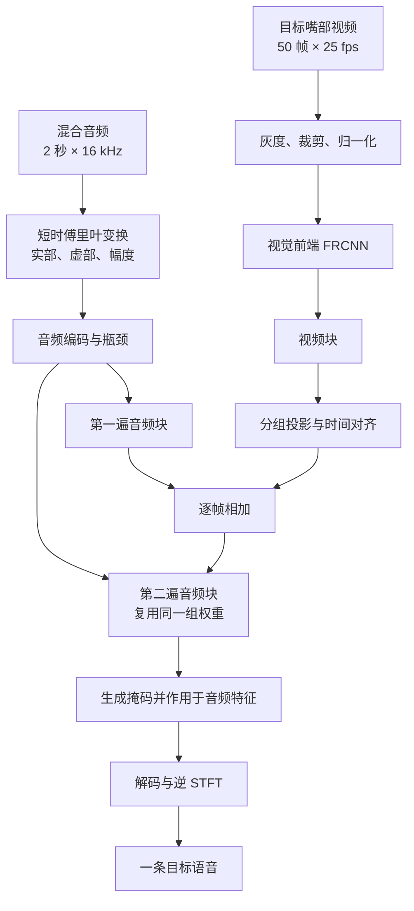
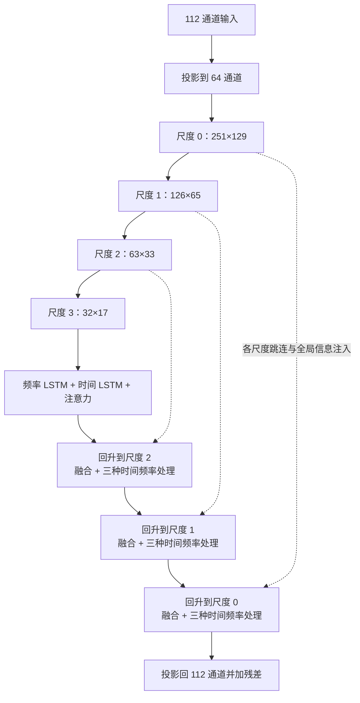
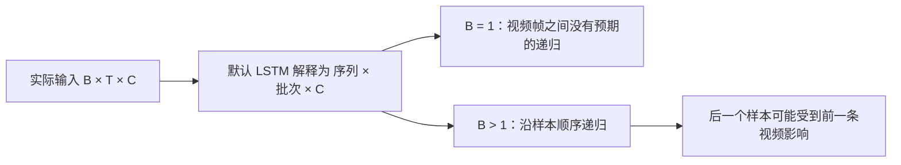

# Falcon 模型：从音视频输入到分窗输出

Falcon 接收一段混合音频和目标说话人的嘴部画面，输出一条目标语音。两人同时说话时，视频告诉模型应该保留哪一个人的声音；输出是一条目标说话人的语音。仓库中常见的 `LRS2-2Mix` 指两人混合，当前六份根配置的 `n_src` 均为 1。直接改成 2 并不能得到可用的双输出：已有前向实验在掩码与解码器的通道重排处报错。

本文解释默认 small 模型的数据流，以及离线评测、Studio 和 Space 如何使用它。代码基线为 `6e5c1b5`；数字标明计算工具、输入和实验范围。路径和调用以 [Falcon.py](../../look2hear/models/Falcon.py)、[Falcon_Contrastive.py](../../look2hear/models/Falcon_Contrastive.py)、[FRCNN 视频模型](../../look2hear/videomodels/frcnn_videomodel.py) 与 [默认配置](../../configs/Falcon.yml) 为准。下文引用的 2026-11-10 定向实验使用官方 small 权重，输入和设备条件列在对应结果旁。

## 1. 先看整体：模型如何利用嘴部画面

假设一段 2 秒录音中，小李和小王同时说话，输入视频只给出小李的嘴部区域。视觉编码器先把嘴部运动变成一串特征，音频网络再用这些特征调节混音的表示，输出小李的估计语音。模型依靠训练学习两种模态之间的关系；它不会先识别出两人的文字，再按照文字剪辑声音。



图中的残差连线表示第二遍音频块接收融合结果与最初音频瓶颈特征之和。视觉只在第一遍之后通过 CAF 加入一次；`AudioBlock` 内部有四个音频尺度，但并不在每一级都重新加入视频。仓库提供的上游总体示意图可辅助认识论文中的模块；具体执行顺序以上面的源码流程为准。


### 输入的时间和空间单位

| 对象 | 默认示例 | 含义 |
|---|---:|---|
| 音频采样率 | 16,000 Hz | 每秒 16,000 个样本；2 秒为 32,000 个样本 |
| STFT 窗长 / hop | 256 / 128 样本 | 每帧窗长 16 ms，帧间移动 8 ms |
| 频点 / 音频帧 | 129 / 251 | 256 点实信号 STFT 有 129 个非冗余频点；`center=True` 时 2 秒得到 251 帧 |
| 视频帧率 / 帧数 | 25 fps / 50 帧 | 每帧约 40 ms，对应 640 个音频样本，也相当于 5 个 STFT hop |
| 嘴部图像 | 存储常见为 96×96，输入模型前裁成 88×88 | 训练使用随机裁剪和水平翻转；评测使用中心裁剪 |

`640` 是 25 fps 下每帧视频对应的音频采样数；音频 STFT 的 hop 为 128 个采样。音画同步还依赖同一时间轴上的视频时间戳与音频。

## 2. 音频路径：把波形变成可分离的特征

### 2.1 STFT 编码

`STFTEncoder` 对波形调用 `torch.stft`，使用 Hann 窗，默认居中补边。对于 `B=1` 的 2 秒输入，主要形状如下：

```text
波形                    [1, 32000]
复数频谱                [1, 129, 251]
堆叠实部、虚部、幅度    [1, 3, 251, 129]
可学习的编码卷积        [1, 112, 251, 129]
音频瓶颈                [1, 112, 251, 129]
```

频谱的每一个时间—频率位置描述该小段声音在相应频率附近的变化；实部和虚部保留相位信息，幅度反映能量。编码卷积把这三种输入变成 112 维**可学习特征**。后续对 112 个通道的实虚拆分属于模型内部的特征组织；物理频谱的实部和虚部来自前面的 STFT。

### 2.2 四个尺度的 AudioBlock

音频块先把 112 通道投影到 64 通道，再同时沿时间和频率下采样。下表是以随机 2 秒输入注册前向钩子得到的形状；方括号省略批次和通道，只列时间帧 × 频点。相同结构在一次模型前向中执行两遍，权重共享。

| 尺度 | 默认形状 | 该尺度上的处理 |
|---|---:|---|
| 0 | 251×129 | 回升时运行频率 LSTM、时间 LSTM 与自注意力 |
| 1 | 126×65 | 回升时运行同类模块 |
| 2 | 63×33 | 回升时运行同类模块 |
| 3 | 32×17 | 下采样到底后运行同类模块 |



频率方向使用双向 LSTM：它在同一时间帧内沿频率轴观察两侧。时间方向使用单向 LSTM；注意力的时间得分矩阵在 `causal=True` 时有下三角掩码。它们分别服务于频谱结构、时间变化和长距离特征关联。归一化和卷积也参与时间依赖，完整模型的因果性见第 5 节。

`InjectionMultiSum` 用局部特征、深层全局特征及门控做跨尺度融合；`concat_layers[3]`、`[1]`、`[0]` 在默认四级结构中参与回升，`[2]` 没有被调用。这个未使用层包含 5,568 个参数；已有清零对照显示该层清零不改变当次输出，而其他被使用层的清零会改变输出。它们仍存在于权重文件和参数总数中。

### 2.3 掩码与解码

`MaskGenerator` 从分离后的特征生成 112 通道掩码，并按 56 + 56 通道组织成复数形式；它对编码后的混合特征做复数乘法。随后，转置卷积将特征映射回两个频谱通道，`torch.istft` 重建与输入等长的波形：`[B, 1, T]`。

默认掩码激活为 ReLU，拆分后两组掩码值非负。这个约束发生在可学习的特征域，后续解码器还会影响最终声学 STFT 的相位。

## 3. 视频路径：从嘴部帧到音频条件

嘴部图像先转成灰度，训练侧数据变换按 `/255`、裁剪、`(x−0.421)/0.165` 处理；训练随机裁剪可从 96×96 选出不同位置的 88×88，评测则固定中心裁剪。两者尺寸相同，但内容不必相同。默认训练入口加载视觉前端权重并冻结其参数；仅调用 `eval()` 本身只切换模块行为，不等价于冻结参数。

默认 FRCNN 用三维卷积处理局部视频帧，再由二维 ResNet 提取视觉特征，得到约 `[B, 512, 50]`。前端首个三维卷积的时间核覆盖相邻 5 帧，即在该操作处相对中心帧各看 2 帧，25 fps 下为 ±80 ms；这是视觉前端首层的局部感受野。

`VideoBlock` 的结果经过 `Conv1d(512→112)` 分组投影。分组数是 `gcd(512,112)=16`，然后沿时间维用 nearest 插值从 50 帧对齐到音频的 251 帧，在频率维扩展为 1 后广播相加：

```text
视频块输出      [B, 512, 50]
分组投影        [B, 112, 50]
时间对齐        [B, 112, 251]
扩一个频率维    [B, 112, 251, 1]
加到音频        [B, 112, 251, 129]
```

这里没有构造音频查询与视频键值的跨模态 Q/K/V 注意力，而是将视频条件作为每个音频时间位置的加性偏置。仓库中另有通用 `CrossAttention` 类；默认 Falcon 融合使用加性偏置。

## 4. 默认 VideoBlock 的批次维问题

默认 `VideoBlock` 先将特征整理为 `[B,T,C]`，却将它送给 `batch_first=False` 的 PyTorch LSTM。该 LSTM 会按 `[序列,批次,特征]` 解释输入：模型中的真实批次 `B` 被当成递归序列，视频时间 `T` 被当成批次。



2026-11-10 的隔离实验在 CPU、官方 small 权重和真实 FRCNN 下，将 LRS2 测试样本 43 放在批次第二位，固定它的音频和嘴部，也固定第一条音频，只更换第一条真实嘴部画面：第二条输出的差值 RMS 为 **0.000278448**，峰值差 **0.00441349**；其原输出 RMS 为 **0.154796**。这组输入出现了跨样本影响；测试集平均质量仍需全量评测。另一项随机输入对照打开 `video_lstm_batch_first=True` 后，在相同替换条件下的差值为零；切换开关改变了模型行为，实际质量仍需单独训练和验证。

空间批量尤其值得留意：Studio 默认一次处理一个窗口；Space 会把多个窗口放进同一批。真实 LRS2 的一条 2 秒录音，在 Space 的完整视觉前端和拼接流程下比较 batch=1 与 batch=4，输出差值 RMS 为 **0.00027224**、峰值差 **0.00436008**。这项对照使用一条录音。实验输入、权重哈希和结果见 [真实视频隔离实验](../verification/deepdive-20261110/falcon_cross_sample_real_20261110.json) 与 [Space 分批对照](../verification/deepdive-20261110/falcon_space_batch_real_20261110.json)。

## 5. “因果”和前视：配置名不能代替数据依赖

**帧级因果**指时刻 `t` 的输出只依赖 `t` 及以前的输入。窗口化处理可以让系统逐块产生结果，但每个块在送入模型时已经包含整窗数据；如果网络使用全窗统计，窗内早期输出仍会受到窗尾变化影响。

默认 `cLNhw` 的实现先做 `GroupNorm(1,C)`，对每个样本的通道、时间、频率一起计算统计量，再进行沿时间的累积归一化。第一步把整个窗口的统计信息带入每一帧；第二步累积当前及以前的值，输出保留前一步的全窗依赖。见 [归一化实现](../../look2hear/layers/normalizations.py)。

已有深挖区分了三个口径，引用时应连同探针条件一起说明：

| 口径 | 已有记录 | 解释 |
|---|---:|---|
| 一遍音频块的几何范围 | 约 57 帧，约 456 ms | 在特定探针设置下，将全窗归一化的影响剥离后观察的一遍模块；不是整网延迟 |
| 两遍音频链的几何范围 | 约 113 帧，约 904 ms | 同一类探针下的整链估计；受输入、对齐和阈值影响 |
| 当前发布行为 | 可依赖窗口末尾 | `cLNhw` 在整个输入窗口计算统计；2 秒示例最多涉及到该窗末尾 |

表中分别记录模块几何范围、整链几何范围和实际窗口依赖。端到端时间还取决于系统调度与设备。Studio 只在已有的 2 秒输入窗上计算后输出窗内一段；它使用多少未来上下文，取决于输出段在该窗中的位置。

### 5.1 `paper_causal` 的现状

`paper_causal=True` 试图让部分卷积使用左侧因果 padding，但当前 `ConvNormAct` 对 stride=2 的输出仍按 padding 数量直接裁剪，导致多裁时间帧。真实 small 权重的 2 秒前向钩子记录：

| 设置 | 四级下采样的时间帧 |
|---|---|
| 默认 `paper_causal=False` | `251 → 251 → 126 → 63 → 32` |
| `paper_causal=True` | `251 → 251 → 124 → 60 → 28` |

两种设置都将输出恢复到输入长度，内部特征长度和 padding 不同。当前 A/B 同时改变这两个量；`cLNhw` 仍使用全窗统计。`kernel_size=1, causal=True` 的通用边界存在 `:-0` 空切片；默认路径的运行情况见定向实验。定向实验的输入和输出见 [模型批次与裁剪检查](../verification/deepdive-20261110/模型批次与裁剪检查.log)。

### 5.2 归一化替换实验如何解读

旧报告曾将某次 `ln_c` 替换实验的 `early_min_db=-240` 解释为前 121 帧全部为零；这只取了最小值。该实验归档中同一段的 `early_max_db=-75.2895`，以 −100 dB 为响应阈值时 `first_resp_frame=108`，所以归档**不支持该段每一帧都为数值零**。该实验使用当时未提交的代码状态、零视觉输入和特定扰动，不能直接推广至所有输入，也不能单凭它评价替换归一化后的语音质量。[原始归档](../verification/deepdive-20261108/ln-variant.json) 与 [实验脚本](../../tools/repro/experiments/ln_variant.py) 可供核对。

## 6. 一次前向、分窗与延迟

### 6.1 同一模型的三种调用

| 场景 | 调用方式 | 对输出的含义 |
|---|---|---|
| LRS2 / RealSSA-Sim 基准 | `audio_visual_test.py` 按单条音频整段前向 | 归一化统计跨该条输入；指标与整段输入绑定 |
| Studio | 每次一个 2 秒窗口，按 0.5 秒步长输出 | 每窗重新计算，不保存跨窗 LSTM 状态；输出块做淡化 |
| Space | 录完后一次提交请求，内部仍拆窗 | 多个相邻窗可在一批中推理；默认批量可能触发第 4 节的跨窗影响 |
| RealSSA-Real DNSMOS | 长音频分窗，之后算无参考指标 | 与 Studio 的开头嘴部填充和输出淡化不同，不能称完全相同协议 |

### 6.2 Studio 一块输出从哪里来

16 kHz 下的常量为 `WINDOW=32000`、`HOP=8000`、`GUARD=1280`、`FADE=320`，分别对应 2 秒、0.5 秒、80 ms、20 ms。服务端从每窗预测中取 `[22720,30720)`，即 8,000 个样本作为一个输出块；相邻块的边缘使用 20 ms 淡化。`output_delay_ms=80` 表示该块末尾距输入窗末尾 80 ms。端到端延迟还包括等待输入、块粒度、推理、网络和音频设备开销。

以片段时间线为基准，第 `w` 个 Space 窗大致覆盖：

```text
输入窗口： [0.5w − 1.42,  0.5w + 0.58) 秒
输出片段： [0.5w,         0.5w + 0.5) 秒
```

越过录音开始的音频补零；越过视频边界的输入使用边界帧。首窗需要等到片段开始后的约 0.58 秒数据已收集；浏览器还需实际获得满足时间检查的帧。发生系统等待、设备卡顿或模型运算延迟时，墙钟时间还会增加。浏览器按实际捕获时间戳选近邻帧，不能把理想 25 fps 网格当成真实设备必然行为。

### 6.3 分窗与整段结果的差异

整段一次前向与分窗前向看到的时间上下文和归一化统计不同，因而同一个权重也可能给出不同结果。仓库一次 **6 秒合成流**的记录中，按 Studio 首窗开始拼接与整段前向比较得到约 **14.71 dB** 的一致性度量；去掉冷启动首窗后约 **16.72 dB**。该指标衡量两种输出的一致性；目标提取质量和听感可另行评测。输入由三个 2 秒片段拼接，音频连接处有 10 ms 淡化，嘴部轨道以 2 秒画面重复。已有结果见 [仲裁实验归档](../verification/deepdive-20261108/canonical-6s.json)。

另一脚本 `streaming_consistency.py` 的逐帧索引使用 `np.rint(start/640+0.5+i)`，在均匀帧中心的假设下会出现重复和跳帧。本轮固定真实权重及同一条 6 秒拼接输入，只替换取帧索引，实际比较其中 4.5 秒输出：一致性由 **18.201** 变为 **17.492 dB**。该对照使用不同于 14.71 dB 仲裁实验的脚本和条件。[取帧对照及输入哈希](../verification/deepdive-20261110/falcon_frame_alignment_probe_20261110.json)

仲裁脚本的相位配对统计还有筛选条件与注释不一致的问题。6 秒输入下按注释所述规则重新筛选后，两两比较的最小值仍为 **17.02 dB**，最大值由包含同网格相位组合的 **105.66** 变为 **20.82 dB**；这不改变本段所引的 14.71 dB 拼接结果。[重算记录](../verification/deepdive-20261110/canonical-corrected-pairs-6s.json)

## 7. 参数量和计算量怎么比较

参数量按模型和前向用途区分：计入优化器的参数、权重文件中的持久化状态，与某个分离前向实际使用的参数分别统计。

| 项目 | 数量 | 说明 |
|---|---:|---|
| small 音频模型 | 537,697 个参数元素 | 包含未使用的 5,568 个参数和训练侧说话人池化头 |
| 音频 `state_dict` | 525 个键，537,762 个元素 | 元素总数比参数多 65 个持久化 buffer 元素；“键”和“元素”是不同单位 |
| 视觉前端 FRCNN | 11,186,688 个参数元素 | 训练入口按配置加载预训练权重并冻结 |
| 音视频合计 | 11,724,385 个参数元素 | 按以上两项相加；不等于每次分离前向都实际使用这些参数 |

在仓库指定配置、2 秒音频和 50 帧视觉特征下，[计数脚本](../../evaluated_mac_params.py) 使用 `ptflops 0.7.5` 的 PyTorch 后端得到**音频部分约 10.611 GMAC**，包含 LSTM，不包含 FRCNN。仓库另一项同工具记录给出 88×88、50 帧视觉部分约 15.897 GMAC，相加约 26.51 GMAC；这说明视觉部分也占相当的计算量。

这些数字采用 **ptflops 工具计数口径**。本轮算子探针中，显式 `torch.matmul`、`torch.mul` 和 `torch.add` 被该后端计数；`x*x`、`x+x` 与直接 `torch.stft` / `torch.istft` 在此探针中计为零。完整模型的漏计量与论文所用算子统计方法仍待核算。[算子探针记录](../verification/deepdive-20261110/falcon_ptflops_ops_probe_20261110.txt)

长录音整段前向还要考虑内存随长度增长：注意力为每个头形成时间帧 × 时间帧得分矩阵。以 60 秒、约 7,501 帧、4 头、float32、batch=1 估算，最高时间尺度的一个得分矩阵约 900 MB，尚未加上 softmax、其他尺度、特征和模型状态。这是按张量形状计算的内存估算。

## 8. 与权重、训练和评测结果的关系

训练侧 `FalconSpeakerContrastive` 与 Studio small 是两份代码。一次 CPU `eval()` 对照在同一组随机音频、随机嘴部输入和 small 权重下，两侧视觉特征及音频输出逐位相同；结果支持两条路径在该次输入及 CPU 条件下一致；Big 与 MPS 可分别测试。Big 使用 Studio 内的 `SpeakerContrastiveV2` / `SISNRRepel` 和更宽的通道配置，不是 small 权重的直接替换。

small 与 Big 的视觉前端各有 137 个状态项。本轮逐项比较发现其中 **60 项不同**，均是 BatchNorm 的 `running_mean`、`running_var` 和 `num_batches_tracked`；参数张量相同。推理也会使用这些 running 统计。

当前能引用的性能结果还要说明模型、数据和协议。历史 LRS2 测试集中，small 官方权重整段评测的 SI-SNRi / SDRi 分别为 **7.029 / 7.713 dB**；旧配方训练的 ep124 记录为 **8.858 / 9.270 dB**。两次来源与训练条件不同，论文中 LRS2 对应的 14.1 / 14.7 尚未完成同协议复现。公开权重的训练来源在仓库报告中有不同表述；checkpoint 自身未保存完整训练配方，作者的训练语料仍待确认。原始 CSV 可从 [阶段评测证据](../verification/phase2/README.md) 查找，历史 README 中可能存在会改写输出的旧命令，运行前先阅读目标脚本。

## 9. 接下来怎样验证改动

改动视频轴、归一化或卷积 padding 都会改变权重所看到的计算图。评估语音质量时，可同时固定数据、权重、采样率、音画时间戳、批次组成、训练步数和评测协议，并分别记录：

1. **形状与数值**：2 秒、短输入、不同 batch 和不同窗口下输出长度、有限值、每尺度形状及固定输入差异；`B=1` 与 `B>1` 分开检查。
2. **未来依赖与实际延迟**：明确扰动位置、阈值、窗口位置和输入上下文；分别报告模型依赖、输出 guard、每块等待、推理时间及设备 I/O，避免把这些量直接相加或互相替代。
3. **质量**：使用同一套测试样本分别跑整段和实际分窗流程，给出 SI-SNRi、SDRi 等分母、逐句差异和听感样例；模型开关修正后的正式比较需要重训或清楚说明沿用旧权重的限制。
4. **数据和证据**：对计划样本 ID 做集合检查，而不只比较行数；所有结果写入独立输出目录，保留配置、权重和输入哈希。真实摄像头跟踪、多人切换与网络/设备延迟需要单独联调。
