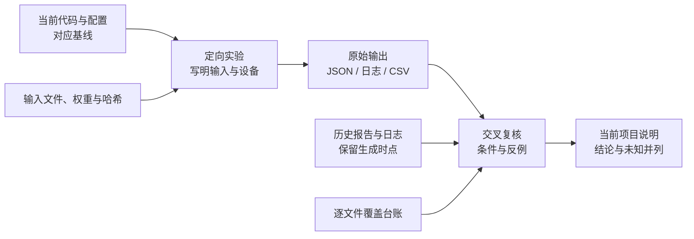

# 2026-11-10：项目审读与定向验证证据

本目录汇集 2026-11-10 对源码、文档和历史结果的复核记录，以及定向实验脚本与输出。每项结论都标明对应记录和实验条件。项目入口与问题状态请从 [项目文档索引](../../README.md) 进入；理解模型的计算路径可读 [模型与分窗说明](../../understanding/20261110-model-and-streaming.md)。

本轮读取的仓库代码基线为 `6e5c1b5e1d717a071046d4b66174e30d593b1a7f`。部分旧实验使用其他提交、临时脚本或含未提交修改的工作区；各项版本信息见对应记录。历史 `.log`、`.csv` 和原始结果与新复核一并保留。

## 从问题找到证据

| 想了解什么 | 首选文件 | 阅读时的范围 |
|---|---|---|
| 写作逐篇复核 | [142 篇文档台账](writing-review-20261110.tsv) | 阅读范围、修改前后哈希及保留情况 |
| 文档逐篇复核（48–94） | [覆盖台账](data-audit-20261110/document-review-048-094.tsv) | 按冻结清单逐篇记录阅读范围、发现和后续更正 |
| 文档逐篇复核（95–140） | [覆盖台账](document-review-095-140.tsv) | 按冻结清单记录逐篇全文复读、文件哈希与修订建议 |
| 文档逐篇复核（1–47） | [逐篇说明](documents-review-001-047.md) | 分组阅读及定向事实检查的范围见报告 |
| 长专题补充全文复读（38–41、70–73） | [38–41 台账](document-supplement-038-041.tsv) · [70–71 台账](document-supplement-070-071.tsv) · [72–73 台账](documents-review-072-073.md) | 逐篇记录阅读范围、历史更正和实验条件 |
| 文档修订前的问题快照 | [问题与验证状态](问题与验证状态.md) | 保留修订前的实测、代码推断及待办；其中文档尚未修改、待修订等状态不代表现在，现状看[复现状态页](../../STATUS.md)和[最新审查证据](data-audit-20261110/README.md) |
| 每轮发现和纠正依据 | [审查记录](审查记录.md) | 是按时间追加的过程记录，较早的“待核实”可能已在后文解决 |
| 流程图实际渲染 | [渲染检查记录](diagram-render-20261110/README.md) | 各图对应源文件、渲染结果和可读性检查；历史图的修改与原稿分开保存 |
| 项目图片逐项复核 | [图片审查记录](image-review-20261110.md) | 逐张记录图片内容、引用位置和待核实事项 |
| 哪些文件确实读过 | [逐文件覆盖台账](逐文件覆盖台账.tsv) | 574 项是该基线 Git 跟踪清单；“全文”“部分”“自动索引”和“哈希”含义不同 |
| 历史数据二轮核验 | [逐文件清单与汇总](data-audit-20261110/README.md) | 211 个历史及本轮文本证据文件的哈希、格式和部分指标重算；未重新运行音频指标 |
| 历史日志语义复核（40–78） | [初审说明](log-review-040-078.md) · [补读逐份台账](data-audit-20261110/log-complete-review-040-078.tsv) | 记录各文件终态与阅读范围；两份日志的重复动态进度未逐条读 |
| 历史日志语义复核（79–117） | [逐份说明](data-audit-20261110/log-semantic-079-117.md) | 39 份日志的终态与条件；一份超长参数列表未逐名检查 |
| 历史日志逐份目录 | [117 份日志分类与终态提示](data-audit-20261110/log-review.tsv)、[关键词匹配目录](data-audit-20261110/log-catalog.json) | 分类、首尾和关键上下文检查；并非全部日志逐行语义审阅 |
| 各项历史日志、表格与关联文档 | [证据文件索引](verification-inventory.json) | 格式扫描、部分数值重算及定向阅读状态 |
| 模型、数据、工具及配置文件分别读到哪里 | [Python 清单](falcon_all_python_inventory_20261110.json)、[数据与训练代码清单](falcon_data_train_code_inventory_20261110.json)、[模型及层清单](falcon_look2hear_code_inventory_20261110.json)、[YAML 清单](falcon_yaml_inventory_20261110.json) | 逐文件记录代码内容及阅读范围 |
| 旧报告与 review 的证据边界 | [2026-11-08 深挖复核](深挖文档复核状态.md)、[历史理解文档](historical-understanding-review.json)、[历史 review](historical-round-reviews.json)、[Phase 1/2 报告](历史验证报告审阅.md) | 历史文档原文可能保留当时判断；后续修复与本轮反例须另看 |

文件索引记录阅读范围。模型运行条件见各实验脚本和输出；CSV 均值核对记录了表内统计。



## 实验和输出

### 模型、因果性与批次

| 实验 | 入口和结果 | 实测结果 | 进一步核查 |
|---|---|---|---|
| VideoBlock 批次轴与 `paper_causal` 形状 | [脚本](模型批次与裁剪检查.py)、[日志](模型批次与裁剪检查.log) | CPU、固定随机音频和视觉特征，small 发布权重 strict 加载；默认 batch 内前一视频可影响后一输出；开启 `paper_causal` 后 stride=2 中间帧数缩短 | 真实多人的平均质量、Big 权重及修正开关后的质量待测 |
| 真实嘴部帧的跨样本隔离 | [脚本](falcon_cross_sample_real_20261110.py)、[JSON](falcon_cross_sample_real_20261110.json) | 一组真实 LRS2 测试音视频、真实 FRCNN 与 small 权重下，固定第二样本，只换前一视频仍改变输出 | 多条录音的总体指标、听感及训练收敛效果待测 |
| Space 单窗与批量 | [脚本](falcon_space_batch_real_20261110.py)、[JSON](falcon_space_batch_real_20261110.json) | 一条真实录音拆成四窗，batch=1 与 batch=4 的最终拼接输出可测不同 | 全量测试集的平均差异及差异来源待测 |
| P2A 类整句批量 | [四条当前索引样本](falcon_p2a_batch_real_20261110.json)、[按原抽样算法选出的当前索引样本](falcon_p2a_seed0_batch_real_20261110.json) | small 官方权重和真实嘴部在有限批次下可观察到输出差异 | 历史 P2A 临时索引尚未找到，原始四条样本待定位 |
| 工具算子计数 | [脚本](falcon_ptflops_ops_probe_20261110.py)、[输出](falcon_ptflops_ops_probe_20261110.txt) | ptflops 0.7.5 默认 PyTorch 后端会记录探针中的显式 `torch.matmul/mul/add`，但本例 `x*x`、`x+x`、STFT/iSTFT 记为 0 | 完整模型中遗漏算子的运算量待测；10.611 GMAC 是 ptflops 的计数结果 |

[历史 `ln_variant.json`](../deepdive-20261108/ln-variant.json) 记录 `early_min_db=-240`、`early_max_db=-75.2895`，首响应为第 108 帧；因此前 121 帧并非全部为零。归档对应当时有未提交修改的工作区。

### 分窗、帧索引与对齐

| 实验 | 入口和结果 | 条件与限制 |
|---|---|---|
| 逐帧取整误差 | [6 秒拼接流脚本](falcon_frame_alignment_probe_20261110.py)、[结果](falcon_frame_alignment_probe_20261110.json)；[2 秒单窗脚本](falcon_frame_select_review_20261110.py)、[结果](falcon_frame_select_review_20261110.json) | 原 `streaming_consistency.py` 在假定均匀帧中心时会出现重复/跳帧；6 秒合成输入实际比较 4.5 秒输出，旧/修正取帧约 18.201/17.492 dB。2 秒单窗使用另一组样本，以 SI-SDR 计量。真实浏览器按捕获时间戳选帧 |
| 相位配对排除条件 | [修正筛选脚本](canonical_corrected_pairs.py)、[6 秒结果](canonical-corrected-pairs-6s.json) | 只改配对筛选条件；该组合成流的最小值仍为 17.02 dB、最大值由 105.66 改为 20.82 dB。输入由短音视频片段拼接；4 秒及其他输入待复测 |
| 非零时移校正方向 | [脚本](p2f_lag_direction_review.py)、[JSON](p2f_lag_direction_review.json)；[第二个独立脉冲探针](falcon_best_lag_probe_20261110.py) | 合成信号表明 `protocol_check.py` 非零 lag 的移动方向反了；影响的是该脚本的 best-shift 指标。历史 P2F 正文称 50 条 lag=0，但仅凭保存的汇总 JSON 无法独立证明逐条均为 0，原逐条缓存未找到 |

`canonical_corrected_pairs.py` 是保存的实验副本，脚本头中“1.28 秒 guard”等旧说明没有同步更正；代码常量 `GUARD=1280` 在 16 kHz 下是 **80 ms**。输入片段间 10 ms 淡化与输出块间 20 ms 淡化也是两件事。使用结果时以实际常量和结果字段为准，不把旧说明直接当作当前协议。

### 数据与评测完整性

| 实验 | 入口和结果 | 条件与限制 |
|---|---|---|
| 文件名增益与源波形能量比 | [脚本](能量比审查/audit.py)、[1000 条记录](能量比审查/samples.csv)、[摘要](能量比审查/summary.json) | 从 paper 训练索引按 `0,40,…` 系统抽样，均为 s1 目标方向；计算两条已缩放 PCM 波形的全段能量比，不去均值。48/1000 超出 0–10 dB、26/1000 小于 0；这是系统抽样，结果反映所抽样本的波形能量比 |
| 覆盖率与非有限值 | [脚本](falcon_eval_coverage_inf_probe_20261110.py)、[输出](falcon_eval_coverage_inf_probe_20261110.txt) | 合成 A/B/C/D 计划中，实际 A/B/A/D 仍通过按行数的 `verified`；`Inf` 的合并计数与分片 finite 计数也不同。此处使用合成分片构造重复和遗漏 |
| 已有全量结果的 ID 集合 | [脚本](评测ID集合核查.py)、[输出](评测ID集合核查.log) | 两份 LRS2 全量表各 3,000 行、两份 RealSSA-Sim 表各 9,169 行，与**当前**各自索引按文件名比较无重复、缺失或多出；未证明历史运行时索引与当前完全相同 |
| CSV 与 JSON 聚合 | [CSV 逐项重算](recompute_verification_csv.py)、[DNSMOS 对照](compare_dnsmos_csv_summary.py)、[JSON 关联](check_json_csv_links.py)、[逐文件索引](verification-inventory.json) | 18 份逐句表核对均值、总体标准差与有效数；5 份 MOS 表重算均值，其中 full3/full4 与摘要对照；2 份训练表只检查有限训练步及单调性。full3 算术自洽仍因窗口起点错误作废 |
| P2F 指标对拍保存值 | [脚本](check_p2f_saved_values.py) | 根据 JSON 保存的 50 条数值重算均值和差值 |

四份历史全量表的集合检查补充了行数守卫，但不改变其代码只能核行数这一事实。RealSSA-Sim 两份表的 SI-SNRi 有效数为 9,169，SDRi/PESQ 为 9,166；引用平均值时应带各指标的有效数。

## 输入、权重与环境记录

在本轮使用的服务器 `dev_a800_2gpus` 上，项目环境为 `/root/miniforge3/envs/falcon`。此次 CPU 定向模型实验使用 PyTorch `2.8.0+cu128`；多数固定 4 个 CPU 线程。各实验的 `device`、`torch_threads`、`torch` 字段和同名脚本记录了具体运行条件。

| 证据 | 已记录的身份 |
|---|---|
| 官方 small 缓存权重 | `/root/.cache/falcon_weights/falcon.pt`；本轮相关 JSON 记录 SHA-256 `a1888b5a3484a38a68c42d1a0e73334b1f2e7924c6e6444b2cfdd27becce928c` |
| 真实 Space 样本 | [JSON](falcon_space_batch_real_20261110.json) 记录 mix、target、mouth 路径和各自 SHA-256，以及 16 kHz、32,000 样本和 50 张 96×96 帧 |
| 分窗索引样本 | [JSON](falcon_frame_alignment_probe_20261110.json) 记录三段 mix/target、一份 mouth、代码及权重的路径与 SHA-256；其参考帧位置是显式假设 |
| 1,000 条能量审查 | [摘要](能量比审查/summary.json) 记录三个索引哈希、脚本哈希和逐条 CSV 哈希；[逐条结果](能量比审查/samples.csv) 记录源路径及两个音频文件的哈希 |
| 模型随机输入探针 | [脚本](模型批次与裁剪检查.py) 固定随机种子和线程，输入并非真实画面；[日志](模型批次与裁剪检查.log)记录批次差值和形状 |

`falcon.pt` 的哈希标识了被测文件；其完整训练配置尚未找到。作者使用的训练语料和论文各项结果对应的 checkpoint 仍待确认。

## 本轮测试与跳过项

- **复现测试**：[原始日志](复现测试全集.log)记录 CPU、不可见 GPU 的 `166 passed / 2 skipped / 38 warnings`。两项跳过分别依赖 `/root/tmp/lrs2_eval_s1.log` 与 `lrs2_eval_s2.log`，以及旧 `/root/tmp/p2d_train/.../version_*/metrics.csv` 路径；[跳过项核查](跳过项核查.log)保存了相同条件下的定向复查和测试收集映射。
- **归档曲线补充检查**：[脚本](archive_metrics_check.py) 临时将仓库归档 `P2D-train-metrics-1gpu.csv` 映射为测试需要的目录，再调用原测试函数；[输出](archive-metrics-check.log)记录补充断言通过。正式测试中的对应项仍记为 skipped。
- **Studio / Space**：[测试记录](Studio和Space测试.log)为 CPU 下 `73 passed / 2 deselected`，排除了 slow 两项；Studio 八项 Node 检查见 [日志](frontend-node-tests.log)，Space 组装后的国际化检查见 [日志](frontend-space-i18n.log)。真实摄像头、会议声卡及线上 Gradio/ZeroGPU 场景待测试。
- **数据与指标**：[日志](数据和指标测试.log)记录 4 个测试文件的 `29 passed`；同目录 [测试逐文件审阅](测试审阅-status.md) 与 [两份大型测试逐项说明](测试审阅-phase1-phase2-details.md)列出测试范围及未覆盖的批次串扰、切换 target 重跑、取帧时间和多 rank 条件等情况。

完整套件中的两处测试显式调用 `py_compile`；现场检查到仓库下 135 个被忽略 `.pyc` 在测试时段的同一分钟更新。这些文件与测试调用的具体对应关系尚未逐一确认。后续测试可隔离 `PYTHONPYCACHEPREFIX`，并先检查输出路径。

## 怎样复验，而不覆盖已有记录

以下命令使用 CPU、专用解释器和新的临时目录；结果写入命令创建的临时目录，不写入本目录。路径适用于本项目的 A800 服务器，其音频和权重需仍与结果 JSON 中的哈希一致。耗时和数值可能受依赖、线程和输入变化影响。下面的模型脚本用到真实权重，但输入为**随机张量**；覆盖率脚本只构造临时假结果。目录名只用于当前示例，可按环境调整。

```bash
REPO=/root/code/github_repos/Falcon-fork
PY=/root/miniforge3/envs/falcon/bin/python
RUN_DIR=$(mktemp -d /tmp/falcon-review-20261110.XXXXXX)
cd "$REPO"

# small 权重：批次轴影响与 paper_causal 下采样形状
PYTHONDONTWRITEBYTECODE=1 CUDA_VISIBLE_DEVICES= OMP_NUM_THREADS=4 \
  PYTHONPATH="$REPO" "$PY" \
  docs/verification/deepdive-20261110/模型批次与裁剪检查.py \
  > "$RUN_DIR/model-probe.log" 2>&1

# 临时合成分片：重复 ID、遗漏 ID 和 Inf 计数
PYTHONDONTWRITEBYTECODE=1 CUDA_VISIBLE_DEVICES= \
  PYTHONPATH="$REPO" "$PY" \
  docs/verification/deepdive-20261110/falcon_eval_coverage_inf_probe_20261110.py \
  > "$RUN_DIR/coverage-probe.log" 2>&1

# ptflops 指定算子的计数行为
PYTHONDONTWRITEBYTECODE=1 CUDA_VISIBLE_DEVICES= \
  "$PY" docs/verification/deepdive-20261110/falcon_ptflops_ops_probe_20261110.py \
  > "$RUN_DIR/ptflops-probe.log" 2>&1

printf '输出目录：%s\n' "$RUN_DIR"
```

`falcon_eval_coverage_inf_probe_20261110.py` 自己还会在系统临时目录创建以 `falcon_coverage_inf_probe_` 开头的目录，并在终端输出其路径；它不会写入真实评测目录。需要重跑 6 秒相位筛选时，`canonical_corrected_pairs.py` 默认输出会指向固定 `/tmp/w213`，因此应显式使用新的 `--json` 目标，并在 `PYTHONPATH` 加上 `tools/repro/experiments` 以找到 `_falcon_cpu_common.py`。该实验需要已保存的真实音频和权重，耗时长于上面的轻量算子探针。`falcon_frame_alignment_probe_20261110.py` 使用固定 `/tmp/falcon_frame_alignment_probe_20261110.json` 输出，重跑前应先检查该路径，避免覆盖其他人的记录。

本目录中的旧日志、CSV 和原始 JSON 作为历史证据保留。新的实验应另起文件，写明输入和权重哈希、代码状态、时间、失败与跳过项；改变结果解释时，在新记录中标明它修正哪一项、原因是什么。
